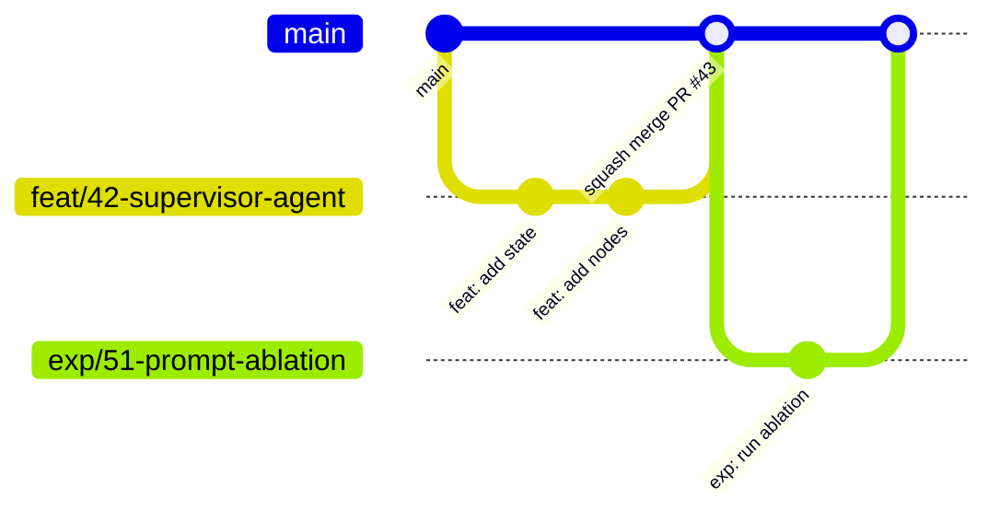

# Contributing to Khoailanggraph

Thanks for contributing! This guide covers how we work: workflow, conventions, and quality gates.
It applies to all team members and to both the **engineering** and **research** tracks.

> [!NOTE]
> Some tooling referenced here is still being set up (see [`docs/PLANNING.md`](docs/PLANNING.md)).

## Table of Contents

- [Code of Conduct](#code-of-conduct)
- [Ways to Contribute](#ways-to-contribute)
- [Development Setup](#development-setup)
- [Workflow](#workflow)
  - [Issues](#issues)
  - [Branching](#branching)
  - [Commits](#commits)
  - [Pull Requests](#pull-requests)
  - [Code Review](#code-review)
- [Coding Conventions](#coding-conventions)
  - [General](#general)
  - [Python (backend)](#python-backend)
  - [LangGraph / Agents](#langgraph--agents)
  - [TypeScript / React (frontend)](#typescript--react-frontend)
  - [API Contract](#api-contract)
  - [Database & Migrations](#database--migrations)
- [Logging & Errors](#logging--errors)
- [Testing](#testing)
- [Research Contributions](#research-contributions)
- [Documentation & ADRs](#documentation--adrs)
- [Security & Secrets](#security--secrets)
- [Releases](#releases)
- [Getting Help](#getting-help)

---

## Code of Conduct

By participating, you agree to follow our [Code of Conduct](CODE_OF_CONDUCT.md). Be kind, be specific, assume good intent.

## Ways to Contribute

- Report bugs - use the **Bug report** issue template
- Propose features - use the **Feature request** template
- Propose or run experiments - use the **Experiment** template
- Improve docs
- Review pull requests (reviewing is contributing!)

## Development Setup

Follow [README -> Getting Started](README.md#getting-started), then:

```bash
just setup          # installs deps + pre-commit hooks
just lint && just test
```

If both pass, you're ready. **Do not skip installing pre-commit hooks** - CI runs the same checks.

## Workflow

We use **GitHub Flow**: `main` is always deployable; all work happens on short-lived branches merged via PR.



### Issues

- **Every piece of work starts with an issue** (except trivial typo fixes).
- Use labels: `type:*` (`bug`, `feature`, `chore`, `docs`, `experiment`), `area:*` (`backend`, `frontend`, `agents`, `research`, `infra`), `priority:*` (`p0`-`p3`).
- Assign yourself before starting so work isn't duplicated.
- Keep issues small: if it takes more than ~3 days, split it.

### Branching

Format: `<type>/<issue-number>-<short-kebab-description>`

| Type | Use for | Example |
|---|---|---|
| `feat/` | New feature | `feat/42-supervisor-agent` |
| `fix/` | Bug fix | `fix/57-sse-disconnect` |
| `refactor/` | Code change without behavior change | `refactor/60-extract-llm-client` |
| `docs/` | Documentation only | `docs/12-architecture-diagram` |
| `chore/` | Tooling, deps, config | `chore/8-setup-ruff` |
| `test/` | Tests only | `test/70-graph-integration` |
| `exp/` | Research experiment | `exp/51-prompt-ablation` |

Rules:
- Branch from latest `main`; rebase on `main` to resolve conflicts (don't merge `main` into your branch repeatedly).
- Never push directly to `main` (protected branch).

### Commits

We follow **[Conventional Commits](https://www.conventionalcommits.org/)** - enforced by `commitlint` in a pre-commit hook.

```
<type>(<optional scope>): <description>

[optional body: what and why, not how]

[optional footer: Closes #42, BREAKING CHANGE: ...]
```

**Types:** `feat`, `fix`, `refactor`, `perf`, `test`, `docs`, `style`, `build`, `ci`, `chore`, `revert`, `exp`
**Scopes:** `backend`, `frontend`, `agents`, `api`, `db`, `research`, `infra`, `deps`

Examples:

```
feat(agents): add supervisor node that routes to specialist agents
fix(api): close SSE stream when client disconnects
exp(research): compare single-agent vs multi-agent on dataset v1
docs: add ADR-0003 on checkpoint storage
```

Guidelines:
- Imperative mood, lowercase, no trailing period, <= 72 characters in the subject.
- One logical change per commit. Commit messages matter less inside a PR since we **squash merge** - but the **PR title** becomes the final commit, so it must follow the convention.

### Pull Requests

1. Keep PRs **small and focused** (aim for < 400 changed lines, excluding generated code / lockfiles).
2. Title follows Conventional Commits (it becomes the squash commit).
3. Fill in the PR template: *what*, *why*, *how to test*, screenshots for UI, linked issue (`Closes #42`).
4. Open as **Draft** early if you want feedback; mark **Ready for review** when CI is green.
5. Self-review your diff before requesting review.
6. **Moves and renames go in their own PR** (e.g. `refactor: move threads into features/`), with only mechanical edits such as import paths. Change the content in a follow-up PR. Git does not record renames; it detects them from content similarity, and because we squash merge, separate commits inside one PR do not help. A move plus heavy edits shows up as delete + add and breaks `git log --follow` / `git blame`. `git mv` is fine to use but does not change this.

**Definition of Done**

- [ ] CI green (lint, type-check, tests, build)
- [ ] Tests added/updated for the change
- [ ] Docs updated (README, docstrings, ADR if architectural)
- [ ] No secrets, no debug prints, no commented-out code
- [ ] API change -> OpenAPI client regenerated (`just codegen`)
- [ ] DB change -> Alembic migration included

### Code Review

**Authors:** respond to every comment (fix, or explain why not). Don't take it personally.

**Reviewers:** review within **1 working day**. Focus on correctness, design, readability, tests - leave style to the linters. Use prefixes to signal intent:

| Prefix | Meaning |
|---|---|
| `blocker:` | Must be fixed before merge |
| `suggestion:` | Worth considering, not required |
| `nit:` | Minor, optional |
| `question:` | Seeking understanding |

Merge strategy: **Squash and merge**, then delete the branch.

## Coding Conventions

### General

- Formatting is automated - don't argue with the formatter.
- `.editorconfig` defines: UTF-8, LF line endings, final newline, 4 spaces (Python), 2 spaces (TS/JSON/YAML/MD).
- Names should reveal intent; avoid abbreviations except well-known ones (`id`, `url`, `llm`).
- Code, comments, commit messages, and docs are written in **English**.
- Comments explain *why*, not *what*.

### Python (backend)

| Tool | Config |
|---|---|
| Formatter + linter | **Ruff** (`line-length = 100`; rule sets `E, F, W, I, N, UP, B, SIM, RUF, ASYNC, S, PL, PT, TC`) |
| Type checker | **mypy** `--strict` |
| Dependencies | **uv** - `uv add <pkg>`, `uv add --dev <pkg>`; commit `uv.lock` |

Conventions:
- **Type hints everywhere** - public functions must be fully typed; avoid `Any`.
- **Pydantic models** at boundaries (API schemas, config, tool inputs, LLM structured output). Plain dataclasses/TypedDicts internally are fine.
- **Async by default** for I/O (FastAPI routes, DB, LLM calls). Never call blocking I/O in async code.
- **Feature modules:** business features live in `features/<name>/` (`router.py`, `schemas.py`, `service.py`, `repository.py`, `models.py`). Start with fewer files and split as the feature grows. Routers contain no business logic.
- **Dependency rules** (enforced by import-linter in `just lint` and CI):

  ```text
  features/*    -> agents, llm, tools, integrations, platform, core
  api/          -> features/* (routers only), core
  agents        -> llm, tools, core          (never features/, api/, fastapi, platform.db)
  tools         -> agents.ports, integrations, platform, core
  llm           -> core
  research/     -> agents, llm, tools, core  (runs graphs without the API)
  ```

- **Features don't import each other's internals.** Use the other feature's public service (exported from its `__init__.py`). Cross-feature DB links are foreign keys referenced by id, not ORM relationships.
- **Ports only where things change:** when a graph needs something from outside (e.g. storing artifacts), define a `Protocol` in `agents/ports.py` and inject the implementation at run time (LangGraph runtime context or `config["configurable"]`). Research and tests inject fakes. Do not add interfaces for things that have one implementation and no planned replacement.
- **Configuration** only via `khoailanggraph.core.config.Settings` (pydantic-settings). No `os.getenv` scattered in code.
- **Docstrings:** Google style for public modules, classes, and functions.
- Naming: `snake_case` functions/variables/modules, `PascalCase` classes, `UPPER_SNAKE_CASE` constants.
- Imports: absolute (`from khoailanggraph.agents...`), sorted by Ruff.

### LangGraph / Agents

- **One graph per package** under `backend/src/khoailanggraph/agents/<graph_name>/` with `state.py`, `nodes.py`, `graph.py`, `prompts.py`.
- **State** is explicitly typed (`TypedDict` or Pydantic) with reducers annotated (e.g. `Annotated[list[AnyMessage], add_messages]`). Keep it minimal.
- **Nodes are small, pure-ish functions**: take state, return a partial state update. Side effects go through tools or ports injected at run time (`agents/ports.py`) - this makes them unit-testable.
- **Prompts live in files/constants, not inline** in node logic, and are versioned (changes to prompts are reviewed like code - they change behavior).
- **Never hard-code a model or provider in a node.** Get models only via `khoailanggraph.llm.get_chat_model(role=..., config=config)`; never instantiate `ChatOpenAI` / `ChatAnthropic` directly. New roles go in `backend/config/models.yaml`. See [README: Model Configuration](README.md#model-configuration).
- **Stay provider-neutral:** use LangChain's common interfaces (`bind_tools`, `with_structured_output`, standard message types). If a provider-specific feature is unavoidable, isolate it in `llm/` behind a capability flag.
- **Pass `config` through** every node so per-request model overrides and tracing callbacks propagate.
- **Tools:** typed inputs (Pydantic), clear docstrings (the LLM reads them), deterministic error messages, timeouts on external calls.
- **Guard rails:** set `recursion_limit`, handle tool errors gracefully, and never let an exception kill a stream silently.
- **Every graph must have:** a unit test with a fake LLM, and a Mermaid diagram exported to `docs/architecture/agents/`.

### TypeScript / React (frontend)

| Tool | Config |
|---|---|
| Type checker | `tsc` with `strict`, `noUncheckedIndexedAccess`, `exactOptionalPropertyTypes`, `noImplicitOverride`, `verbatimModuleSyntax` |
| Linter | **ESLint** flat config: `typescript-eslint` (strict-type-checked), `react-hooks`, `react-refresh`, `jsx-a11y`, `import` sorting |
| Formatter | **Prettier** (+ `prettier-plugin-tailwindcss`) |
| Package manager | **pnpm** - commit `pnpm-lock.yaml` |

Conventions:
- **No `any`** - use `unknown` + narrowing. No non-null assertions (`!`) without a comment.
- **Feature-based structure:** code for a feature lives in `src/features/<feature>/`. Shared UI in `src/components/`. Features don't import each other's internals.
- **Components:** function components, named exports, one component per file.
- **Server state** via TanStack Query only - don't copy server data into Zustand/`useState`.
- **Validation** with Zod at boundaries (forms, untrusted data).
- **UI components:** use shadcn/ui primitives from `src/components/ui/` before building custom ones. Style with Tailwind utilities; avoid ad-hoc CSS files. Use `cn()` from `@/lib/utils` (re-exports shadcn's `cn` package, a clsx + tailwind-merge replacement) to combine classes.
- **Heavy components** (CodeMirror, React Flow, PDF viewer) are lazy-loaded with `React.lazy` so the initial bundle stays small.
- **Untrusted content** (LLM-generated HTML/Markdown) is never rendered with `dangerouslySetInnerHTML`; HTML artifacts go in a sandboxed iframe.
- **Accessibility:** semantic HTML, labels on inputs, keyboard navigable. `jsx-a11y` must pass.
- Path alias: `@/` -> `src/`.

**File naming** (enforced by `eslint-plugin-check-file` in `pnpm lint`):

| File | Pattern | Examples |
|---|---|---|
| Component (`.tsx`) | `PascalCase.tsx`, name = the exported component | `ChatPage.tsx`, `ChatPage.test.tsx` |
| Hook (`.ts` in a `hooks/` folder) | `useSomething.ts`, name = the exported hook | `useRunStream.ts` |
| Any other `.ts` | `<subject>.<kind>.ts` | `chat.api.ts`, `settings.store.ts`, `run-events.reducer.test.ts` |
| E2E test | `<subject>.spec.ts` | `tests/e2e/chat.spec.ts` |

- **Subject** (before the first dot): what the file is about, in kebab-case. Always include it, even when the folder already says it (`features/chat/chat.api.ts`), so names are unique in search results and editor tabs.
- **Kind** (after the dot): the role of the file, one of `api`, `types`, `schema`, `store`, `reducer`, `config`, `constants`, `utils`, `handlers`, `setup`, `spec`. Tests append `.test`. Need a new kind? Add it to the list here and in `eslint.config.js` in the same PR.
- **Exceptions** (names set by a tool or convention): `src/components/ui/**` and `src/hooks/use-mobile.ts` (shadcn CLI), `src/lib/utils.ts` (shadcn alias), `src/routes/**` (TanStack Router file-based routes: the file name is the URL), `src/routeTree.gen.ts`, `index.ts` barrels, `main.tsx`, `*.d.ts`, and root config files (`vite.config.ts`, ...).

### API Contract

- The backend **OpenAPI schema is the single source of truth**.
- All endpoints live under `/api/v1`. Long-running work is modeled as runs (create, stream, resume, cancel), never as one long HTTP request.
- FastAPI generates the schema from routes and Pydantic models. `just codegen` dumps it to `frontend/openapi.json` (via `create_app().openapi()`, no running server needed) and generates the client in `frontend/src/api/generated/`. Both are committed so API changes show up in PR diffs; **never edit them by hand**. CI reruns codegen and fails if either is out of date.
- Keep the app factory free of side effects (no DB connection at creation; connect in the lifespan) so codegen works without infrastructure.
- Request/response schemas live in `features/<name>/schemas.py`; schemas shared across features (error shape, pagination) live in `api/schemas.py`.
- FastAPI cannot describe SSE payloads on its own. Register the event models from `features/runs/events.py` as OpenAPI components so the frontend gets generated types for them too.
- Breaking API changes require a `BREAKING CHANGE:` footer and coordination with frontend.
- Streaming endpoints use **SSE** with the event schema defined in [PLANNING: Agent run lifecycle](docs/PLANNING.md#6-agent-run-lifecycle).
- Errors follow a single shape (e.g. RFC 9457 Problem Details).

### Database & Migrations

- Every schema change ships with an **Alembic migration** in the same PR (`just db-revision "add threads table"`).
- Migrations must be reversible (`downgrade` implemented) and reviewed carefully.
- Never edit a migration that has been merged to `main` - add a new one.

## Logging & Errors

- Backend: `structlog` only (`logger = get_logger(__name__)`). **No `print()`** (Ruff `T20` enforces this).
- Log **events with context**, not sentences: `logger.info("tool_called", tool=name, thread_id=tid, latency_ms=ms)`.
- Levels: `DEBUG` (dev detail) | `INFO` (business events) | `WARNING` (recoverable) | `ERROR` (failed operation) | `CRITICAL` (service down).
- Bind `request_id` and `thread_id` in middleware so all logs for one request are correlated.
- **Never log** API keys, tokens, passwords, or full user content in production.
- LLM calls and agent steps are traced separately in Langfuse/LangSmith; application logs and LLM traces complement each other.
- Raise domain exceptions (`khoailanggraph.core.errors`); map them to HTTP responses in one place (exception handlers), not in every route.
- Frontend: use an error boundary per route; no `console.log` left in committed code (ESLint `no-console`).

## Testing

- **Backend:** `pytest`. Unit tests mock LLMs (LangChain fake chat models) - tests must be **deterministic and free**.
- Mark tests calling real LLMs with `@pytest.mark.llm`; they're excluded from default CI runs.
- **Frontend:** Vitest + Testing Library; test behavior, not implementation. Mock HTTP with MSW.
- **E2E:** Playwright for critical flows only.
- Coverage target: **>= 80%** for `features/*/service.py`, `agents/`, `tools/` (not a hard gate for UI).
- Test file naming: `test_<module>.py` / `<Component>.test.tsx`.
- A bug fix PR includes a test that fails without the fix.

## Research Contributions

Research work follows the same PR process, with extra rules for reproducibility.

**Experiment lifecycle**

1. Open an issue with the **Experiment** template: research question, hypothesis, metric, dataset, expected cost.
2. Create branch `exp/<issue>-<slug>` and folder `research/experiments/<YYYY-MM-DD>-<slug>/`.
3. Add `config.yaml` (models, prompts version, temperature, seed, dataset version) and `README.md`.
4. Run via the harness (`just eval research/experiments/<...>/config.yaml`) - not ad-hoc notebook cells.
5. Record results in the experiment `README.md`: **Hypothesis -> Setup -> Results -> Conclusion -> Next steps**, including the git SHA and trace/experiment links.
6. Open a PR; a teammate reviews the method and conclusions (not just the code).

**Rules**

- **Reuse product code.** Import graphs from `khoailanggraph.agents`; add variants via config/parameters, don't fork code into `research/`.
- **Notebooks** are for exploration and figures. Outputs are stripped by `nbstripout` on commit. Promote reusable code to `research/src/`.
- **Data:** small files (< 10 MB) in Git; larger via DVC. Never commit personal or licensed data without permission; document dataset sources and licenses in `research/datasets/README.md`.
- **Cost awareness:** estimate LLM cost before large runs; use caching; note actual cost in the experiment README.
- **Negative results are results.** Record them - they're valuable for the thesis.
- **Literature:** add references to `research/literature/references.bib` with a short reading note.

## Documentation & ADRs

- Update docs in the same PR as the code change.
- Significant technical decisions (framework choice, data model, agent topology, storage) are recorded as **Architecture Decision Records** in `docs/adr/NNNN-title.md` using the template in `docs/adr/0000-template.md`:

  ```markdown
  # NNNN. Title
  - Status: proposed | accepted | superseded by NNNN
  - Date: YYYY-MM-DD
  ## Context
  ## Decision
  ## Consequences
  ## Alternatives considered
  ```
- Meeting notes with the supervisor go in `docs/meetings/YYYY-MM-DD.md` (decisions + action items).

## Security & Secrets

- **Never commit secrets.** Use `.env` (git-ignored) and keep `.env.example` updated with placeholder values.
- `gitleaks` runs in pre-commit and CI. If a secret leaks, **rotate it immediately** and tell the team.
- Report vulnerabilities privately per [SECURITY.md](SECURITY.md), not in public issues.
- Treat LLM output as untrusted input (prompt injection): validate tool arguments, never execute generated code without sandboxing.

## Releases

- Versioning: [SemVer](https://semver.org/). Pre-1.0 while in development (`0.x.y`).
- `release-please` opens a release PR from Conventional Commits and generates `CHANGELOG.md`.
- Milestones map to capstone checkpoints (e.g. `v0.1.0` = walking skeleton, `v1.0.0` = final defense).

## Getting Help

- Questions about the codebase -> GitHub Discussions or the team chat channel.
- Stuck for more than ~1 hour -> ask. Pair programming is encouraged.
- Unsure whether something needs an ADR or an issue -> it probably does; ask in chat.
