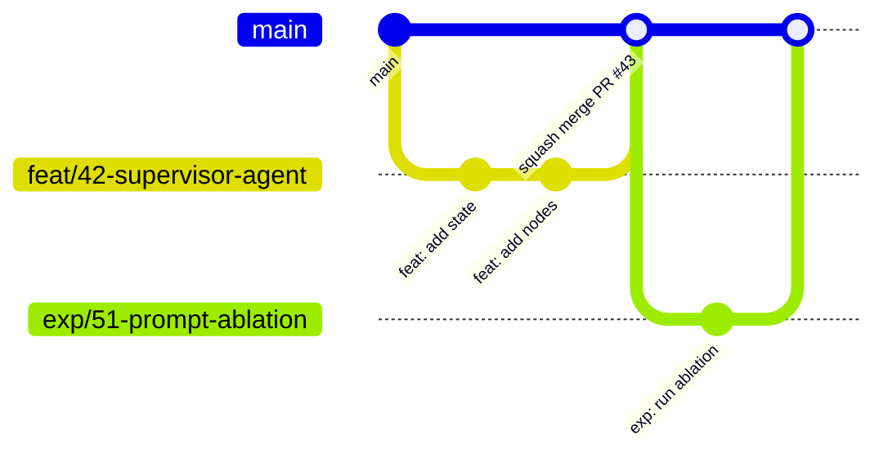

# Contributing to Khoailanggraph

Thanks for contributing! This guide covers how we work: workflow, conventions, and quality gates.
It applies to all team members and to both the **engineering** and **research** tracks.

> [!NOTE]
> Some tooling referenced here is still being set up (see [`docs/PLANNING.md`](docs/PLANNING.md)).

## Table of Contents

- [Contributing to Khoailanggraph](#contributing-to-khoailanggraph)
  - [Table of Contents](#table-of-contents)
  - [Code of Conduct](#code-of-conduct)
  - [Ways to Contribute](#ways-to-contribute)
  - [Development Setup](#development-setup)
  - [Workflow](#workflow)
    - [Issues](#issues)
    - [Branching](#branching)
    - [Commits](#commits)
    - [Pull Requests](#pull-requests)
    - [Code Review](#code-review)
  - [Coding Conventions](#coding-conventions)
    - [General](#general)
    - [Python (backend)](#python-backend)
    - [LangGraph / Agents](#langgraph--agents)
    - [TypeScript / React (frontend)](#typescript--react-frontend)
    - [API Contract](#api-contract)
    - [Database \& Migrations](#database--migrations)
  - [Logging \& Errors](#logging--errors)
  - [Testing](#testing)
  - [Research Contributions](#research-contributions)
  - [Documentation \& ADRs](#documentation--adrs)
  - [Security \& Secrets](#security--secrets)
  - [Releases](#releases)
  - [Getting Help](#getting-help)

---

## Code of Conduct

By participating, you agree to follow our [Code of Conduct](CODE_OF_CONDUCT.md). Be kind, be specific, assume good intent.

## Ways to Contribute

- Report bugs - use the **Bug report** issue template
- Propose features - use the **Feature request** template
- Propose or run experiments - use the **Experiment** template
- Improve docs
- Review pull requests (reviewing is contributing!)

## Development Setup

Follow [README -> Getting Started](README.md#getting-started), then:

```bash
just setup          # installs deps + pre-commit hooks
just lint && just test
```

If both pass, you're ready. **Do not skip installing pre-commit hooks** - CI runs the same checks.

## Workflow

We use **GitHub Flow**: `main` is always deployable; all work happens on short-lived branches merged via PR.



### Issues

- **Every piece of work starts with an issue** (except trivial typo fixes).
- Use labels: `type:*` (`bug`, `feature`, `chore`, `docs`, `experiment`), `area:*` (`backend`, `frontend`, `agents`, `research`, `infra`), `priority:*` (`p0`-`p3`).
- Assign yourself before starting so work isn't duplicated.
- Keep issues small: if it takes more than ~3 days, split it.

### Branching

Format: `<type>/<issue-number>-<short-kebab-description>`

| Type | Use for | Example |
|---|---|---|
| `feat/` | New feature | `feat/42-supervisor-agent` |
| `fix/` | Bug fix | `fix/57-sse-disconnect` |
| `refactor/` | Code change without behavior change | `refactor/60-extract-llm-client` |
| `docs/` | Documentation only | `docs/12-architecture-diagram` |
| `chore/` | Tooling, deps, config | `chore/8-setup-ruff` |
| `test/` | Tests only | `test/70-graph-integration` |
| `exp/` | Research experiment | `exp/51-prompt-ablation` |

Rules:
- Branch from latest `main`; rebase on `main` to resolve conflicts (don't merge `main` into your branch repeatedly).
- Never push directly to `main` (protected branch).

### Commits

We follow **[Conventional Commits](https://www.conventionalcommits.org/)** - enforced by `commitlint` in a pre-commit hook.

```
<type>(<optional scope>): <description>

[optional body: what and why, not how]

[optional footer: Closes #42, BREAKING CHANGE: ...]
```

**Types:** `feat`, `fix`, `refactor`, `perf`, `test`, `docs`, `style`, `build`, `ci`, `chore`, `revert`, `exp`
**Scopes:** `backend`, `frontend`, `agents`, `api`, `db`, `research`, `infra`, `deps`

Examples:

```
feat(agents): add supervisor node that routes to specialist agents
fix(api): close SSE stream when client disconnects
exp(research): compare single-agent vs multi-agent on dataset v1
docs: add ADR-0003 on checkpoint storage
```

Guidelines:
- Imperative mood, lowercase, no trailing period, <= 72 characters in the subject.
- One logical change per commit. Commit messages matter less inside a PR since we **squash merge** - but the **PR title** becomes the final commit, so it must follow the convention.

### Pull Requests

1. Keep PRs **small and focused** (aim for < 400 changed lines, excluding generated code / lockfiles).
2. Title follows Conventional Commits (it becomes the squash commit).
3. Fill in the PR template: *what*, *why*, *how to test*, screenshots for UI, linked issue (`Closes #42`).
4. Open as **Draft** early if you want feedback; mark **Ready for review** when CI is green.
5. Self-review your diff before requesting review.
6. **Moves and renames go in their own PR** (e.g. `refactor: move threads into features/`), with only mechanical edits such as import paths. Change the content in a follow-up PR. Git does not record renames; it detects them from content similarity, and because we squash merge, separate commits inside one PR do not help. A move plus heavy edits shows up as delete + add and breaks `git log --follow` / `git blame`. `git mv` is fine to use but does not change this.

**Definition of Done**

- [ ] CI green (lint, type-check, tests, build)
- [ ] Tests added/updated for the change
- [ ] Docs updated (README, docstrings, ADR if architectural)
- [ ] No secrets, no debug prints, no commented-out code
- [ ] API change -> OpenAPI client regenerated (`just codegen`)
- [ ] DB change -> Alembic migration included

### Code Review

**Authors:** respond to every comment (fix, or explain why not). Don't take it personally.

**Reviewers:** review within **1 working day**. Focus on correctness, design, readability, tests - leave style to the linters. Use prefixes to signal intent:

| Prefix | Meaning |
|---|---|
| `blocker:` | Must be fixed before merge |
| `suggestion:` | Worth considering, not required |
| `nit:` | Minor, optional |
| `question:` | Seeking understanding |

Merge strategy: **Squash and merge**, then delete the branch.

## Coding Conventions

### General

- Formatting is automated - don't argue with the formatter.
- `.editorconfig` defines: UTF-8, LF line endings, final newline, 4 spaces (Python), 2 spaces (TS/JSON/YAML/MD).
- Names should reveal intent; avoid abbreviations except well-known ones (`id`, `url`, `llm`).
- Code, comments, commit messages, and docs are written in **English**.
- Comments explain *why*, not *what*.

### Python (backend)

| Tool | Config |
|---|---|
| Formatter + linter | **Ruff** (`line-length = 100`; rule sets `E, F, W, I, N, UP, B, SIM, RUF, ASYNC, S, PL, PT, TC`) |
| Type checker | **mypy** `--strict` |
| Dependencies | **uv** - `uv add <pkg>`, `uv add --dev <pkg>`; commit `uv.lock` |

Conventions:
- **Type hints everywhere** - public functions must be fully typed; avoid `Any`.
- **Pydantic models** at boundaries (API schemas, config, tool inputs, LLM structured output). Plain dataclasses/TypedDicts internally are fine.
- **Async by default** for I/O (FastAPI routes, DB, LLM calls). Never call blocking I/O in async code.
- **Feature modules:** business features live in `features/<name>/` (`router.py`, `schemas.py`, `service.py`, `repository.py`, `models.py`). Start with fewer files and split as the feature grows. Routers contain no business logic.
- **Dependency rules** (enforced by import-linter in `just lint` and CI):

  ```text
  features/*    -> agents, llm, tools, integrations, platform, domain, settings
  api/          -> features/* (routers only), domain, settings
  agents        -> llm, tools, domain, settings  (never features/, api/, fastapi, platform.db)
  tools         -> agents.ports, integrations, platform, domain, settings
  llm           -> settings
  domain        -> nothing                       (standard library and Pydantic only; no I/O, no settings)
  research/     -> agents, llm, tools, domain, settings  (runs graphs without the API)
  ```

- **Features don't import each other's internals.** Use the other feature's public service (exported from its `__init__.py`). Cross-feature DB links are foreign keys referenced by id, not ORM relationships.
- **Business rules live in `domain/`:** content schemas, the integrity rules of artifacts, items and trace links, key generation, and domain exceptions. They are pure functions and models: no database, no HTTP, no LangGraph, no settings. Features and graphs call them; they never call back.
- **Ports only where things change:** when a graph needs something from outside (e.g. storing artifacts), define a `Protocol` in `agents/ports.py` and inject the implementation at run time (LangGraph runtime context or `config["configurable"]`). Research and tests inject fakes. Do not add interfaces for things that have one implementation and no planned replacement.
- **Configuration** only via `khoailanggraph.settings.Settings` (pydantic-settings). No `os.getenv` scattered in code.
- **Docstrings:** Google style for public modules, classes, and functions.
- Naming: `snake_case` functions/variables/modules, `PascalCase` classes, `UPPER_SNAKE_CASE` constants.
- Imports: absolute (`from khoailanggraph.agents...`), sorted by Ruff.

### LangGraph / Agents

- **One graph per package** under `backend/src/khoailanggraph/agents/<graph_name>/` with `state.py`, `nodes.py`, `graph.py`, `prompts.py`.
- **State** is explicitly typed (`TypedDict` or Pydantic) with reducers annotated (e.g. `Annotated[list[AnyMessage], add_messages]`). Keep it minimal.
- **Nodes are small, pure-ish functions**: take state, return a partial state update. Side effects go through tools or ports injected at run time (`agents/ports.py`) - this makes them unit-testable.
- **Prompts live in files/constants, not inline** in node logic, and are versioned (changes to prompts are reviewed like code - they change behavior).
- **Never hard-code a model or provider in a node.** Get models only via `khoailanggraph.llm.get_chat_model(role=..., config=config)`; never instantiate `ChatOpenAI` / `ChatAnthropic` directly. New roles go in `backend/config/models.yaml`. See [README: Model Configuration](README.md#model-configuration).
- **Stay provider-neutral:** use LangChain's common interfaces (`bind_tools`, `with_structured_output`, standard message types). If a provider-specific feature is unavoidable, isolate it in `llm/` behind a capability flag.
- **Pass `config` through** every node so per-request model overrides and tracing callbacks propagate.
- **Tools:** typed inputs (Pydantic), clear docstrings (the LLM reads them), deterministic error messages, timeouts on external calls.
- **Guard rails:** set `recursion_limit`, handle tool errors gracefully, and never let an exception kill a stream silently.
- **Every graph must have:** a unit test with a fake LLM, and a Mermaid diagram exported to `docs/architecture/agents/`.

### TypeScript / React (frontend)

| Tool | Config |
|---|---|
| Type checker | `tsc` with `strict`, `noUncheckedIndexedAccess`, `exactOptionalPropertyTypes`, `noImplicitOverride`, `verbatimModuleSyntax` |
| Linter | **ESLint** flat config: `typescript-eslint` (strict-type-checked), `react-hooks`, `@next/next` (core web vitals), `jsx-a11y`, `import` sorting |
| Formatter | **Prettier** (+ `prettier-plugin-tailwindcss`) |
| Package manager | **pnpm** - commit `pnpm-lock.yaml` |

Conventions:
- **No `any`** - use `unknown` + narrowing. No non-null assertions (`!`) without a comment.
- **Feature-based structure:** code for a feature lives in `src/features/<feature>/`, and code that knows no feature, including the frame of the screens, in `src/shared/`. The layers follow [Feature-Sliced Design](https://feature-sliced.design): a layer imports only the layers under it.
- **Import direction** (enforced by ESLint `no-restricted-imports`): imports go one way, `app` -> `features` -> `shared`.

  | Layer | Folders | May import |
  |---|---|---|
  | Shared | `src/shared/`: `components/` (`ui/` for shadcn/ui, `frame/` for the frame of the screens, `state/` for query states, `form/` for the fields of forms), `hooks/`, `lib/` (generic utilities), `api/` (server access, `generated/`), `domain/` (the vocabulary of the product that several features share, one folder per topic: `run-status/`, `output-language/`), `config/` (page addresses) | Other shared code only |
  | Features | `src/features/<feature>/` | Shared code |
  | App | `src/app/`, `src/providers/` | Features (through their `index.ts`) and shared code |

  - A feature never imports another feature. When two features appear together, the app layer composes them; code both need moves to the shared layer.
  - A shared component that shows feature content receives it as a prop (`children` or a named `ReactNode` prop) from `src/app/`. Example: `src/app/(app)/layout.tsx` passes the thread list and the artifact panel into `AppShell`.
  - The rule covers relative paths too: shared code does not reach `features/`, `app/` or `providers/` with `../`, and a relative import inside a feature never climbs out of the feature folder (shared code is imported with `@/`).
  - Code outside `src/shared/components/frame/` imports the frame from `@/shared/components/frame`, its `index.ts`; files inside the folder use relative imports, and the rest of the shared code does not import the frame.
  - A topic of `src/shared/domain/` holds the values, types and helpers of one subject of the product, with an `index.ts` that exports them. Code outside the topic imports it from that index (`@/shared/domain/run-status`); files of the topic use relative imports. A topic is plain TypeScript: it imports only its own files and other topics of the domain, so it holds no React, no state, no call to the API and no other shared code (both enforced by ESLint `no-restricted-imports`). How a value is shown, such as the color of a run status, belongs to a component.
  - `src/mocks/` and `src/test/` are test infrastructure and may import feature types.
- **Feature public API:** each feature has an `index.ts` that exports only what other code needs (page and shared components, hooks, types). Code outside the feature imports from `@/features/<feature>`, never from a file inside it (enforced by ESLint `no-restricted-imports`); code inside the feature uses relative imports. Anything not exported from `index.ts` is private and can change freely.
- **Inside a feature:** components render and handle events. Hooks (`hooks/`) hold the queries and the mutations and what follows a call: navigation, the cache, a toast, and the errors of the API turned into what the page shows, such as a message or the problems at the fields of a form. `<feature>.api.ts` sends the requests. A component imports no `*.api` module, no `api-fetch.utils`, no TanStack Query and no `*.store` module (enforced by ESLint); it calls a hook. `<feature>.utils.ts` holds pure helpers that know nothing of the API, and `<feature>.schema.ts` the schemas of the forms, with unit tests. The words that a feature shows for the answers of the API, such as a toast or the message of an error by its status or code, are values of `<feature>.constants.ts`; a hook turns an error into its message with `errorMessageOf` of `api-error.utils`, so no hook writes such words itself.
- **Components:** function components, named exports, one exported component per file. Its small parts stay in the file as local functions; a part moves to its own file when it grows large or another file uses it. Next.js routing files (`page.tsx`, `layout.tsx`, `error.tsx`, ...) are the exception: they must use a default export.
- **Routes stay thin:** `src/app/` holds only Next.js routing files. A `page.tsx` renders a component from `src/features/`; the frame lives in `src/shared/components/frame/`, global providers in `src/providers/`.
- **Server and Client Components:** files in `src/app/` are Server Components by default. Add `'use client'` at the top of a component file that uses state, effects, event handlers, or browser APIs. Code that reads `window`, `document`, or `localStorage` runs in an effect or event handler, never during render, so the server-rendered HTML matches the first client render.
- **Server state** via TanStack Query only - don't copy server data into Zustand/`useState`.
- **Addresses of pages** come from `routes` of `@/shared/config/routes`, a factory grouped as the folders of `src/app/` are (`routes.signIn(next)`, `routes.settings()`); a page with an id gets a group that takes the id once. Code writes no path as a literal. Each leaf writes its whole path in one template given to `checkedRoute`, so that the route types check it, and query parameters take their names from `RouteParam`.
- **Query keys** come from the key factory of the feature, `<feature>.keys.ts`: an object of functions from the widest key to the narrowest, each key starting with the one above (`accountKeys.all()`, `accountKeys.me()`). A query and every invalidation of it call the same function; no key is written as an inline array.
- **Query options:** a query used by one hook keeps its `queryFn` and options in that hook. A query that is also read or written elsewhere (`setQueryData`, `getQueryData`, `useQueries`, a prefetch) is defined once with `queryOptions` in `<feature>.queries.ts`, on a key of the key factory, and every use calls it, so that they share the key, the function and the type of the data.
- **Query states:** a component that shows data from a query handles four states, in this order: loading (`isPending`), error (`isError`), empty (success with no data), success. The first three use the shared components from `@/shared/components/state`:

  | State | Component | Rules |
  |---|---|---|
  | Loading | `LoadingState` | Skeleton rows roughly shaped like the content, with a `label` for screen readers. A spinner is only for short actions (a button that is submitting). |
  | Error | `ErrorState` | A message the user understands, plus `onRetry={() => void query.refetch()}`. The error stays where the data would be; it does not replace the page. |
  | Empty | `EmptyState` | Says what is missing and, when there is one, offers the next step through `action`. |

  - Each component has two sizes: `compact` for narrow containers (sidebar, cards) and `page` (default) for a panel or a whole page.
  - Queries use `useQuery`, not `useSuspenseQuery`: a suspended query would run on the server during rendering, where the API is not reachable with the user's session.
  - Unexpected errors (a bug while rendering) are caught by the route error boundary (`error.tsx`). An item that a component registers on the frame has a boundary of its own, so that it fails alone. Slow routes show a `loading.tsx`.
  - Every state must be reachable in `pnpm dev:mock` through a mock scenario (frontend README: Mock data).
- **Validation** with Zod at boundaries (forms, untrusted data).
- **Forms** use react-hook-form with a Zod schema in `<feature>.schema.ts`, whose fields are named after the fields of the request. A field is a `TextField`, or a `FormField` around any other control, from `@/shared/components/form`: they tie the label, `aria-invalid`, `data-invalid` and the error to the control. When the request fails, the hook of the mutation shows the problems of the API at their fields with `showFieldProblems` and the `setError` of the form, and gives the message for under the form with `formErrorOf`. The form is a `Form` from the same folder, which leaves the checks to the schema; the message under it is a `FieldError`, and the button that submits it a `PendingButton`.
- **UI components:** use shadcn/ui primitives from `src/shared/components/ui/` before building custom ones. Style with Tailwind utilities; avoid ad-hoc CSS files. Use `cn()` from `@/shared/lib/utils` (re-exports shadcn's `cn` package, a clsx + tailwind-merge replacement) to combine classes. Outside `src/shared/components/ui/`, a class has no CSS value of its own in brackets (`text-[0.625rem]`, `grid-cols-[8rem_1fr]`, `[scrollbar-width:none]`; state selectors such as `data-[state=open]` are fine): use a token or utility of the scale, or add a token or `@utility` to `src/app/styles.css`. A `style` prop is for a value that comes from data, such as the depth of a tree row.
- **Confirmation:** an action that ends the session, deletes, or cannot be undone asks first with `ConfirmDialog` of `src/shared/components/ui/confirm-dialog.tsx`. Its title is a question that names the action, and the button that confirms says the action (`Sign out`, not `OK`). An action that returns a promise keeps the dialog open until it is done.
- **Heavy components** (CodeMirror, React Flow, PDF viewer) are lazy-loaded with `next/dynamic` (`ssr: false` for components that need the browser) so the initial bundle stays small.
- **Untrusted content** (LLM-generated HTML/Markdown) is never rendered with `dangerouslySetInnerHTML`; HTML artifacts go in a sandboxed iframe.
- **Accessibility:** semantic HTML, labels on inputs, keyboard navigable. `jsx-a11y` must pass.
- Path alias: `@/` -> `src/`.

**File naming** (enforced by `eslint-plugin-check-file` in `pnpm lint`):

| File | Pattern | Examples |
|---|---|---|
| Component (`.tsx`) | `PascalCase.tsx`, name = the exported component | `ChatPage.tsx` |
| Hook (`.ts` in a `hooks/` folder) | `useSomething.ts`, name = the exported hook | `useRunStream.ts` |
| Any other `.ts` | `<subject>.<kind>.ts` | `chat.api.ts`, `settings.store.ts`, `run-events.reducer.ts` |
| Config that holds React elements (`.tsx`) | `<subject>.config.tsx` | `console-frame.config.tsx` |
| Unit test | `<file under test>.test.ts(x)`, in a `__tests__/` folder next to the file under test | `features/chat/__tests__/chat.api.test.ts`, `shared/components/state/__tests__/ErrorState.test.tsx` |
| Cases of a data-driven unit test | `<file under test>.data.ts`, beside its test | `shared/api/__tests__/api-error.utils.data.ts` |
| E2E test | `<subject>.spec.ts`, in a folder per feature | `tests/e2e/account/account.spec.ts` |
| Screenshot spec | `<page>.spec.ts`, in a folder per feature | `tests/screenshots/account/account.spec.ts` |
| Cases of an E2E test or of a screenshot spec | `<subject>.data.ts`, beside its spec | `tests/e2e/account/account.data.ts` |

- **Subject** (before the first dot): what the file is about, in kebab-case. Always include it, even when the folder already says it (`features/chat/chat.api.ts`), so names are unique in search results and editor tabs.
- **Kind** (after the dot): the role of the file, one of `api`, `keys`, `queries`, `types`, `schema`, `store`, `reducer`, `config`, `constants`, `utils`, `handlers`, `fixtures`, `setup`, `spec`. Need a new kind? Add it to the list here and in `eslint.config.js` in the same PR.
- **Exceptions** (names set by a tool or convention): `src/shared/components/ui/**` and `src/shared/hooks/use-mobile.ts` (shadcn CLI), `src/shared/lib/utils.ts` (shadcn alias), Next.js file conventions (below), `index.ts` barrels, `*.d.ts`, and root config files (`next.config.ts`, ...).
- **Next.js file conventions** keep the names the framework requires:
  - Routing files in `src/app/**`: `page.tsx`, `layout.tsx`, `loading.tsx`, `error.tsx`, `not-found.tsx`, `global-error.tsx`, `template.tsx`, `default.tsx`, `route.ts`.
  - Metadata files in `src/app/**`: `icon.tsx`, `apple-icon.tsx`, `opengraph-image.tsx`, `twitter-image.tsx`, `sitemap.ts`, `robots.ts`, `manifest.ts`.
  - Entry points directly in `src/`: `proxy.ts`, `instrumentation.ts`, `instrumentation-client.ts`.
  - Any other file placed in `src/app/**` follows the table above.

**Folder naming** (enforced by the same plugin):

| Folder | Pattern | Examples |
|---|---|---|
| Inside `src/app/` (route segments) | kebab-case segment, or a Next.js form: `(group)`, `[param]`, `[...param]`, `[[...param]]`, `_private`, `@slot` | `settings/`, `(app)/`, `threads/[threadId]/` |
| Everywhere else in `src/` and `tests/` | kebab-case, or `__tests__` for unit tests | `features/chat/`, `shared/components/`, `features/chat/__tests__/` |

A folder name in `src/app/` is a URL segment, so renaming it changes the URL.

### API Contract

- The backend **OpenAPI schema is the single source of truth**.
- All endpoints live under `/api/v1`. Long-running work is modeled as runs (create, stream, resume, cancel), never as one long HTTP request.
- FastAPI generates the schema from routes and Pydantic models. `just codegen` dumps it to `frontend/openapi.json` (via `create_app().openapi()`, no running server needed) and generates the client in `frontend/src/shared/api/generated/`. Both are committed so API changes show up in PR diffs; **never edit them by hand**. CI reruns codegen and fails if either is out of date.
- Keep the app factory free of side effects (no DB connection at creation; connect in the lifespan) so codegen works without infrastructure.
- Request/response schemas live in `features/<name>/schemas.py`; schemas shared across features (error shape, pagination) live in `api/schemas.py`.
- FastAPI cannot describe SSE payloads on its own. Register the event models from `features/runs/events.py` as OpenAPI components so the frontend gets generated types for them too.
- Breaking API changes require a `BREAKING CHANGE:` footer and coordination with frontend.
- Streaming endpoints use **SSE** with the event schema defined in [API design: run event stream](docs/API.md#6-run-event-stream).
- Errors follow a single shape (e.g. RFC 9457 Problem Details).

### Database & Migrations

- Every schema change ships with an **Alembic migration** in the same PR (`just db-revision "add threads table"`).
- Migrations must be reversible (`downgrade` implemented) and reviewed carefully.
- Never edit a migration that has been merged to `main` - add a new one.

## Logging & Errors

- Backend: `structlog` only (`logger = get_logger(__name__)`). **No `print()`** (Ruff `T20` enforces this).
- Log **events with context**, not sentences: `logger.info("tool_called", tool=name, thread_id=tid, latency_ms=ms)`.
- Levels: `DEBUG` (dev detail) | `INFO` (business events) | `WARNING` (recoverable) | `ERROR` (failed operation) | `CRITICAL` (service down).
- Bind `request_id` and `thread_id` in middleware so all logs for one request are correlated.
- **Never log** API keys, tokens, passwords, or full user content in production.
- LLM calls and agent steps are traced separately in Langfuse/LangSmith; application logs and LLM traces complement each other.
- Raise domain exceptions (`khoailanggraph.domain.errors`); map them to HTTP responses in one place (exception handlers), not in every route.
- Frontend: use an error boundary per route; no `console.log` left in committed code (ESLint `no-console`).

## Testing

- **Backend:** `pytest`. Unit tests mock LLMs (LangChain fake chat models) - tests must be **deterministic and free**.
- Mark tests calling real LLMs with `@pytest.mark.llm`; they're excluded from default CI runs.
- **Frontend:** Vitest + Testing Library; test behavior, not implementation. Mock HTTP with MSW.
- **Data-driven tests:** cases that share one flow and differ only in their data are one `it.each` over a table of cases, and the table lives in `<file under test>.data.ts` beside the test. A test with its own flow stays a plain `it`. The Playwright tests (E2E and screenshots) follow the same rule: a flow that takes several cases runs over a table of them in the `.data.ts` beside the spec, one `test` per case, and a flow of its own stays a plain `test`.
- **E2E:** Playwright for critical flows only.
- Coverage target: **>= 80%** for `features/*/service.py`, `agents/`, `tools/` (not a hard gate for UI).
- Test file naming: `test_<module>.py` / `<Component>.test.tsx`. Frontend unit tests live in a `__tests__/` folder next to the file under test, never beside it (enforced by ESLint).
- A bug fix PR includes a test that fails without the fix.

## Research Contributions

Research work follows the same PR process, with extra rules for reproducibility.

**Experiment lifecycle**

1. Open an issue with the **Experiment** template: research question, hypothesis, metric, dataset, expected cost.
2. Create branch `exp/<issue>-<slug>` and folder `research/experiments/<YYYY-MM-DD>-<slug>/`.
3. Add `config.yaml` (models, prompts version, temperature, seed, dataset version) and `README.md`.
4. Run via the harness (`just eval research/experiments/<...>/config.yaml`) - not ad-hoc notebook cells.
5. Record results in the experiment `README.md`: **Hypothesis -> Setup -> Results -> Conclusion -> Next steps**, including the git SHA and trace/experiment links.
6. Open a PR; a teammate reviews the method and conclusions (not just the code).

**Rules**

- **Reuse product code.** Import graphs from `khoailanggraph.agents`; add variants via config/parameters, don't fork code into `research/`.
- **Notebooks** are for exploration and figures. Outputs are stripped by `nbstripout` on commit. Promote reusable code to `research/src/`.
- **Data:** small files (< 10 MB) in Git; larger via DVC. Never commit personal or licensed data without permission; document dataset sources and licenses in `research/datasets/README.md`.
- **Cost awareness:** estimate LLM cost before large runs; use caching; note actual cost in the experiment README.
- **Negative results are results.** Record them - they're valuable for the thesis.
- **Literature:** add references to `research/literature/references.bib` with a short reading note.

## Documentation & ADRs

- Update docs in the same PR as the code change.
- Significant technical decisions (framework choice, data model, agent topology, storage) are recorded as **Architecture Decision Records** in `docs/adr/NNNN-title.md` using the template in `docs/adr/0000-template.md`:

  ```markdown
  # NNNN. Title
  - Status: proposed | accepted | superseded by NNNN
  - Date: YYYY-MM-DD
  ## Context
  ## Decision
  ## Consequences
  ## Alternatives considered
  ```
- Meeting notes with the supervisor go in `docs/meetings/YYYY-MM-DD.md` (decisions + action items).

## Security & Secrets

- **Never commit secrets.** Use `.env` (git-ignored) and keep `.env.example` updated with placeholder values.
- `gitleaks` runs in pre-commit and CI. If a secret leaks, **rotate it immediately** and tell the team.
- Report vulnerabilities privately per [SECURITY.md](SECURITY.md), not in public issues.
- Treat LLM output as untrusted input (prompt injection): validate tool arguments, never execute generated code without sandboxing.

## Releases

- Versioning: [SemVer](https://semver.org/). Pre-1.0 while in development (`0.x.y`).
- `release-please` opens a release PR from Conventional Commits and generates `CHANGELOG.md`.
- Milestones map to capstone checkpoints (e.g. `v0.1.0` = walking skeleton, `v1.0.0` = final defense).

## Getting Help

- Questions about the codebase -> GitHub Discussions or the team chat channel.
- Stuck for more than ~1 hour -> ask. Pair programming is encouraged.
- Unsure whether something needs an ADR or an issue -> it probably does; ask in chat.
