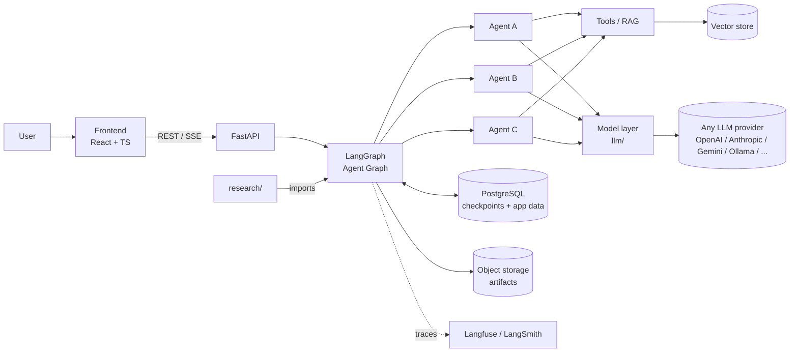

<div align="center">

# Khoailanggraph

**A multi-agent AI system built on LangGraph - engineered as a product, studied as research.**


[](https://github.com/nhinguyen140809/khoai-lang-graph/actions/workflows/ci.yml)
[](https://www.python.org/)
[](https://www.typescriptlang.org/)
[](https://github.com/astral-sh/ruff)
[](https://www.conventionalcommits.org)
[](LICENSE)

[Overview](#overview) |
[Architecture](#architecture) |
[Getting Started](#getting-started) |
[Research](#research) |
[Contributing](CONTRIBUTING.md) |
[Docs](docs/)

</div>

> [!NOTE]
> **Status: Planning.** This README describes the *target* setup. Items marked TODO and sections marked (planned) are not implemented yet.
> "Khoailanggraph" is a working name. See [`docs/PLANNING.md`](docs/PLANNING.md) for decisions and open questions.

---

## Table of Contents

- [Khoailanggraph](#khoailanggraph)
  - [Table of Contents](#table-of-contents)
  - [Overview](#overview)
  - [Key Features](#key-features)
  - [Architecture](#architecture)
  - [Tech Stack](#tech-stack)
    - [Backend](#backend)
    - [Frontend](#frontend)
    - [Research Tooling](#research-tooling)
    - [Tooling \& Infra](#tooling--infra)
  - [Repository Structure](#repository-structure)
  - [Getting Started](#getting-started)
    - [Prerequisites](#prerequisites)
    - [Installation (planned)](#installation-planned)
    - [Run (planned)](#run-planned)
    - [Environment variables](#environment-variables)
  - [Model Configuration](#model-configuration)
  - [Development](#development)
  - [Testing](#testing)
  - [Research](#research)
  - [Documentation](#documentation)
  - [Roadmap](#roadmap)
  - [Team](#team)
  - [Contributing](#contributing)
  - [Citation](#citation)
  - [License](#license)
  - [Acknowledgements](#acknowledgements)

---

## Overview

<!-- TODO: 2-4 sentences. What problem does it solve, for whom, and why a multi-agent approach? -->

Khoailanggraph is a capstone project with two parallel goals:

| Track | Goal | Output |
|---|---|---|
| **Engineering** | Ship a usable, maintainable product | Web app + API, deployed |
| **Research** | Answer a measurable question about multi-agent workflows | Experiments, evaluation results, paper/thesis |

Both tracks share **one codebase**: research experiments import the same agent graphs the product runs, so every finding is directly applicable to the product and every product change can be evaluated.

## Key Features

- [TODO] Multi-agent workflow orchestrated with **LangGraph** (supervisor / specialized agents / tools)
- [TODO] Real-time streaming of agent steps and tokens to the UI (Server-Sent Events)
- [TODO] Persistent conversation state and human-in-the-loop checkpoints
- [TODO] Full LLM tracing and observability (every agent step is inspectable)
- [TODO] Reproducible evaluation harness for research experiments

## Architecture



- **Frontend** talks to the backend only through a typed API client generated from the backend's OpenAPI schema.
- **Backend** is a modular monolith: business features live in `features/<name>/` (router, schemas, service, repository), on top of shared modules `agents/`, `llm/`, `tools/`, `platform/`, `domain/`, `settings/`. Graphs in `agents/` never depend on features or HTTP, so `research/` can run them without the API. `domain/` holds the business rules that need no infrastructure (content schemas of artifacts and items, integrity rules, domain errors) and imports no other package; both the graphs and the features import it, so what an agent produces and what the API validates use the same definition. Dependency rules: [CONTRIBUTING: Python](CONTRIBUTING.md#python-backend).
- **Model layer** (`llm/`) is the only place that creates chat models. Agents ask for a *role* (e.g. `supervisor`), never a hard-coded model, so models and providers can be switched by config. See [Model Configuration](#model-configuration).
- **Research** never duplicates agent code; it imports `khoailanggraph` as a library and runs it against datasets.

Details: [`docs/architecture/`](docs/architecture/) | Decisions: [`docs/adr/`](docs/adr/)

## Tech Stack

### Backend

| Concern | Choice |
|---|---|
| Language / runtime | Python 3.12+ |
| Package & env manager | [uv](https://docs.astral.sh/uv/) |
| Agent orchestration | LangGraph, LangChain Core |
| LLM abstraction | LangChain `init_chat_model` + provider packages (`langchain-openai`, `langchain-anthropic`, `langchain-google-genai`, `langchain-ollama`, ...); optional LiteLLM / OpenRouter |
| Web framework | FastAPI + Uvicorn |
| Validation & settings | Pydantic v2, pydantic-settings |
| Database / ORM / migrations | PostgreSQL, SQLAlchemy 2 (async), Alembic |
| Agent state persistence | `langgraph-checkpoint-postgres` |
| Background runs | In-process task manager first; arq + Redis if needed |
| Object storage (artifacts) | S3-compatible (MinIO locally) |
| Vector store | pgvector (keeps infra to one DB) |
| Logging | structlog (JSON in prod, pretty in dev) |
| LLM observability | Langfuse (self-hostable) or LangSmith |
| Lint & format | Ruff |
| Type checking | mypy (strict) |
| Module boundaries | import-linter |
| Testing | pytest, pytest-asyncio, pytest-cov, respx |

### Frontend

| Concern | Choice |
|---|---|
| Framework | Next.js 16 (App Router, Turbopack) + React 19 + TypeScript (strict) |
| Package manager | pnpm |
| Styling | Tailwind CSS v4 |
| Component library | shadcn/ui (see [`docs/PLANNING.md`](docs/PLANNING.md#4-ui-component-library)) |
| Chat, graph, multi-step flows, artifact viewers, ... | See [companion libraries](docs/PLANNING.md#companion-libraries) |
| Routing | Next.js App Router (file-based, typed routes) |
| Server state | TanStack Query |
| Client state | Zustand |
| Forms & validation | React Hook Form + Zod |
| API client | Generated from OpenAPI (`@hey-api/openapi-ts` or `orval`) |
| Lint & format | ESLint (flat config, typescript-eslint), Prettier |
| Testing | Vitest + Testing Library, MSW, Playwright (E2E) |

### Research Tooling

| Concern | Choice |
|---|---|
| Notebooks | Jupyter (outputs stripped via `nbstripout`) |
| Experiment config | YAML configs validated by Pydantic |
| Experiment tracking | Langfuse / LangSmith datasets + experiments (optionally MLflow) |
| Data versioning | DVC (if datasets outgrow Git) |
| Analysis | pandas / polars, matplotlib / seaborn |
| Paper | LaTeX (synced with Overleaf) |

### Tooling & Infra

| Concern | Choice |
|---|---|
| Local environment | Docker Compose (Postgres, Langfuse, MinIO, ...) |
| Task runner | `just` (or `make`) |
| Git hooks | pre-commit |
| Commit convention | Conventional Commits + commitlint |
| CI | GitHub Actions |
| Releases / changelog | release-please |
| Dependency updates | Renovate or Dependabot |

## Repository Structure

```text
khoailanggraph/
├── .github/
│   ├── workflows/                   # ci.yml, release.yml, ...
│   ├── ISSUE_TEMPLATE/              # bug_report.yml, feature_request.yml, experiment.yml
│   ├── PULL_REQUEST_TEMPLATE.md
│   └── CODEOWNERS
│
├── backend/
│   ├── src/khoailanggraph/
│   │   ├── features/                # one package per business feature (vertical slice)
│   │   │   ├── threads/
│   │   │   │   ├── router.py        # FastAPI routes (thin, no business logic)
│   │   │   │   ├── schemas.py       # request/response schemas (Pydantic)
│   │   │   │   ├── service.py       # business logic / use cases
│   │   │   │   ├── repository.py    # DB queries (SQLAlchemy)
│   │   │   │   └── models.py        # SQLAlchemy models
│   │   │   ├── runs/                # same files as threads/, plus:
│   │   │   │   ├── events.py        # SSE event models (exported to OpenAPI for codegen)
│   │   │   │   └── executor.py      # run executor wiring (starts / cancels runs)
│   │   │   ├── projects/            # projects that own threads and artifacts
│   │   │   ├── artifacts/           # artifacts, items, trace links; + ArtifactSink implementation
│   │   │   ├── model_settings/      # allowlisted models, per-user model choices
│   │   │   └── auth/                # (later)
│   │   ├── api/                     # HTTP wiring shared by all features
│   │   │   ├── router.py            # mounts feature routers under /api/v1
│   │   │   ├── deps.py              # shared dependencies (DB session, current user)
│   │   │   ├── schemas.py           # shared schemas (Problem Details errors, pagination)
│   │   │   └── errors.py            # maps domain.errors exceptions to HTTP responses
│   │   ├── agents/                  # LangGraph graphs; never imports features/ or api/
│   │   │   ├── <graph_name>/        # one package per graph
│   │   │   │   ├── graph.py         # StateGraph definition & compile
│   │   │   │   ├── state.py         # TypedDict / Pydantic state
│   │   │   │   ├── nodes.py         # node functions
│   │   │   │   └── prompts.py       # (or prompts/*.md)
│   │   │   ├── ports.py             # Protocols graphs need from outside (e.g. ArtifactSink)
│   │   │   └── registry.py          # name -> compiled graph
│   │   ├── llm/                     # provider-agnostic model layer
│   │   │   ├── registry.py          # loads model profiles, allowlist, capabilities
│   │   │   ├── factory.py           # get_chat_model(role, config) -> BaseChatModel
│   │   │   └── resolver.py          # merges defaults / .env / user settings / request
│   │   ├── tools/                   # tools callable by agents
│   │   ├── integrations/            # external API clients (non-LLM), used by tools
│   │   ├── platform/                # shared infrastructure
│   │   │   ├── db.py                # async engine, session, declarative Base
│   │   │   ├── storage.py           # S3-compatible object storage client
│   │   │   └── executor.py          # background run executor (in-process first)
│   │   ├── domain/                  # business rules with no infrastructure; imports no other package
│   │   │   ├── artifacts/           # one Pydantic model per artifact kind and schema version
│   │   │   ├── items/               # one Pydantic model per item kind and schema version
│   │   │   ├── registry.py          # kind + schema version -> model; exports JSON Schema
│   │   │   ├── links.py             # link types and the allowed pairs of item kinds
│   │   │   ├── rules.py             # integrity rules: item in artifact, no cycle, conditional fields
│   │   │   ├── keys.py              # key prefixes and key format per item kind
│   │   │   └── errors.py            # domain exceptions
│   │   ├── settings/
│   │   │   ├── base.py              # Settings class (pydantic-settings)
│   │   │   └── logging.py           # structlog setup
│   │   └── main.py                  # FastAPI app factory
│   ├── config/
│   │   └── models.yaml              # model profiles + role defaults
│   ├── migrations/                  # Alembic (env.py imports every features/*/models.py)
│   ├── tests/
│   │   ├── unit/                    # mirrors src layout (features/, agents/, ...)
│   │   ├── integration/
│   │   └── conftest.py
│   ├── pyproject.toml
│   ├── uv.lock
│   └── Dockerfile
│
├── frontend/
│   ├── src/
│   │   ├── app/                     # Next.js App Router: routes only (folder = URL segment)
│   │   │   ├── layout.tsx           # root layout: <html>, <body>, <Providers>
│   │   │   ├── not-found.tsx
│   │   │   ├── (app)/               # route group for pages inside the app shell
│   │   │   │   ├── layout.tsx       # wraps the group in <AppShell>
│   │   │   │   ├── error.tsx        # error boundary for the group
│   │   │   │   ├── page.tsx         # / (chat)
│   │   │   │   └── settings/page.tsx
│   │   │   └── styles.css           # Tailwind + shadcn theme tokens
│   │   ├── providers/               # Providers.tsx composes the global providers (query, theme, mocking)
│   │   ├── features/                # feature modules (chat/, agents/, workflow/, artifacts/, settings/)
│   │   │   └── chat/
│   │   │       ├── components/
│   │   │       ├── hooks/
│   │   │       ├── chat.api.ts
│   │   │       └── chat.types.ts
│   │   ├── components/
│   │   │   ├── layout/              # app shell: sidebar + resizable chat / artifact panels
│   │   │   └── ui/                  # shadcn/ui components (owned, editable)
│   │   ├── hooks/                   # shared hooks (shadcn use-mobile)
│   │   ├── lib/                     # utils, api client setup
│   │   ├── api/generated/           # OpenAPI-generated client (do not edit)
│   │   ├── mocks/                   # MSW handlers (NEXT_PUBLIC_API_MOCKING, tests)
│   │   └── test/                    # Vitest setup
│   ├── public/mockServiceWorker.js  # generated by `msw init` (do not edit)
│   ├── tests/e2e/                   # Playwright
│   ├── openapi.json                 # API schema snapshot from `just codegen` (do not edit)
│   ├── components.json              # shadcn/ui CLI config
│   ├── openapi-ts.config.ts         # codegen: openapi.json -> src/api/generated/
│   ├── eslint.config.js             # incl. file naming rules
│   ├── prettier.config.js
│   ├── playwright.config.ts
│   ├── tsconfig.json
│   ├── next.config.ts               # /api proxy, typed routes, dev memory options
│   ├── postcss.config.mjs           # Tailwind CSS plugin
│   ├── vitest.config.ts
│   └── package.json
│
├── research/
│   ├── README.md                    # research questions, how to reproduce
│   ├── notebooks/                   # exploration only, numbered: 01-xxx.ipynb
│   ├── experiments/
│   │   └── <YYYY-MM-DD>-<slug>/     # one folder per experiment
│   │       ├── config.yaml
│   │       ├── README.md            # hypothesis, setup, result, conclusion
│   │       └── results/             # small summaries only (large -> DVC)
│   ├── evals/                       # evaluation harness, metrics, LLM-as-judge
│   ├── datasets/                    # small datasets / DVC pointers
│   ├── src/khoailanggraph_research/ # reusable research code (runners, metrics)
│   ├── paper/                       # LaTeX source, figures
│   └── literature/                  # reading notes, references.bib
│
├── docs/
│   ├── PLANNING.md
│   ├── architecture/                # C4 diagrams, agent graph diagrams
│   ├── adr/                         # Architecture Decision Records
│   ├── api/                         # API notes (OpenAPI is the source of truth)
│   └── meetings/                    # meeting notes with supervisor
│
├── infra/
│   ├── docker-compose.yml           # local dev services
│   └── docker-compose.prod.yml
│
├── scripts/                         # one-off dev scripts (seed data, codegen)
├── .editorconfig
├── .env.example
├── .nvmrc                           # Node version (22)
├── .gitignore
├── .pre-commit-config.yaml
├── justfile
├── CHANGELOG.md
├── CITATION.cff
├── CODE_OF_CONDUCT.md
├── CONTRIBUTING.md
├── LICENSE
├── SECURITY.md
└── README.md
```

## Getting Started

### Prerequisites

| Tool | Version | Install |
|---|---|---|
| Git | >= 2.40 | - |
| Python | 3.12+ | managed by `uv` |
| uv | latest | `curl -LsSf https://astral.sh/uv/install.sh \| sh` |
| Node.js | 22 LTS | via `fnm` or `nvm` (see `.nvmrc`) |
| pnpm | 9+ | `corepack enable` |
| Docker + Compose | latest | Docker Desktop / Engine |
| just | latest | `uv tool install rust-just` or package manager |

> [!TIP]
> On Windows, develop inside **WSL2** and keep the repo on the Linux filesystem (not `/mnt/c`).

### Installation (planned)

```bash
git clone https://github.com/nhinguyen140809/khoai-lang-graph.git khoailanggraph
cd khoailanggraph

cp .env.example .env          # then fill in API keys
just setup                    # installs backend + frontend deps and pre-commit hooks
just infra-up                 # starts Postgres, Langfuse, ... via Docker Compose
just db-migrate               # applies Alembic migrations
```

### Run (planned)

```bash
just dev                      # backend (http://localhost:8000) + frontend (http://localhost:3000)
```

- API docs: http://localhost:8000/docs
- LangGraph Studio (optional): `just studio`

### Environment variables

All variables are documented in [`.env.example`](.env.example). Never commit `.env`.

| Variable | Description |
|---|---|
| `APP_ENV` | `local` / `staging` / `production` |
| `DATABASE_URL` | PostgreSQL connection string |
| `OPENAI_API_KEY` / `ANTHROPIC_API_KEY` / `GOOGLE_API_KEY` / ... | LLM provider keys (only set the ones you use) |
| `OLLAMA_BASE_URL` | Local models via Ollama (optional) |
| `LLM__DEFAULT_MODEL` | Default model for every role, format `provider:model` |
| `LLM__ROLES__<ROLE>` | Override the model for one agent role, e.g. `LLM__ROLES__SUPERVISOR` |
| `LLM__ALLOW_USER_OVERRIDE` | Whether users may pick models from the UI (`true` / `false`) |
| `LANGFUSE_PUBLIC_KEY`, `LANGFUSE_SECRET_KEY`, `LANGFUSE_HOST` | Tracing |
| `LOG_LEVEL` | `DEBUG` / `INFO` / ... |
| `LOG_FORMAT` | `console` (dev) / `json` (prod) |

## Model Configuration

Goal: switch model **or provider** without touching agent code.

**1. Models are referenced as `provider:model` strings**, resolved with LangChain's `init_chat_model`:

```text
anthropic:claude-sonnet-5
openai:gpt-4.1-mini
google_genai:gemini-2.5-flash
ollama:llama3.1
```

**2. Agents request a role, not a model.** Each agent node calls
`get_chat_model(role="supervisor", config=config)` from `khoailanggraph.llm`. Roles let you use a cheap, fast model for routing and a stronger one for reasoning.

**3. Profiles live in `backend/config/models.yaml`:**

```yaml
defaults:
  model: anthropic:claude-sonnet-5
  temperature: 0.2
  max_retries: 2
  fallbacks: [openai:gpt-4.1-mini]

roles:                         # which model each agent role uses
  supervisor: anthropic:claude-haiku-4-5
  researcher: anthropic:claude-sonnet-5
  writer: openai:gpt-4.1-mini

allowlist:                     # models a user may pick in the UI
  - id: anthropic:claude-sonnet-5
    label: Claude Sonnet 5
    capabilities: [tools, structured_output, vision]
  - id: ollama:llama3.1
    label: Llama 3.1 (local)
    capabilities: [tools]
```

**4. Resolution order** (later wins):

```text
models.yaml defaults
  -> .env overrides        (LLM__DEFAULT_MODEL, LLM__ROLES__SUPERVISOR, ...)
    -> user settings       (chosen in the UI, stored in DB, must be in allowlist)
      -> per-request       (LangGraph config["configurable"]["models"], used by research/evals)
```

**5. Rules**

- API keys stay **server-side** in `.env`. The UI only chooses among allowlisted models returned by `GET /api/v1/models`.
- The resolver checks capabilities (e.g. a role that needs tool calling cannot be assigned a model without `tools`).
- Every trace/log records the resolved `provider:model`, so results stay comparable.
- Adding a provider = install its `langchain-*` package, add its key to `.env`, add entries to `models.yaml`. No agent code changes.

## Development

Common commands (see `justfile` for the full list):

| Command | Description |
|---|---|
| `just dev` | Run backend and frontend with hot reload |
| `just lint` | Ruff + mypy + import-linter + ESLint + tsc |
| `just fmt` | Format everything (Ruff, Prettier) |
| `just test` | Run all unit & integration tests |
| `just e2e` | Run Playwright end-to-end tests |
| `just codegen` | Regenerate the frontend API client from OpenAPI |
| `just db-revision "msg"` | Create an Alembic migration |
| `just eval <config>` | Run a research evaluation |

Coding conventions, logging, branching, and commit rules are in **[CONTRIBUTING.md](CONTRIBUTING.md)**.

## Testing

| Layer | Tooling | What it covers |
|---|---|---|
| Backend unit | pytest | nodes, tools, feature services - LLMs **mocked** (fake chat models) |
| Backend integration | pytest + Testcontainers | API + DB + compiled graph |
| Frontend unit | Vitest + Testing Library + MSW | components, hooks |
| E2E | Playwright | critical user flows |
| Agent quality | `research/evals` | LLM-graded / metric-based evaluation on datasets |

Testing rules (LLM mocking, the `llm` marker, coverage targets): [CONTRIBUTING: Testing](CONTRIBUTING.md#testing).

## Research

The research track lives in [`research/`](research/).

- Experiment workflow and rules (branch, folder layout, config, reproducibility, notebooks): [CONTRIBUTING: Research Contributions](CONTRIBUTING.md#research-contributions)
- Methodology (dataset splits, baselines, statistics, LLM-as-judge): [PLANNING: Research methodology](docs/PLANNING.md#7-research-methodology)

<!-- TODO: fill in once defined -->
**Research questions (draft):**
- RQ1: ...
- RQ2: ...

See [`research/README.md`](research/README.md) for how to reproduce results.

## Documentation

| Document | Purpose |
|---|---|
| [`docs/PLANNING.md`](docs/PLANNING.md) | Goals & scope, decisions, designs, risks, open questions |
| [`docs/architecture/`](docs/architecture/) | System & agent graph diagrams |
| [`docs/adr/`](docs/adr/) | Architecture Decision Records |
| [`CONTRIBUTING.md`](CONTRIBUTING.md) | Workflow & conventions |
| [`CHANGELOG.md`](CHANGELOG.md) | Release history (auto-generated) |

## Roadmap

Phases and timeline: [PLANNING: Suggested timeline](docs/PLANNING.md#11-suggested-timeline-adjust-to-the-semester). Progress is tracked in [GitHub Projects](https://github.com/nhinguyen140809/khoai-lang-graph/projects) / Issues.

## Team

| Name | Role | GitHub |
|---|---|---|
| ... | Backend / Agents | @... |
| ... | Frontend | @... |
| ... | Research / Evaluation | @... |
| ... | Supervisor | - |

## Contributing

Please read [CONTRIBUTING.md](CONTRIBUTING.md) and our [Code of Conduct](CODE_OF_CONDUCT.md) before opening a PR.

## Citation

If you use this work, please cite it (see [`CITATION.cff`](CITATION.cff)):

```bibtex
@misc{khoailanggraph2026,
  title  = {Khoailanggraph: <TODO subtitle>},
  author = {<TODO>},
  year   = {2026},
  note   = {Capstone project, <University>},
  url    = {https://github.com/nhinguyen140809/khoai-lang-graph}
}
```

## License

Distributed under the MIT License. See [`LICENSE`](LICENSE).
<!-- Check your university's IP policy before choosing a license. -->

## Acknowledgements

- Supervisor: ...
- [LangGraph](https://github.com/langchain-ai/langgraph), [FastAPI](https://fastapi.tiangolo.com/), [shadcn/ui](https://ui.shadcn.com/)
