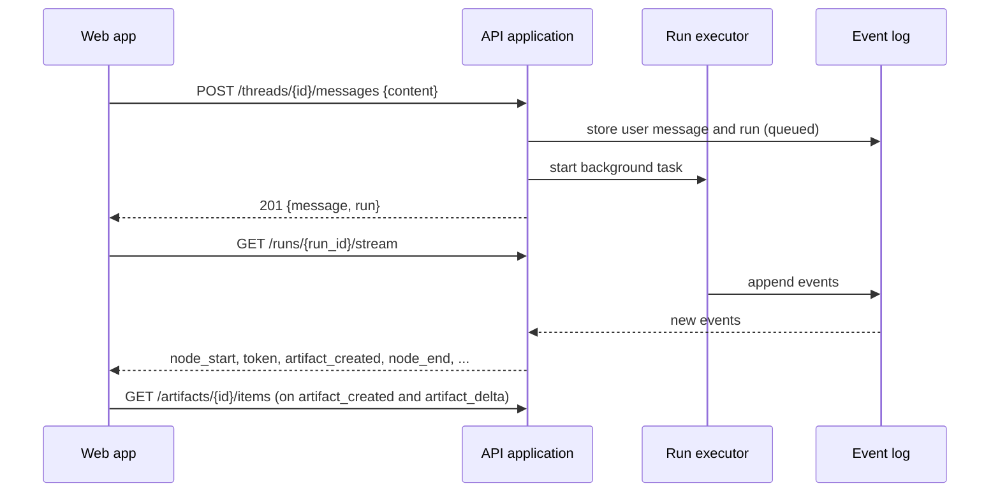
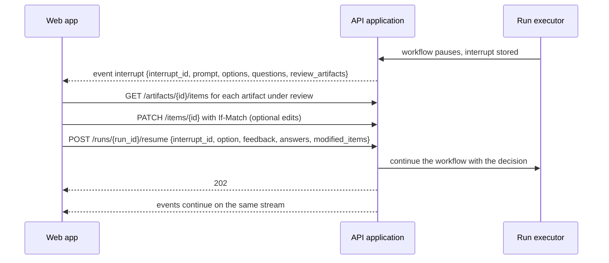

# API Design

Design of the HTTP API between the web app and the API application: conventions, resources, endpoints, the run event stream, and the main flows.

Once the backend exists, its OpenAPI schema is the single source of truth for request and response bodies. This document then keeps only what a schema cannot express: conventions, flows, and reasons.

## Contents

- [1. Method and decision drivers](#1-method-and-decision-drivers)
- [2. Context](#2-context)
- [3. Conventions](#3-conventions)
- [4. Resource map](#4-resource-map)
- [5. Endpoints](#5-endpoints)
- [6. Run event stream](#6-run-event-stream)
- [7. Main flows](#7-main-flows)
- [8. Decisions and trade-offs](#8-decisions-and-trade-offs)
- [9. Open points](#9-open-points)
- [10. Review checklist](#10-review-checklist)

---

## 1. Method and decision drivers

The API follows resource-oriented REST design: nouns as resources, standard HTTP methods and status codes, and long-running work modeled as a resource instead of a long request.

The decision drivers come from the study of how LLM agent products work, in the learning notes on LLM agent API fundamentals (kept on the study notes branch). Each driver is a property the API must have.

| # | Driver | Why | Where it shows in this API |
|---|---|---|---|
| D1 | The server holds all state | The LLM API is stateless and the browser cannot hold provider keys or run tools, so the backend plays the role a local agent process plays for a command-line agent | Every screen can be rebuilt from `GET` requests; nothing is kept only in the browser |
| D2 | A run is a resource, not a request | A workflow takes minutes and waits for a human; it must survive a closed tab, a reload and a second device | `POST` creates a run, `GET` reads or streams it |
| D3 | Events go through a durable log | Replay after reconnect, resume after hours, cost tracking and debugging all need the same ordered record | The stream endpoint reads the event log; the workflow never writes into an HTTP response |
| D4 | Server to client is a stream, client to server is plain requests | During a run nearly all data flows down; the user sends a few separate actions | One event stream per run, plus `POST` for resume and cancel |
| D5 | Agent output is structured | Free text cannot be rendered as a persona card or a requirement row, and cannot be traced | Artifacts and items are typed resources; a review request is a typed event, not a chat message |
| D6 | Usage is recorded per step | Token counts come only from the provider; cost, cache hit rate and quotas are computed by the backend from them | Usage fields on run steps and runs; a usage endpoint |
| D7 | Every client uses the same API | The web app, tests and a later command-line client must behave the same | No endpoint is specific to one screen |

## 2. Context

| Fact | Source |
|---|---|
| The web app is the only client today. It calls the API under `/api/v1` on the same origin | [Architecture: building blocks](architecture/README.md#3-building-blocks) |
| The session is an httpOnly cookie | [Planning: key decisions](PLANNING.md#3-key-decisions--rationale-to-become-adrs) |
| Runs execute as background tasks inside the API process | [Planning: agent run lifecycle](PLANNING.md#6-agent-run-lifecycle) |
| Artifacts belong to a project; a thread is a working session; a run is one execution of the workflow | [Data shape: domain overview](DATA_SHAPE.md#2-domain-overview) |
| Entities and field names | [Data shape](DATA_SHAPE.md) |

## 3. Conventions

### Base path and versioning

All endpoints live under `/api/v1`. A breaking change goes to `/api/v2`. Adding a field, an endpoint or an optional parameter is not a breaking change; clients ignore fields they do not know.

### Authentication and CSRF

| Rule | Detail |
|---|---|
| Session | httpOnly cookie, `Secure`, `SameSite=Lax`, set by the login endpoint |
| Missing or expired session | `401` on every endpoint except register, login and health |
| No access to a resource | `404`, the same as a resource that does not exist, so that ids cannot be probed |
| CSRF | Every request with a method other than `GET` or `HEAD` must carry an `Origin` header equal to the application origin; otherwise `403` |
| Stream | The stream is a `GET` and is authenticated by the same cookie |

### Requests and responses

| Topic | Rule |
|---|---|
| Body format | JSON, `snake_case` field names, UTF-8 |
| Ids | UUID strings in paths and bodies. Items also expose `key`, for display only; paths always use `id` |
| Timestamps | ISO 8601 in UTC, for example `2026-10-02T08:30:00Z` |
| Null | An optional field with no value is present with `null`, not omitted |
| Enums | Lower-case strings with the exact values in [Data shape](DATA_SHAPE.md) |
| Secrets | A field marked `server-only` in the [data shape](DATA_SHAPE.md#field-notation) never appears in a response: the password hash, the session token hash, the encrypted provider key and the id of its encryption key, and the storage keys. The session token itself is sent only in the cookie |

### Methods and status codes

| Action | Method | Success |
|---|---|---|
| Read one or a list | `GET` | `200` |
| Create | `POST` on the collection | `201` with the created resource and a `Location` header |
| Start long-running work | `POST` | `202` with the resource in its initial status |
| Partial update | `PATCH` | `200` with the updated resource |
| Replace a settings document | `PUT` | `200` |
| Delete | `DELETE` | `204` |
| Action that is not create, update or delete | `POST` on `/{resource}/{id}/{action}` | `200` or `202` |

### Lists

Every list endpoint uses cursor pagination and the same envelope.

| Part | Rule |
|---|---|
| Request | `?limit=` (default 50, maximum 200) and `?cursor=` (opaque string from the previous page) |
| Response | `{ "items": [...], "next_cursor": "..." }`; `next_cursor` is `null` on the last page |
| Order | Stated per endpoint and stable; ties are broken by `id` |
| Filters | Query parameters named after the field, for example `?kind=spec_requirement&review_status=draft`. A filter given several times matches any of its values, for example `?rollup_run_status=interrupted&rollup_run_status=failed`. A filter on a time is the name of the field with `_after` and an ISO 8601 time, and keeps the items after that time, for example `?last_activity_after=2026-10-15T00:00:00Z` |

### Errors

Errors use the Problem Details format (RFC 9457) with media type `application/problem+json`.

```json
{
  "type": "about:blank",
  "title": "Version conflict",
  "status": 409,
  "code": "version_conflict",
  "detail": "The item is at version 4; the request was based on version 3.",
  "errors": []
}
```

`code` is the stable value clients branch on. `errors` lists field problems for validation failures as `{ "field": "...", "message": "..." }`.

| Status | `code` | When |
|---|---|---|
| 400 | `invalid_request` | Malformed JSON or an unknown query parameter value |
| 401 | `unauthenticated` | No valid session |
| 403 | `forbidden` | The CSRF check failed, or the role does not allow the action |
| 404 | `not_found` | The resource does not exist or belongs to someone else |
| 409 | `run_already_active` | A retry was requested while the project has an unfinished run |
| 409 | `version_conflict` | The update was based on an old version |
| 409 | `invalid_state` | The action does not apply to the current status, for example resume on a run that is not interrupted |
| 409 | `idempotency_conflict` | The idempotency key was used before with a different body |
| 422 | `validation_failed` | A field fails validation |
| 429 | `rate_limited` | Too many requests; `Retry-After` gives the wait in seconds |
| 429 | `budget_exceeded` | The monthly budget of the user is reached; the request would start or continue LLM work |
| 502 | `provider_error` | The LLM provider failed and the fallback also failed |
| 500 | `internal_error` | Anything else |

### Concurrent edits

An artifact and an item each carry `version`. An update sends the version it was based on in the `If-Match` header; the server answers `409 version_conflict` when the stored version differs. This covers the user editing an item in two tabs and the user editing while an agent rewrites it.

### Idempotency

`POST` requests that start work, and the request that creates a project, accept an `Idempotency-Key` header: send message, resume, retry, create export, create project. Repeating a request with the same key within 24 hours returns the first response without doing the work again. This makes a retry after a network failure safe.

### Rate limits and budgets

| Limit | Scope | Response when exceeded |
|---|---|---|
| Requests per minute | Per user | `429 rate_limited` |
| Unfinished runs | One per thread | A message sent meanwhile is delivered into that run. A retry answers `409 run_already_active` while any run of the project is unfinished |
| Cost per run | `max_cost_usd` in the run configuration | The run fails with an `error` event, code `cost_limit_exceeded` |
| Cost per user per calendar month in UTC | `monthly_budget_usd` of the user | `429 budget_exceeded` on send message and resume; a run that reaches it while working fails with code `budget_exceeded` |

The budget is checked before every LLM call, not only when the run starts. A client handles both answers to a spent budget: the early `429 budget_exceeded` and a run that fails with `budget_exceeded`.

## 4. Resource map

```text
/api/v1
├── /auth                      register, login, logout
├── /me                        profile, password, sessions
│   ├── /settings
│   ├── /model-settings
│   └── /usage
├── /models                    model catalog
├── /workflow/definition       workflow definition: graph, roles, stages, checkpoint options
├── /artifact-kinds            content schemas of artifact kinds and item kinds
├── /content-schemas/{kind}/{schema_version}   one content schema at one version
├── /projects
│   └── /{project_id}
│       ├── /threads
│       ├── /artifacts
│       ├── /items
│       ├── /trace-links
│       ├── /traceability
│       └── /exports
├── /threads
│   └── /{thread_id}
│       ├── /messages
│       └── /runs
├── /runs
│   └── /{run_id}
│       ├── /steps
│       │   └── /{step_id}/state
│       ├── /state
│       ├── /stream
│       ├── /interrupts
│       ├── /directives
│       ├── /resume
│       ├── /cancel
│       └── /retry
├── /artifacts
│   └── /{artifact_id}
│       ├── /items
│       ├── /revisions
│       ├── /restore
│       └── /trace
├── /items
│   └── /{item_id}
│       ├── /move
│       ├── /revisions
│       ├── /restore
│       └── /trace
├── /trace-links/{link_id}
└── /exports/{export_id}
```

Nesting rule: a collection is nested under its parent only for listing and creating. A single resource is addressed by its own id at the top level, so that a link to it does not need the ids of its parents.

## 5. Endpoints

All paths are relative to `/api/v1`. The Phase column uses the phases of the data shape.

### Authentication and account

| Method and path | Purpose | Phase |
|---|---|---|
| `POST /auth/register` | Create an account; body `email`, `password`, `display_name` | MVP |
| `POST /auth/login` | Start a session; sets the cookie | MVP |
| `POST /auth/logout` | Revoke the current session | MVP |
| `GET /me` | The signed-in user | MVP |
| `PATCH /me` | Change `display_name`, `avatar_url`; each is optional, and a field left out keeps its value. `display_name` is a text that is not empty once trimmed, of at most 100 characters; `avatar_url` is null or an `http` or `https` address; no other field; otherwise `422 validation_failed` at the field. Returns `200` with the user | MVP |
| `POST /me/password` | Change the password; body `current_password`, `new_password`. A wrong `current_password` answers `422 validation_failed` at `current_password`; `new_password` has at least 8 characters and differs from the current password, otherwise `422` at `new_password`. Returns `204`; the session of the request stays, and every other session of the user is revoked | MVP |
| `GET /me/sessions` | The sessions of the user that are not revoked and not expired, ordered by `last_seen_at` descending. Each has the fields of [Session](DATA_SHAPE.md#session-mvp) that are not `server-only`, and `current`, true for the session of the request | MVP |
| `DELETE /me/sessions/{session_id}` | Revoke one session; `204`. Revoking the session of the request signs the user out, as `POST /auth/logout`. A session that is revoked, expired or of another user answers `404` | MVP |

Login and register answer the same way for a wrong password and an unknown email, and are rate limited per IP address.

### Settings and models

| Method and path | Purpose | Phase |
|---|---|---|
| `GET /me/settings` | The [UserSettings](DATA_SHAPE.md#usersettings-mvp) of the user, always `200`: a user who has saved none gets the defaults, `theme` `system`, `ui_language` `en`, `default_output_language` `en`, `default_run_config` with every field null, `notify_on_interrupt` and `notify_on_run_finished` true | MVP |
| `PUT /me/settings` | Replace user settings. Body: any of `theme`, `ui_language`, `default_output_language`, `default_run_config`, `notify_on_interrupt`, `notify_on_run_finished`; a field left out keeps its value. Each enum takes a value of its list and each `notify_on_` field a boolean; `default_run_config` is a whole RunDefaults with the rules of `run_config` of a project, a field left out of it being null; no other field; otherwise `422 validation_failed` at the field, such as `theme` or `default_run_config.max_steps`. Returns `200` with the settings as `GET` answers them | MVP |
| `GET /me/model-settings` | The [ModelSettings](DATA_SHAPE.md#modelsettings-mvp) of the user, one for each agent role that the user chose a model for, ordered by `agent_role`; a role without one uses the server default | MVP |
| `PUT /me/model-settings` | Replace the model settings of the user. Body `items`, a list of `agent_role`, `model_id` and an optional `temperature`; a role left out uses the server default. Each `agent_role` is an agent role of the current workflow definition, given once; each `model_id` is a model of the catalog whose `allowed_roles` holds the role; `temperature` is null or a number from 0 to 1; otherwise `422 validation_failed` at `items.<index>.agent_role`, `items.<index>.model_id` or `items.<index>.temperature`. Returns `200` with the settings as `GET` lists them | MVP |
| `GET /models` | Model catalog: allowed models, capabilities, prices, ordered by `model_id` | MVP |
| `GET /me/usage` | Tokens and cost of the user in one calendar month in UTC, `?month=YYYY-MM`, the current month by default: the total, the budget of the month, and, with `?group_by=` one of `day`, `project`, `agent_role`, `model`, the groups. See the example below | MVP |
| `GET /workflow/definition` | One version of the workflow definition, see [workflow definition](#workflow-definition). `?version=` reads an older version, so a past run is shown with the definition it ran with | MVP |

Usage of the current month, `GET /me/usage?group_by=project`:

```json
{
  "month": "2026-10",
  "budget_usd": 20.0,
  "total": { "input_tokens": 412000, "output_tokens": 61000, "cache_read_tokens": 180000, "cache_write_tokens": 24000, "cost_usd": 3.07, "duration_ms": 1650000 },
  "groups": [
    { "key": "90aa...", "usage": { "input_tokens": 395000, "output_tokens": 58000, "cache_read_tokens": 176000, "cache_write_tokens": 23000, "cost_usd": 3.01, "duration_ms": 1580000 } },
    { "key": "7c41...", "usage": { "input_tokens": 17000, "output_tokens": 3000, "cache_read_tokens": 4000, "cache_write_tokens": 1000, "cost_usd": 0.06, "duration_ms": 70000 } }
  ]
}
```

- `budget_usd` is the budget that applies to the month: `monthly_budget_usd` of the user, or the server default when it is null. It is null when the month has no limit.
- `total` and each `usage` are a [Usage](DATA_SHAPE.md#run-mvp); `groups` is empty without `group_by`, and `key` is the id, the day (`YYYY-MM-DD`), the role or the model of the group.
- The usage of a step counts in the month and the day, in UTC, of its `started_at`. `groups` has one entry for each key with usage in the month: by `key` for `day`, by `cost_usd` descending for the others, ties broken by `key`. A step without an agent role or a model calls no LLM and is in no group of `agent_role` or `model`, so the groups add up to the tokens and the cost of `total`, and only `total` holds its time.
- A `month` that is not `YYYY-MM`, or a `group_by` out of its list, answers `400 invalid_request`. A month without usage, such as a month to come, answers `total` at zero and no groups.

### Workflow definition

`GET /workflow/definition` returns one version of the workflow definition: the graph, the names a run may store, the checkpoints with their options and questions, and the schemas of the run parameters and of the workflow state. The web app draws the graph, the stages, the reviews and the run settings from it, and the backend checks every name a run stores against it.

The response is a definition file as described in [Workflow definitions](workflow/README.md), valid against [`definition.schema.json`](workflow/definition.schema.json). Version 1 is written out in full in [`requirements_engineering.v1.json`](workflow/requirements_engineering.v1.json). An excerpt, where `"...": "..."` stands for the rest of the definition:

```json
{
  "name": "requirements_engineering",
  "version": 1,
  "entry": { "first_run": "planner", "later_runs": "intent_router", "pending_messages": "intent_router" },
  "nodes": [
    { "id": "planner", "kind": "agent", "label": "planner", "stage": "planning", "agent_role": "planner" }
  ],
  "...": "..."
}
```

Rules:

- Without `?version=` the response is the current version. A run is shown with the version it ran with, `workflow_version` of the run.
- A definition version never changes once a run has used it. The response carries `Cache-Control: public, max-age=31536000, immutable` when `?version=` is given.
- A stage has a `title` for the user, an `internal` flag and a `parent`. The pages for the user show the titles of the stages that are not internal, as a tree by `parent`; the graph, with the node ids, is for the developer view.
- An item kind has an `issue` field: null, or `{ "status_field", "open_values" }` for a kind that records a problem to settle (version 1: `ambiguity_issue`, `conflict`, `validation_issue`). An item of such a kind is an open issue when the field of its content named by `status_field` holds one of `open_values`. The web app lists the open issues from it, so a kind added in the definition is listed without a client change.
- The node list has no positions. The web app lays the graph out itself, so a node added in the backend appears without a client change.

### Workflow state

`GET /runs/{run_id}/state` and `GET /runs/{run_id}/steps/{step_id}/state` return the values of the workflow state, read from the checkpoint the workflow runtime saves after every step:

```json
{
  "run_id": "5f2d...",
  "step_id": "e9d1...",
  "workflow_version": 1,
  "values": {
    "current_stage": "interviewing",
    "active_persona_index": 1,
    "interview_turn": 3,
    "iteration_count": 0,
    "personas": [
      { "item_id": "8c20...", "kind": "persona", "key": "PER-001", "version": 1 },
      { "item_id": "8c21...", "kind": "persona", "key": "PER-002", "version": 2 }
    ],
    "interview_transcripts": [
      { "artifact_id": "b1f0...", "kind": "interview_transcript", "title": "Interview with the student", "version": 7 },
      { "artifact_id": "b1f1...", "kind": "interview_transcript", "title": "Interview with the mentor", "version": 2 }
    ]
  }
}
```

- `values` follows the `state_schema` of the run's definition version, so the web app shows it as a generic tree, whatever fields an experiment adds.
- The state holds references, not copies: an artifact or an item appears as a reference with the version the step used, as in [Data shape: workflow state to entities](DATA_SHAPE.md#workflow-state-to-entities). Its content is read with `GET /artifacts/{artifact_id}?version=` or `GET /items/{item_id}?version=`, which answer also for an artifact or item deleted since.
- Provider keys and other secrets never appear in the state.
- Only members of the project can read the state of its runs.

### Projects

| Method and path | Purpose | Phase |
|---|---|---|
| `GET /projects` | Projects of the user; filters `status`, `rollup_run_status` (one or more values; `none` matches a project without a run) and `last_activity_after`; ordered by `last_activity_at` descending. Each item has `rollup_run_status`, which the project list shows; `item_counts` comes only with `GET /projects/{project_id}` | MVP |
| `POST /projects` | Create; body `name`, `description`, `output_language`. `output_language` left out takes `default_output_language` of the user settings. `name` is optional: without it, the first run names the project from its initial intent, and the event stream of that run sends `project_named`. Accepts an `Idempotency-Key`, so that a retry after a lost answer creates no second project | MVP |
| `GET /projects/{project_id}` | One project, with `item_counts`, `unfinished_run_counts` and `rollup_run_status` | MVP |
| `PATCH /projects/{project_id}` | Change name, description, status, `run_config`, `model_overrides`. Each key of `model_overrides` is an agent role of the current workflow definition and each value a model of the catalog whose `allowed_roles` holds the role; otherwise `422 validation_failed` at `model_overrides.<role>` | MVP |
| `DELETE /projects/{project_id}` | Soft delete: the project is left out of lists, and its endpoints answer `404`. A project with an unfinished run (`queued`, `running` or `interrupted`) answers `409 invalid_state`; the run is stopped first | MVP |

### Threads and messages

| Method and path | Purpose | Phase |
|---|---|---|
| `GET /projects/{project_id}/threads` | Threads of a project; ordered by `last_message_at` descending | MVP |
| `GET /threads` | Threads of the user across projects; `?project_id=`; ordered by `last_message_at` descending | MVP |
| `POST /projects/{project_id}/threads` | Create an empty thread; body optional `title`: left out or `null` leaves the thread without a title until its first message, any other value is a text with more than whitespace, else `422 validation_failed` at `title`. The first message of the thread starts the work. The message that starts the first run of the project becomes the initial intent of the project, see [Data shape: Project](DATA_SHAPE.md#project-mvp) | MVP |
| `GET /threads/{thread_id}` | One thread, with `active_run_id` and `latest_run_status` | MVP |
| `PATCH /threads/{thread_id}` | Change `title`, `status`. `title` is a text with more than whitespace and cannot be set back to `null`; `status` is `active` or `archived`; otherwise `422 validation_failed` at the field | MVP |
| `DELETE /threads/{thread_id}` | Soft delete: the thread is left out of lists, and its endpoints answer `404`. A thread with an unfinished run (`queued`, `running` or `interrupted`) answers `409 invalid_state`; the run is stopped first | MVP |
| `GET /threads/{thread_id}/messages` | Chat messages; ordered by `sequence` ascending. User messages carry `delivery` | MVP |
| `POST /threads/{thread_id}/messages` | Send a user message. Body `content`, optional `run_config` with the fields of [RunDefaults](DATA_SHAPE.md#rundefaults-mvp) and optional `models`, a map of agent role to model, both used only when the message starts a run. Each key of `models` is an agent role of the current workflow definition and each value a model of the catalog whose `allowed_roles` holds the role; otherwise `422 validation_failed` at `models.<role>`. Returns `201` with the message and the run it started or was sent to | MVP |

Sending a message is the only way the chat box starts work, and it is never rejected because the thread has an unfinished run:

- With no unfinished run, the message starts a new run with the current workflow definition version; `delivery` is `started_run`.
- With an unfinished run, the message is stored as `pending`. At the next safe point of the run, the intent router decides which node should handle it; `delivery` becomes `delivered`, and the stream sends `message_delivered`.
- The full behavior, including what happens when the run ends first, is in [Runtime: messages during a run](architecture/runtime.md#5-messages-during-a-run).

The first message of a thread:

```http
POST /api/v1/threads/7f3a.../messages
Idempotency-Key: 5c0e...
Content-Type: application/json

{ "content": "I want to build an online platform for university students to find mentors." }
```

Response `201`:

```json
{
  "message": {
    "id": "c2a1...",
    "thread_id": "7f3a...",
    "sequence": 1,
    "run_id": "3b90...",
    "author": "user",
    "agent_role": null,
    "content": "I want to build an online platform for university students to find mentors.",
    "artifact_refs": [],
    "item_refs": [],
    "delivery": "started_run",
    "delivered_in_step_id": null,
    "created_at": "2026-10-02T08:10:00Z"
  },
  "run": {
    "id": "3b90...",
    "thread_id": "7f3a...",
    "number": 1,
    "status": "queued",
    "workflow_name": "requirements_engineering",
    "workflow_version": 1,
    "current_stage": "planning",
    "last_event_id": 0
  }
}
```

`run` is the run body, shown here with only some of its fields; the full body is in [Runs](#runs). The message starts the first run of the thread, so its `number` is 1. The web app then opens `GET /api/v1/runs/3b90.../stream` to follow the run. A message sent while this run is unfinished gets the same response shape, with `delivery` `pending` and `run` being the unfinished run.

### Runs

| Method and path | Purpose | Phase |
|---|---|---|
| `GET /threads/{thread_id}/runs` | Runs of a thread; ordered by `created_at` descending | MVP |
| `GET /runs/{run_id}` | Number in the thread, status, stage, iteration, step count, usage, error, `workflow_name`, `workflow_version`, `last_event_id`. The status transitions are listed in [Runtime: lifecycle](architecture/runtime.md#3-lifecycle) | MVP |
| `GET /runs/{run_id}/steps` | Run steps; ordered by `sequence` | MVP |
| `GET /runs/{run_id}/state` | The current workflow state of the run, see [workflow state](#workflow-state) | MVP |
| `GET /runs/{run_id}/steps/{step_id}/state` | The workflow state saved after that step; the starting point of a retry from the next step | MVP |
| `GET /runs/{run_id}/stream` | Event stream, see [section 6](#6-run-event-stream) | MVP |
| `GET /runs/{run_id}/interrupts` | Interrupts of the run, each with its prompt, options, questions and artifacts under review, and the decision that resolved it, including those resolved at once with the defaults because their checkpoint is not in `review_checkpoints`; `?status=pending` gives the one the user must answer | MVP |
| `GET /runs/{run_id}/directives` | Directives of the run with their items, ordered by `iteration`; explains why the run looped | MVP |
| `POST /runs/{run_id}/resume` | Answer the pending interrupt, see below | MVP |
| `POST /runs/{run_id}/cancel` | Stop the run. The open call to the LLM provider is closed. `202` | MVP |
| `POST /runs/{run_id}/retry` | Create a new run that starts from a step of this run; body `from_step_id`. The new run resolves its RunConfig when it starts, see [Data Shape: RunDefaults](DATA_SHAPE.md#rundefaults-mvp). Before it starts, the artifacts, items and trace links of the project are brought back to the versions that the state of that step references, see [Runtime: retry](architecture/runtime.md#retry). Returns the new run | MVP |

Run body, `GET /runs/5f2d...`, while the run waits at the analysis review. It is the third run of the thread: the first run went through the whole workflow, the second failed at its cost limit, and this run retries the second from its planner step, so its steps start again at the planner. `models` is shortened to two of the roles:

```json
{
  "id": "5f2d...",
  "thread_id": "7f3a...",
  "project_id": "90aa...",
  "number": 3,
  "started_by": "11b7...",
  "workflow_name": "requirements_engineering",
  "workflow_version": 1,
  "status": "interrupted",
  "current_stage": "analysis_review",
  "iteration_count": 0,
  "run_config": {
    "models": { "planner": "anthropic:claude-sonnet-5", "interviewer": "openai:gpt-4.1-mini" },
    "review_checkpoints": ["checkpoint_personas", "checkpoint_analysis", "checkpoint_spec"],
    "output_language": "en",
    "max_steps": 80,
    "max_cost_usd": 2.0,
    "parameters": { "target_personas_num": 3, "max_personas": 3, "max_turns": 12, "max_iterations": 2 }
  },
  "retry_of_run_id": "4c18...",
  "error": null,
  "usage": { "input_tokens": 48210, "output_tokens": 9930, "cache_read_tokens": 31500, "cache_write_tokens": 6200, "cost_usd": 0.42, "duration_ms": 214000 },
  "trace_id": "b81c...",
  "step_count": 67,
  "last_event_id": 246,
  "started_at": "2026-10-06T08:30:01Z",
  "finished_at": null
}
```

Steps of a run, `GET /runs/5f2d.../steps`, ordered by `sequence`. The example shows the first four steps; a step that calls no LLM has `agent_role` and `model_id` null and zero usage:

```json
{
  "items": [
    {
      "id": "e1a0...", "run_id": "5f2d...", "sequence": 1,
      "node": "planner", "agent_role": "planner", "stage": "planning", "status": "succeeded", "iteration": 0,
      "subject_item_id": null, "model_id": "anthropic:claude-sonnet-5", "llm_calls": 1,
      "usage": { "input_tokens": 1820, "output_tokens": 640, "cache_read_tokens": 0, "cache_write_tokens": 0, "cost_usd": 0.015, "duration_ms": 9400 },
      "produced": [], "error": null,
      "started_at": "2026-10-06T08:30:01Z", "finished_at": "2026-10-06T08:30:10Z"
    },
    {
      "id": "e1a1...", "run_id": "5f2d...", "sequence": 2,
      "node": "persona_generator", "agent_role": "persona_generator", "stage": "persona_generation", "status": "succeeded", "iteration": 0,
      "subject_item_id": null, "model_id": "anthropic:claude-sonnet-5", "llm_calls": 1,
      "usage": { "input_tokens": 2400, "output_tokens": 1500, "cache_read_tokens": 0, "cache_write_tokens": 0, "cost_usd": 0.03, "duration_ms": 18200 },
      "produced": [
        { "item_id": "8c20...", "kind": "persona", "key": "PER-001", "version": 1 },
        { "item_id": "8c21...", "kind": "persona", "key": "PER-002", "version": 1 }
      ],
      "error": null,
      "started_at": "2026-10-06T08:30:10Z", "finished_at": "2026-10-06T08:30:28Z"
    },
    {
      "id": "e1a2...", "run_id": "5f2d...", "sequence": 3,
      "node": "checkpoint_personas", "agent_role": null, "stage": "persona_review", "status": "succeeded", "iteration": 0,
      "subject_item_id": null, "model_id": null, "llm_calls": 0,
      "usage": { "input_tokens": 0, "output_tokens": 0, "cache_read_tokens": 0, "cache_write_tokens": 0, "cost_usd": 0, "duration_ms": 95000 },
      "produced": [], "error": null,
      "started_at": "2026-10-06T08:30:28Z", "finished_at": "2026-10-06T08:32:03Z"
    },
    {
      "id": "e1a3...", "run_id": "5f2d...", "sequence": 4,
      "node": "interviewer", "agent_role": "interviewer", "stage": "interviewing", "status": "succeeded", "iteration": 0,
      "subject_item_id": "8c20...", "model_id": "openai:gpt-4.1-mini", "llm_calls": 1,
      "usage": { "input_tokens": 1100, "output_tokens": 120, "cache_read_tokens": 900, "cache_write_tokens": 0, "cost_usd": 0.001, "duration_ms": 2100 },
      "produced": [{ "item_id": "9d01...", "kind": "interview_message", "key": "PER-001#1", "version": 1 }],
      "error": null,
      "started_at": "2026-10-06T08:32:03Z", "finished_at": "2026-10-06T08:32:05Z"
    }
  ],
  "next_cursor": "eyJzIjo0fQ"
}
```

Directives of a run, `GET /runs/5f2d.../directives`, ordered by `iteration`. The first was issued by the decision of the user at a checkpoint, the second by a step; each `items` entry is an item reference with the `role` that the kind allows. Exactly one of `issued_by_step_id` and `human_decision_id` is set, the other is null:

```json
{
  "items": [
    {
      "id": "3b7c...", "run_id": "5f2d...", "kind": "rework",
      "issued_by_step_id": null, "human_decision_id": "a41e...",
      "target_node": "interviewer", "iteration": 1,
      "instruction": "Clarify CONF-001: would a layered design work?",
      "items": [
        { "item": { "item_id": "8c20...", "kind": "persona", "key": "PER-001", "version": 1 }, "role": "addressed_to" },
        { "item": { "item_id": "7e11...", "kind": "conflict", "key": "CONF-001", "version": 2 }, "role": "about" }
      ],
      "details": {},
      "created_at": "2026-10-06T08:41:12Z"
    },
    {
      "id": "3b7d...", "run_id": "5f2d...", "kind": "intent",
      "issued_by_step_id": "e1b4...", "human_decision_id": null,
      "target_node": "analyst", "iteration": 2,
      "instruction": "Check the login requirement again.",
      "items": [
        { "item": { "item_id": "6d02...", "kind": "analyzed_requirement", "key": "REQ-004", "version": 1 }, "role": "about" }
      ],
      "details": {},
      "created_at": "2026-10-06T08:55:40Z"
    }
  ],
  "next_cursor": null
}
```

The pending interrupt, `GET /runs/5f2d.../interrupts?status=pending`. The `interrupt` event carries the same fields, with `interrupt_id` for `id`, and without `status`, `created_at`, `resolved_at` and `decision`, since it is sent while the interrupt is pending:

```json
{
  "items": [
    {
      "id": "7b0c...",
      "run_id": "5f2d...",
      "step_id": "e9d2...",
      "node": "checkpoint_analysis",
      "prompt": "Review the requirements analysis. Accept it, or reject it with feedback.",
      "options": [
        { "key": "accept", "label": "Accept", "requires_feedback": false, "approves": true, "is_default": true },
        { "key": "reject_reanalyse", "label": "Reject and re-analyse", "requires_feedback": true, "approves": false, "is_default": false },
        { "key": "reject_reinterview", "label": "Reject and re-interview", "requires_feedback": true, "approves": false, "is_default": false }
      ],
      "questions": [],
      "allow_edits": true,
      "review_artifacts": [
        { "artifact_id": "b210...", "kind": "requirements_analysis", "title": "Requirements analysis", "version": 4 }
      ],
      "status": "pending",
      "created_at": "2026-10-06T08:41:12Z",
      "resolved_at": null,
      "decision": null
    }
  ],
  "next_cursor": null
}
```

A resolved interrupt gives its `decision`, the [HumanDecision](DATA_SHAPE.md#humandecision-mvp) that resolved it: `option`, `feedback`, `answers`, `decided_by` (null when the run took the defaults because its checkpoint is not in `review_checkpoints`) and `decided_at`. It is null while the interrupt is pending and for a cancelled one. The persona review of the same run, answered by the user, in `GET /runs/5f2d.../interrupts`:

```json
{
  "id": "6a1f...",
  "run_id": "5f2d...",
  "step_id": "e1a2...",
  "node": "checkpoint_personas",
  "prompt": "Review the personas. Edit them if needed, then approve them.",
  "options": [
    { "key": "approve", "label": "Approve the interviewees", "requires_feedback": false, "approves": true, "is_default": true }
  ],
  "questions": [],
  "allow_edits": true,
  "review_artifacts": [
    { "artifact_id": "b1e0...", "kind": "persona_catalog", "title": "Interviewees", "version": 1 }
  ],
  "status": "resolved",
  "created_at": "2026-10-06T08:30:28Z",
  "resolved_at": "2026-10-06T08:32:03Z",
  "decision": {
    "option": "approve",
    "feedback": null,
    "answers": {},
    "decided_by": "11b7...",
    "decided_at": "2026-10-06T08:32:03Z"
  }
}
```

Resume body:

```json
{
  "interrupt_id": "7b0c...",
  "option": "reject_reinterview",
  "feedback": "Ask the student and the admin whether a layered design works for both.",
  "answers": {},
  "modified_items": [{ "item_id": "d3f9...", "version": 2 }]
}
```

This answers the pending interrupt above: the user corrected the analyzed requirement `AR-007` (`d3f9...`) before answering.

Resume rules:

- The user edits items through the item endpoints first. The resume body only lists which items were edited and at which version; it does not carry content.
- `option` is the key of one of the options of the interrupt; the set of options comes from the workflow definition, so the API does not change when a checkpoint gains or loses an option. An unknown key answers `422 validation_failed`.
- `feedback` is required when the chosen option requires it.
- `answers` has one entry per answered question, by question key, in the shape of `Answer` in the [data shape](DATA_SHAPE.md#humandecision-mvp). Every required question is answered, every choice is a choice of its question, and `text` is present when a chosen choice requires it; otherwise `422 validation_failed` with the question key in the field path.
- `modified_items` is accepted only when the interrupt allows edits.
- When the chosen option approves, the artifacts under review and their items that are still `draft` become `approved`, each as a new version with `change_reason` `reviewed`.
- When the chosen option does not approve, nothing is approved: the items listed in `modified_items` keep the versions the user saved, and the agents read them together with `feedback` before they write again.
- The server stores a human decision, marks the interrupt resolved, gives the decision as `decision` of the interrupt, and continues the run. The response is `202` with the run.

An interrupt can ask several questions of different types and is answered at once. The checkpoints of definition version 1 ask none; the example comes from a checkpoint that clarifies the intent of a project, see [Runtime: open points](architecture/runtime.md#8-open-points):

```json
{
  "id": "8c1d...",
  "step_id": "e1b4...",
  "node": "clarify_intent",
  "prompt": "Before I plan the interviews, tell me who will use the platform and what the first version must take care of.",
  "options": [],
  "questions": [
    {
      "key": "users", "type": "multi_select", "prompt": "Who uses the platform in their day, so the interviews ask the right people?", "required": true,
      "choices": [
        { "key": "students", "label": "Students", "requires_text": false },
        { "key": "mentors", "label": "Mentors", "requires_text": false },
        { "key": "other", "label": "Someone else, please specify", "requires_text": true }
      ],
      "min_selected": 1, "max_selected": null,
      "default_answer": { "choice_keys": ["students", "mentors"], "text": null, "number": null },
      "source": "agent"
    },
    {
      "key": "payments", "type": "single_select", "prompt": "Should the first version already take payments, or is a free pilot enough?", "required": true,
      "choices": [
        { "key": "yes", "label": "Yes", "requires_text": false },
        { "key": "no", "label": "No", "requires_text": false }
      ],
      "min_selected": null, "max_selected": null,
      "default_answer": { "choice_keys": ["no"], "text": null, "number": null },
      "source": "agent"
    },
    {
      "key": "sessions_per_week", "type": "number", "prompt": "How many sessions should a mentor offer each week, at most?", "required": false,
      "choices": [],
      "min_selected": null, "max_selected": null,
      "default_answer": { "choice_keys": [], "text": null, "number": 2 },
      "source": "agent"
    }
  ]
}
```

The answers in the resume body; the user picked "Someone else", so the text explains it:

```json
{
  "interrupt_id": "8c1d...",
  "option": null,
  "feedback": null,
  "answers": {
    "users": { "choice_keys": ["students", "other"], "text": "Alumni who want to mentor", "number": null },
    "payments": { "choice_keys": ["no"], "text": null, "number": null },
    "sessions_per_week": { "choice_keys": [], "text": null, "number": 3 }
  },
  "modified_items": []
}
```
- Resume on an interrupt that is already resolved answers `409 invalid_state`.

### Artifacts and items

The output of the workflow has two levels, each with its own endpoints: an artifact is a work product such as the requirement specification, and an item is one entry inside it such as the requirement `REQ-001`. One set of endpoints per level serves all kinds. Fixed fields are at the top level of the body and the fields of the kind are under `content`.

Artifact body:

```json
{
  "id": "a7f3...",
  "kind": "requirement_specification",
  "project_id": "90aa...",
  "title": "Requirement specification",
  "summary": "12 functional and 4 non-functional requirements for the mentoring platform.",
  "schema_version": 1,
  "content": {
    "purpose": "Help university students find and book mentors.",
    "scope": "Mentor discovery, booking and feedback.",
    "out_of_scope": ["Payments"],
    "definitions": [{ "term": "Mentor", "definition": "A verified volunteer who offers sessions." }]
  },
  "subject_item_id": null,
  "version": 9,
  "review_status": "draft",
  "item_count": 16,
  "created_by": { "actor": "agent", "agent_role": "requirement_engineer", "user_id": null, "run_id": "3b90...", "step_id": "e7c0..." },
  "updated_by": { "actor": "user", "agent_role": null, "user_id": "11b7...", "run_id": null, "step_id": null },
  "created_at": "2026-10-02T08:30:00Z",
  "updated_at": "2026-10-02T09:02:11Z"
}
```

Item body:

```json
{
  "id": "c41e...",
  "artifact_id": "a7f3...",
  "project_id": "90aa...",
  "key": "REQ-001",
  "kind": "spec_requirement",
  "parent_item_id": "5b1d...",
  "position": 1,
  "outline_number": "3.1.1",
  "schema_version": 1,
  "version": 3,
  "review_status": "draft",
  "created_by": { "actor": "agent", "agent_role": "requirement_engineer", "user_id": null, "run_id": "3b90...", "step_id": "e7c0..." },
  "updated_by": { "actor": "user", "agent_role": null, "user_id": "11b7...", "run_id": null, "step_id": null },
  "created_at": "2026-10-02T08:30:00Z",
  "updated_at": "2026-10-02T09:02:11Z",
  "content": {
    "title": "Search mentors",
    "statement": "The system shall let a student search mentors by field of study.",
    "type": "functional",
    "quality_category": null,
    "priority": "must",
    "rationale": "Students named finding a mentor in their field as their main problem.",
    "acceptance_criteria": ["Searching by a field of study lists only mentors of that field"],
    "fit_criterion": null,
    "verification_method": "test"
  }
}
```

Items of an artifact, `GET /artifacts/a7f3.../items?limit=3`, in outline order. Each entry is the item body above with `depth` added, which is 1 at the top level. The example leaves out the fields that every entry repeats (`artifact_id`, `schema_version`, `version`, `review_status`, `created_by`, `updated_by`, the timestamps), and keeps only the title in the content of `REQ-001`:

```json
{
  "items": [
    {
      "id": "3e70...", "key": "SEC-004", "kind": "section", "parent_item_id": null, "position": 3,
      "outline_number": "3", "depth": 1,
      "content": { "title": "Functional requirements", "introduction": null }
    },
    {
      "id": "5b1d...", "key": "SEC-005", "kind": "section", "parent_item_id": "3e70...", "position": 1,
      "outline_number": "3.1", "depth": 2,
      "content": { "title": "Mentor discovery", "introduction": "How a student finds a mentor." }
    },
    {
      "id": "c41e...", "key": "REQ-001", "kind": "spec_requirement", "parent_item_id": "5b1d...", "position": 1,
      "outline_number": "3.1.1", "depth": 3,
      "content": { "title": "Search mentors" }
    }
  ],
  "next_cursor": "eyJrIjoiMy4xLjEifQ"
}
```

Kinds and their schemas, `GET /artifact-kinds`. The display name of a kind is the `title` of its schema, and the key prefix of an item kind is `x-key-prefix`. The example shows one artifact kind with two of its item kinds, and shortens `properties` and `required` of the `spec_requirement` schema to three fields; `"...": "..."` stands for the rest of a schema. The full schemas are the files in [Content schemas](schemas/README.md):

```json
{
  "workflow_version": 1,
  "artifact_kinds": [
    {
      "kind": "requirement_specification",
      "schema_version": 1,
      "schema": { "title": "Requirement specification", "x-ui-display": "document", "...": "..." },
      "item_kinds": [
        {
          "kind": "section",
          "schema_version": 1,
          "schema": { "title": "Section", "x-key-prefix": "SEC", "x-ui-display": "heading", "...": "..." }
        },
        {
          "kind": "spec_requirement",
          "schema_version": 1,
          "schema": {
            "title": "Requirement",
            "x-key-prefix": "REQ",
            "x-ui-display": "table",
            "x-ui-navigable": true,
            "x-ui-title-field": "title",
            "x-ui-list-fields": ["title", "type", "priority", "verification_method"],
            "x-ui-field-order": ["title", "statement", "type", "quality_category", "priority", "rationale", "acceptance_criteria", "fit_criterion", "verification_method"],
            "type": "object",
            "additionalProperties": false,
            "properties": {
              "title": { "type": "string", "description": "Short name, for example \"Search mentors\".", "x-ui-widget": "text" },
              "type": { "type": "string", "enum": ["functional", "non_functional", "constraint"], "x-ui-widget": "select" },
              "fit_criterion": { "type": ["string", "null"], "description": "Measurable threshold. Required when type is non_functional, null otherwise.", "x-ui-widget": "textarea" }
            },
            "required": ["title", "type", "fit_criterion"]
          }
        }
      ]
    }
  ]
}
```

| Method and path | Purpose | Phase |
|---|---|---|
| `GET /artifact-kinds` | The artifact kinds and, inside each, its item kinds, each with the content schema version and the JSON Schema that the current workflow definition version uses. `?workflow_version=` reads them for another definition version. The schemas are the ones in [Content schemas](schemas/README.md), with the `enum` of every value list filled in from that definition version | MVP |
| `GET /content-schemas/{kind}/{schema_version}` | The content schema of one artifact kind or item kind at one version; a kind name is unique across both levels. Used to show an artifact or an item stored with an older version. Never changes, so it carries the same `Cache-Control` as a definition version | MVP |
| `GET /projects/{project_id}/artifacts` | Artifacts of a project; filters `kind`, `review_status`; ordered by the stage that produces the kind | MVP |
| `GET /artifacts/{artifact_id}` | One artifact; `?version=` reads any version, also of a deleted artifact, which answers `404` without `?version=` | MVP |
| `PATCH /artifacts/{artifact_id}` | Change `title`, `summary`, `content` or `review_status`; requires `If-Match` | MVP |
| `GET /artifacts/{artifact_id}/revisions` | Version history of the artifact; ordered by `version` descending. Each entry has `version`, `change_reason`, `changed_by`, `created_at` and `content`, the content of the artifact at that version | MVP |
| `POST /artifacts/{artifact_id}/restore` | Make an old version of the artifact and of its items current again; body `version`. Creates new versions and answers the artifact | MVP |
| `GET /artifacts/{artifact_id}/items` | Items of the artifact in outline order (a section, then what it contains); each item carries `outline_number` and `depth`. `?shape=tree` nests children under their parent instead. Filters `kind`, `review_status`, `parent_item_id`. `?version=` gives the items as they were at that version of the artifact | MVP |
| `POST /artifacts/{artifact_id}/items` | Create an item or a section by hand; body `kind`, `content`, optional `parent_item_id`. The server assigns the key and puts the item last under its parent. Answers `201` with the item | MVP |
| `POST /artifacts/{artifact_id}/items/reorder` | Change the order of the items under one parent; body `parent_item_id` (null for the top level) and `ids`, every item under that parent once in the new order, otherwise `422 validation_failed`. Answers `204` | MVP |
| `POST /items/{item_id}/move` | Move an item, with everything inside it, under another parent of the same artifact; body `parent_item_id`, `position`. A move that breaks a tree rule answers `422 validation_failed`. Answers the moved item | MVP |
| `GET /projects/{project_id}/items` | Items across all artifacts of a project; filters `kind`, `review_status`, `run_id` (created or changed by that run), `q` (text search in key and content); ordered by `key` | MVP |
| `GET /items/{item_id}` | One item; `?version=` reads any version, also of a deleted item, which answers `404` without `?version=` | MVP |
| `PATCH /items/{item_id}` | Change `content` fields or `review_status`; requires `If-Match` | MVP |
| `DELETE /items/{item_id}` | Soft delete: the item gets a new version with change reason `deleted` and is left out of lists; its versions stay readable with `?version=`, and trace links to it stay readable. Deleting a section that still contains items answers `409 invalid_state`. Answers `204` | MVP |
| `GET /items/{item_id}/revisions` | Version history of the item; ordered by `version` descending. Each entry has the fields of an entry of the history of an artifact | MVP |
| `POST /items/{item_id}/restore` | Make an old version current again; body `version`. Creates a new version and answers the item; it also brings back an item that was deleted | MVP |

Artifacts are created by the workflow, one per kind as listed in the data shape; there is no endpoint to create or delete one by hand.

Content rules:

- `content` is validated against the content schema of the kind. A failure answers `422 validation_failed` with the field paths.
- A field marked `x-value-from` in its schema takes only values from the named artifact of the project, for example the stakeholder type of a persona from the stakeholder types of the elicitation plan; another value answers `422 validation_failed`. The schemas served by `GET /artifact-kinds` keep the keyword, and the client reads the allowed values from that artifact.
- `content` never holds the id of an item. Relations between items are created through the trace link endpoints.
- The client renders and edits an artifact and its items from the schemas returned by `GET /artifact-kinds`, and an artifact or item stored with an older schema version from `GET /content-schemas/{kind}/{schema_version}`, so a field added to a schema appears in the client with no client change. A kind can still have its own component where a generic form is not enough, for example a persona card or an interview transcript.

Editing rule: the user changes an artifact or its items only while the run of the project waits for a review that takes changes: the run is `interrupted`, and its pending interrupt has `allow_edits: true` and lists the artifact in `review_artifacts`. Every other change (`PATCH`, create, delete, move, reorder and restore) answers `409 invalid_state`: while a run is `running`, while the pending interrupt does not allow edits or does not list the artifact, and when the thread has no active run.

### Traceability

| Method and path | Purpose | Phase |
|---|---|---|
| `GET /items/{item_id}/trace` | The chain of one item; `?direction=` with one of `backward`, `forward`, `both` (default `both`): `backward` follows the links from their source to their target (where the item came from), `forward` from their target to their source (what was built from it); `?depth=` (default 5). Returns `items` and `links`, see [Trace body](#trace-body) | MVP |
| `GET /artifacts/{artifact_id}/trace` | The chains of all the items of one artifact, from the interview to the backlog, in one answer; same `?direction=` and `?depth=`, with `depth` defaulting to no limit. Returns `items` and `links`, see [Trace body](#trace-body) | MVP |
| `GET /projects/{project_id}/trace-links` | Current links, without the removed ones; filters `link_type`, `source_item_id`, `target_item_id` | MVP |
| `POST /projects/{project_id}/trace-links` | Create a link by hand; body `source_item_id`, `target_item_id`, `link_type`, `note`, `source_quote`, `target_quote` (both optional). The pair of item kinds must be allowed for the link type, and the quotes must follow the [quote rules](#quote-rules), otherwise `422 validation_failed` | MVP |
| `DELETE /trace-links/{link_id}` | Remove a link. The link keeps its row with `deleted_at` set, so the links of an earlier step can be shown again; lists and trace views leave it out | MVP |
| `GET /projects/{project_id}/traceability/matrix` | Rows of `derived_from` chains from backlog item down to raw requirement, see [Matrix body](#matrix-body) | MVP |
| `GET /projects/{project_id}/traceability/coverage` | Lists: requirements with no backlog item, requirements with no source, items that need review after a source changed, see [Coverage body](#coverage-body) | MVP |

#### Trace body

`GET /items/{item_id}/trace` and `GET /artifacts/{artifact_id}/trace` answer the same body: the items found, and the current links between them. Removed links are left out. An item is listed once, however many chains reach it. For an artifact, the starting points are all its items, and the answer holds every item that a chain reaches in the chosen direction, also in other artifacts. A link has the fields of a trace link; an item has the fields below.

```json
{
  "items": [
    {
      "id": "0b4d...",
      "artifact_id": "7c1e...",
      "key": "REQ-004",
      "kind": "spec_requirement",
      "version": 3,
      "review_status": "approved",
      "content": { "title": "Search mentors" }
    }
  ],
  "links": [
    {
      "id": "d92a...",
      "source_item_id": "0b4d...",
      "target_item_id": "5f20...",
      "link_type": "derived_from",
      "target_version": 2,
      "source_quote": null,
      "target_quote": null,
      "note": null
    }
  ]
}
```

Both lists are in full, not paged: the answer for an artifact is bounded by the items of one project. `source_item_id` and `target_item_id` of every link are the `id` of an entry of `items`; a link whose other end is beyond `depth` is left out. The order is by `key` for items and by `id` for links. `404 not_found` for an item or an artifact that does not exist.

#### Quote rules

A link may quote the words that it is about, on each side: `target_quote` holds words of the target item, such as the exact words of an interview message for `evidenced_by`, and `source_quote` holds words of the source item, such as the part of a requirement that comes from the item it is based on. Each is null when the link is about the whole item. A link reads from its source to its target through the title of its link type ("REQ-001 Based on AR-001").

- `quotes` of the link type in the workflow definition says which side may hold words (`quotes.source`, `quotes.target`); a quote on a side that the link type does not allow answers `422 validation_failed` at that field. In definition version 1, `evidenced_by`, `resolved_by`, `concerns` and `flags` may quote their target, `derived_from` both sides, and the other link types neither.
- A quote is one run of words of at most 300 characters, found word for word in one `text` or `textarea` field of its item: the target at `target_version`, the source at its version when the link is made. Otherwise `422 validation_failed` at that field.
- A link has at most one quote per side, since a source, a target and a link type make one link.
- The server never rewrites a quote. When the item changes later, its words may no longer be in it; the client then shows the quote without marking it.

#### Matrix body

The columns come from the server, so a kind that the workflow definition adds appears with no client change. Each column names the item kinds it holds, ordered from the backlog down to the interview. Each row is one `derived_from` chain; a cell holds the items of that column in the chain, and is an empty list where the chain has none.

```json
{
  "columns": [
    { "key": "backlog", "title": "Backlog", "kinds": ["backlog_item"] },
    { "key": "source", "title": "Source", "kinds": ["raw_requirement", "latent_need"] }
  ],
  "rows": [
    {
      "cells": {
        "backlog": [{ "item_id": "9a1c...", "key": "US-012", "kind": "backlog_item", "title": "Search mentors by skill" }],
        "source": [{ "item_id": "5f20...", "key": "RAW-004", "kind": "raw_requirement", "title": "Find a mentor" }]
      }
    }
  ]
}
```

`title` of an item is the title field that the content schema of its kind names. A row has an entry for every `key` of `columns`.

#### Coverage body

Each gap is one list of items that need attention, with its own title and a sentence that says why. The keys of version 1 are `no_backlog_item` (specified requirements with no incoming `derived_from`), `no_source` (specified or analyzed requirements with no outgoing `derived_from`) and `needs_review` (items whose link to a target has an older `target_version` than the target now, or whose target is `superseded`). A gap with no items is still listed.

```json
{
  "gaps": [
    {
      "key": "no_backlog_item",
      "title": "No backlog item",
      "description": "Specified requirements that no backlog item was derived from.",
      "items": [{ "item_id": "0b4d...", "key": "REQ-004", "kind": "spec_requirement", "title": "Search mentors" }]
    }
  ]
}
```

### Exports

| Method and path | Purpose | Phase |
|---|---|---|
| `POST /projects/{project_id}/exports` | Request a document; body `template`, `format`. The template is one of the export templates of the current workflow definition version, and the format one of its formats, otherwise `422 validation_failed`. `202` | MVP |
| `GET /projects/{project_id}/exports` | Exports of a project; ordered by `created_at` descending | MVP |
| `GET /exports/{export_id}` | Status; when `ready`, includes `download_url`, valid for a limited time | MVP |

### Later phase

| Method and path | Purpose |
|---|---|
| `GET`, `POST /projects/{project_id}/members`; `PATCH`, `DELETE /projects/{project_id}/members/{user_id}` | Share a project |
| `GET`, `POST /projects/{project_id}/documents`; `GET`, `DELETE /documents/{document_id}` | Upload source documents. A changed document is uploaded as a new version, with the `first_version_id` of the document; the server gives it the next version number. A version is never edited in place |
| `GET`, `POST /artifacts/{artifact_id}/comments`; `GET`, `POST /items/{item_id}/comments`; `PATCH`, `DELETE /comments/{comment_id}` | Comment on an artifact or on one item |
| `GET /projects/{project_id}/activity` | Activity feed |
| `GET /me/notifications`; `POST /me/notifications/{notification_id}/read` | Notifications |
| `GET /projects/{project_id}/stream` | Event stream of the runs of a project, for a screen that shows the status of the whole project, see [open point 8](#9-open-points) |
| `GET`, `POST /me/provider-credentials`; `DELETE /me/provider-credentials/{credential_id}` | User-supplied provider keys |

### Operations

| Method and path | Purpose |
|---|---|
| `GET /health` | The process is up. No authentication |
| `GET /ready` | The process can reach the database and the object storage. No authentication |

These two are outside `/api/v1`.

## 6. Run event stream

### Transport

`GET /api/v1/runs/{run_id}/stream` answers with Server-Sent Events.

| Property | Rule |
|---|---|
| Client | The browser `EventSource`; the session cookie is sent automatically |
| Response headers | `Content-Type: text/event-stream`, `Cache-Control: no-cache`, `X-Accel-Buffering: no` |
| Event id | The `sequence` of the event in the run event log, increasing by one |
| Reconnect | The client sends `Last-Event-ID`; the server first replays every stored event with a higher sequence, then continues live. `?after=` does the same for a client that cannot set the header. When a request has both, `Last-Event-ID` wins: `EventSource` reconnects by itself to the address it opened, `?after=` included, with the last event it read in the header, so `?after=` would send again the events it has |
| First connect | Without `Last-Event-ID`, the stream starts from the first event of the run |
| Heartbeat | A comment line `: ping` every 15 seconds when no event was sent |
| End | After the `done` event the server closes the stream. A run that already finished replays its events and closes |
| Interrupted run | The stream stays open with heartbeats until the run resumes or is cancelled |
| Several clients | Any number of streams can read the same run; each has its own position |

The stream to the browser and the call to the LLM provider are two separate connections. Closing the browser stream does not stop the run. Cancelling the run closes the provider call.

### Event format

The last events of the run in the run body example: the analyst finishes, then the analysis review pauses the run. Every event has an `id`, a type after `event:`, and a JSON payload after `data:`; a line that starts with `:` is a heartbeat.

```text
id: 241
event: node_start
data: {"node":"analyst","step_id":"e9d1...","agent_role":"analyst","stage":"analysis","iteration":0,"persona_key":null}

id: 242
event: token
data: {"node":"analyst","step_id":"e9d1...","text":"Grouping the raw requirements by topic. "}

id: 243
event: artifact_delta
data: {"artifact_id":"b210...","delta":"AR-007 created","version":4,"item_id":"d3f9...","item_key":"AR-007","change":"item_created"}

id: 244
event: node_end
data: {"node":"analyst","step_id":"e9d1...","status":"succeeded","usage":{"input_tokens":6100,"output_tokens":2300,"cache_read_tokens":4800,"cache_write_tokens":0,"cost_usd":0.05,"duration_ms":31000}}

id: 245
event: node_start
data: {"node":"checkpoint_analysis","step_id":"e9d2...","agent_role":null,"stage":"analysis_review","iteration":0,"persona_key":null}

id: 246
event: interrupt
data: {"node":"checkpoint_analysis","step_id":"e9d2...","payload":{"interrupt_id":"7b0c...","prompt":"Review the requirements analysis. Accept it, or reject it with feedback.","options":[{"key":"accept","label":"Accept","requires_feedback":false,"approves":true,"is_default":true}],"questions":[],"allow_edits":true,"review_artifacts":[{"artifact_id":"b210...","kind":"requirements_analysis","title":"Requirements analysis","version":4}]}}

: ping
```

The `options` of the `interrupt` event are shortened to one here; the event carries every option, as in the pending interrupt example.

### Event types

The type names are the ones defined in [Planning: agent run lifecycle](PLANNING.md#6-agent-run-lifecycle) and already used by the web app. The Fields today column is what the web app parses now; the Added column is new and optional for an old client.

| Type | Meaning | Fields today | Added |
|---|---|---|---|
| `node_start` | A node began | `node` | `step_id`, `agent_role`, `stage`, `iteration`, `persona_key` |
| `node_end` | A node finished | `node` | `step_id`, `status`, `usage` |
| `token` | Text generated by a node | `node`, `text` | `step_id` |
| `tool_call` | A node called a tool | `node`, `tool`, `args` | `step_id` |
| `artifact_created` | A new artifact was saved | `artifact_id`, `name`, `version` | `kind` |
| `artifact_delta` | An artifact changed: an item was added, changed or removed, or a field of the artifact changed | `artifact_id`, `delta` | `version`, `item_id`, `item_key`, `change` with one of `item_created`, `item_updated`, `item_deleted`, `artifact_updated` |
| `message_delivered` | A pending user message was taken in by a step | - | `message_id`, `step_id`, `node` |
| `project_named` | The run named its project, which was created without a name | - | `step_id`, `project_id`, `name` |
| `interrupt` | The run paused for input. Not sent for an interrupt resolved at once with the defaults | `node`, `payload` | `step_id`; `payload` contains `interrupt_id`, `prompt`, `options`, `questions`, `allow_edits`, `review_artifacts` |
| `error` | The run failed | `message` | `code`, one of the codes in [Runtime: failures](architecture/runtime.md#failures); `stage` |
| `done` | The run ended | - | `status` with one of `succeeded`, `failed`, `cancelled` |

`usage` is `{ input_tokens, output_tokens, cache_read_tokens, cache_write_tokens, cost_usd, duration_ms }`.

Rules:

- **Events carry references, not content.** An artifact event gives the ids and versions; the client fetches the artifact or the item when it needs the content. A reconnecting client therefore never applies a stale copy. `name` in `artifact_created` is the title of the artifact.
- **A name is a record of the step.** `project_named` gives the name that the run chose. The client reads the current name from the project, which the user may have changed since, so a replayed event never brings back an old name.
- **Token text is grouped.** The server stores and sends token text in chunks of at most 200 ms of output, not one event per token, so the event log stays small and a replay is fast.
- **Unknown types are ignored.** A client skips an event type it does not know, so a type can be added without a new API version.

## 7. Main flows

### Start a run and follow it



### Review at a checkpoint



### Reload or open on another device

1. `GET /threads/{thread_id}` gives `active_run_id`.
2. `GET /runs/{run_id}` gives the status, the stage and `last_event_id`.
3. `GET /runs/{run_id}/steps`, `GET /threads/{thread_id}/messages` and `GET /projects/{project_id}/artifacts` rebuild the screen; `GET /artifacts/{artifact_id}/items` loads the artifact that is open.
4. If the run is `interrupted`, `GET /runs/{run_id}/interrupts?status=pending` gives the review to show.
5. `GET /runs/{run_id}/stream?after={last_event_id}` continues from the state just loaded, so no event is missed and none is applied twice.

### Cancel and retry

| Action | Request | Result |
|---|---|---|
| Cancel | `POST /runs/{run_id}/cancel` | The provider call is closed, the run becomes `cancelled`, the stream sends `done`. Artifacts and items already saved stay |
| Retry a step | `POST /runs/{run_id}/retry` with `from_step_id` | The artifacts are brought back to the versions of that step, and a new run starts from the checkpoint before it. Earlier steps are not executed again, so their LLM calls are not paid twice |

## 8. Decisions and trade-offs

### Stream transport

| Option | Advantage | Disadvantage | Fits when |
|---|---|---|---|
| Server-Sent Events with `EventSource` | Built into the browser; reconnects by itself with `Last-Event-ID`; passes proxies | `GET` only, no custom headers | Cookie authentication, data flows mostly down |
| Server-Sent Events read with `fetch` | Any method and header | Reconnect logic is written by hand | Token authentication in a header |
| WebSocket | Two-way, low overhead per message | Reconnect and replay written by hand; proxies need configuration | Constant two-way traffic |
| Polling | Simplest | Delay and wasted requests | Fallback only |

Decision: Server-Sent Events with `EventSource`. The session is a cookie, and the client sends only a few separate actions. Trade-off: every state-changing request needs the CSRF check, and a later client that authenticates with a token must read the stream with `fetch`.

### Create and stream as two requests

| Option | Advantage | Disadvantage |
|---|---|---|
| `POST` creates the run, `GET` streams it | The input can be long; a reload or a second device repeats only the `GET`; the run does not depend on the connection | Two round trips before the first event |
| One `POST` that answers with the stream | One round trip | The run is tied to that response; no reconnect through `EventSource`; a reload cannot rejoin |

Decision: two requests.

### Artifact and item endpoints

| Option | Advantage | Disadvantage |
|---|---|---|
| One generic set per level, `kind` as a field, kind fields under `content` | 17 endpoints for 7 artifact kinds and 12 item kinds; one list for the artifact panel; one place for versions, history and trace | `content` is a union type; validation depends on `kind` |
| One set per kind, for example `/personas`, `/requirements` | Each body is fully typed | About 60 endpoints; every cross-kind feature is repeated per kind |

Decision: one generic set per level, matching the generic storage. The content schemas are served by `GET /artifact-kinds`, so the client reads the fields of a kind at run time instead of having them compiled in.

### Carrying edits in the resume request

| Option | Advantage | Disadvantage |
|---|---|---|
| Edit through the item endpoints, resume lists ids and versions | One way to edit an item, with history and conflict detection, in or out of a review | Several requests before resume |
| Resume body carries the edited items | One request | A second way to edit, without `If-Match`; a large body |

Decision: edit first, then resume with references.

### Messages sent during a run

The chat box stays open while a run works, so the user can send a second message before the first one is answered. LangGraph's own server names this case double texting and offers the first, second, fourth and fifth options below.

| Option | Behavior | Advantage | Disadvantage | Fits when |
|---|---|---|---|---|
| Reject | `409`; the web app disables the chat box while a run is unfinished | Simplest | The user cannot add anything for the minutes a run takes | Runs last seconds |
| Enqueue | The message waits and starts a new run after the current one ends | The current run is not disturbed | The message has no effect until the whole run ends, and the current run may produce what the message would have changed | Messages are independent requests |
| Route into the run | At the next safe point of the current run, a router node decides which node should handle the message, and the run continues there | The run takes new information into account without starting over, and earlier work is redone where the message requires it; matches how a chat with an assistant behaves | One LLM call per routing; a jump back costs a rework round | Long runs that the user wants to steer |
| Interrupt and restart | The current run stops at its last checkpoint and a new run continues from there with the message | The message takes effect at once | The step in progress is lost; more states to handle | The message changes the direction of the run |
| Roll back | The current run is cancelled and its progress discarded; a new run starts with the message | Clean start | All progress and cost of the current run are lost | The first message was a mistake |

Decision: route into the run, through the intent router of the workflow, and enqueue what is still pending when the run succeeds. A user who wants to change direction rejects at the next checkpoint or cancels; interrupt and restart can be added later as an explicit action.

### Where the event stream reads from

| Option | Advantage | Disadvantage | Fits when |
|---|---|---|---|
| The workflow writes into the HTTP response | Least code | The run dies with the connection; no replay | Never, for this product |
| Event log in the database, stream endpoint follows it | Replay, several clients, survives reconnect; no extra service | Each event is a database write; the follower polls or listens for notifications | One API process, the MVP |
| Event log plus a publish and subscribe channel | Live delivery across several processes | One more service to run | Runs moved to separate workers |

Decision: the event log in the database now. Because events already pass through the log, moving runs to separate workers later changes where the workflow executes, not the API.

## 9. Open points

1. **CSRF method.** The `Origin` check is assumed. The alternative is a token in a custom header, which also protects when a browser omits `Origin`.
2. **Editing during a run.** Artifacts and items are read-only while a run is `running`. The alternative is to allow edits and let the staleness rule of the data shape mark what must be regenerated.
3. **Chat between runs.** A user message always starts a run of the whole workflow. Asking a question about the artifacts without running the workflow needs a second, lighter graph and a `mode` field on create run.
4. **Token event retention.** Grouped token events are kept with the run. Deleting them after a run ends, while keeping the final message, makes the log smaller but removes word-by-word replay.
5. **Reasoning text.** No event type carries the model's reasoning text. If the product shows it, a `thinking` type is added; the web app already ignores unknown types.
6. **Search by meaning.** `q` on the item list matches text only. With the item embeddings of the data shape (Later), the same endpoint can rank items by meaning; the parameter that selects it is not designed.
7. **The node that names a project.** A project created without a name is named by its first run. The planner, which reads the initial intent first, can return the name with its plan, or a node of its own can run before it; either choice changes the workflow definition and the prompts.
8. **A stream per project.** Each run has a stream of its own (D4). A screen that shows the status of a whole project, such as the status bar of the web app, opens one stream per unfinished run and reads the threads of the project again at each event that changes a status, so a run that starts in a thread without an unfinished run shows only when the threads load again. `GET /projects/{project_id}/stream` (Later) would send, with the transport of the run stream, an event each time a run of the project starts, changes its status, its stage or its cost, or ends, with the `rollup_run_status` of the project after it. Open: the payload of its events, and whether it is a second kind of stream beside D4 or replaces the run streams for that screen. The budget of the month belongs to the user, across projects, so it stays out of this stream: a screen that shows it reads `GET /me/usage` again when a run of the user changes its cost.

## 10. Review checklist

- [ ] Every screen can be rebuilt after a reload from `GET` requests only
- [ ] Closing the browser does not stop a run; cancelling a run closes the provider call
- [ ] Every event has an increasing id, and a reconnect with `Last-Event-ID` replays what was missed
- [ ] The workflow writes events to the log, never to an HTTP response
- [ ] Every `POST` that starts work accepts an idempotency key
- [ ] Every artifact update and every item update is checked against a version
- [ ] Every list endpoint is paginated and states its order
- [ ] Every error has a stable `code`
- [ ] No response contains a secret
- [ ] Every entity of the data shape marked MVP is reachable through an endpoint
- [ ] Field names in this document match the data shape and the event names match the web app
