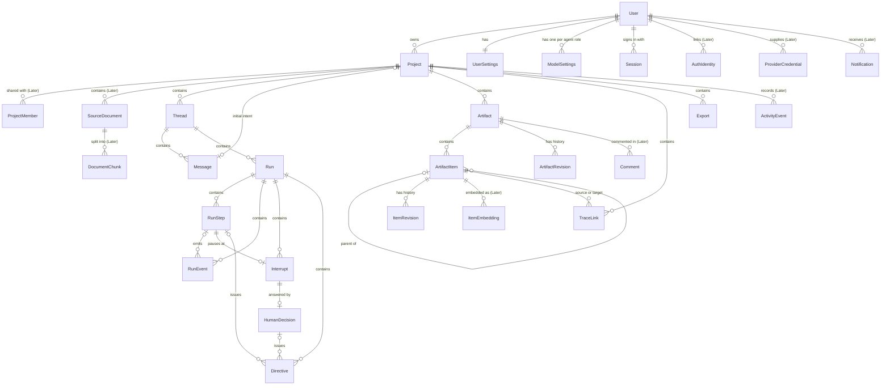
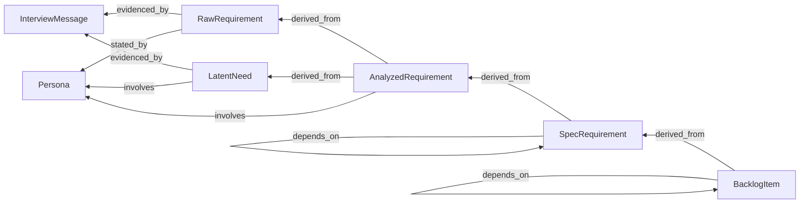
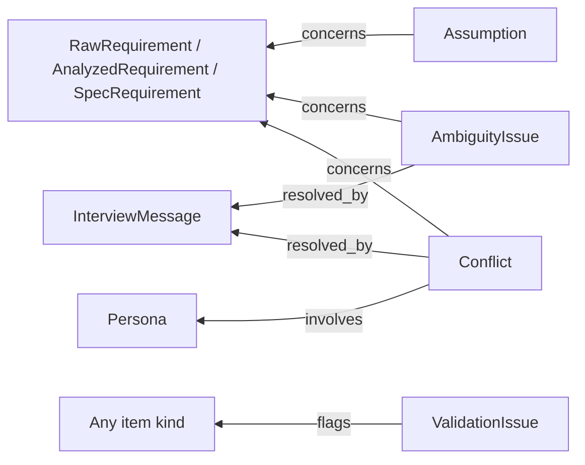

# Data Shape

Conceptual data model of the application: which entities exist, what fields they carry, and how they relate.
It describes data as the user sees it in the UI and as it is rendered into agent prompts.

This document does not choose a database, define tables, or define API endpoints. Those follow from it:

| Next document | Derived from this one |
|---|---|
| [Content schemas](schemas/README.md) | the field tables in [section 7](#7-requirements-engineering-artifacts) |
| Relation list and storage choice | [section 2](#2-domain-overview) and [section 8](#8-traceability) |
| [Database diagram](architecture/database.dbml) | every entity table below |
| API contract ([`API.md`](API.md)) | the same entities, as request and response bodies |
| [Logical and physical architecture views](architecture/README.md) | [section 2](#2-domain-overview) and [section 9](#9-mapping-to-the-agent-workflow) |

## Contents

- [1. Conventions](#1-conventions)
- [2. Domain overview](#2-domain-overview)
- [3. Identity and account](#3-identity-and-account)
- [4. User settings and model configuration](#4-user-settings-and-model-configuration)
- [5. Workspace: projects](#5-workspace-projects)
- [6. Conversation and execution](#6-conversation-and-execution)
- [7. Requirements engineering artifacts](#7-requirements-engineering-artifacts)
- [8. Traceability](#8-traceability)
- [9. Mapping to the agent workflow](#9-mapping-to-the-agent-workflow)
- [10. Supporting entities](#10-supporting-entities)
- [11. Open questions](#11-open-questions)
- [12. Review checklist](#12-review-checklist)

---

## 1. Conventions

### Identifiers

An entity is identified by its `id`, and an artifact item also by its `key`. The two identifiers have different jobs.

| Identifier | Format | Used for |
|---|---|---|
| `id` | UUID, generated by the server | API paths, foreign keys, storage |
| `key` | Prefix and running number, unique inside one project, for example `REQ-001` | Display in the UI, citations in agent prompts and agent output |

Three entities have no `id`, because a natural key identifies them: UserSettings by `user_id`, since a user has one; ProjectMember by `project_id` and `user_id`; and RunEvent by `run_id` and `sequence`, the position from which a client resumes the event stream. ModelCatalogEntry is server configuration, not stored, and is identified by `model_id`.

Only artifact items have a `key`; an artifact is addressed by its kind and title. An LLM copies a short key such as `REQ-001` reliably and copies a UUID poorly, so agents read and write keys, and the server resolves keys to ids before saving.
Keys are never reused: a deleted item keeps its number.

| Item kind | Key prefix | Example |
|---|---|---|
| Persona | `PER` | `PER-001` |
| Raw requirement | `RAW` | `RAW-001` |
| Analyzed requirement | `AR` | `AR-001` |
| Latent need | `LN` | `LN-001` |
| Assumption | `ASM` | `ASM-001` |
| Ambiguity issue | `AMB` | `AMB-001` |
| Conflict | `CONF` | `CONF-001` |
| Specified requirement | `REQ` | `REQ-001` |
| Backlog item | `US` for a story, `EP` for an epic | `US-001` |
| Validation issue | `VAL` | `VAL-001` |
| Interview message | Key of the persona, `#`, position in the transcript | `PER-001#4` |
| Section | `SEC` | `SEC-001` |

The deck uses `REQ-001`, `US-001` and `CONF-001`. It writes personas as `persona-1`; this document proposes `PER-001` so that all keys share one format.

### Field notation

| Notation | Meaning |
|---|---|
| `string`, `int`, `number`, `bool`, `bytes` | Scalars |
| `datetime` | ISO 8601 timestamp in UTC |
| `vector` | An embedding: a list of numbers whose length is fixed by the embedding model |
| `enum` | One value from the exact list in the notes column |
| `T[]` | Ordered list of `T` |
| `map<K, V>` | A JSON object whose keys are values of `K` and whose values are of type `V` |
| `object` | A JSON object whose fields are given in the notes or by a schema |
| A capitalized name such as `RunConfig`, `Usage` or `Origin` | A value object defined in this document: a group of fields embedded in an entity, with no id of its own. `AgentRole`, `Stage`, `ArtifactKind`, `ItemKind` and `LinkType` are strings from the workflow definition instead, see [workflow vocabulary](#workflow-vocabulary) |
| `ref<Entity>` | The `id` of another entity |
| `key<Entity>` | The `key` of an artifact item, used inside agent-facing payloads |
| `?` after the type | Optional, may be null |
| `server-only` before the type | Stored and used by the server only. Never part of a response body, a log line, an event or an agent prompt |

Field names use `snake_case`, the same as the JSON sent by the API.

### Common fields

These fields are not repeated in the entity tables.

| Field | Type | On | Notes |
|---|---|---|---|
| `id` | UUID | Every entity except UserSettings, ProjectMember and RunEvent, see [identifiers](#identifiers) | |
| `created_at` | datetime | Every entity | |
| `updated_at` | datetime | Every entity except the append-only ones: RunEvent, HumanDecision, Directive, TraceLink, ArtifactRevision, ItemRevision, AuthIdentity, ActivityEvent, DocumentChunk | Changes with every update of the row. An append-only entity is never changed after it is created; it is only removed, and a TraceLink is removed by setting `deleted_at`, so it stays readable |
| `deleted_at` | datetime? | User, Project, Thread, SourceDocument, Artifact, ArtifactItem, TraceLink | Soft delete: the row stays and is left out of lists. Trace links to a deleted item stay readable |

ModelCatalogEntry has none of these fields, since it is not stored.

### Workflow vocabulary

The data model separates what every version of the workflow shares from what an experiment may change.

| Part | Examples | How it is stored | Checked by |
|---|---|---|---|
| Structure | Projects, threads, runs, steps, events, interrupts, decisions, directives, artifacts, items, trace links, and the references between them | Fixed entities and fields | The database (foreign keys, unique keys) and the backend |
| Names | Agent roles, stages, node names, checkpoint options, directive kinds and item roles, artifact kinds, item kinds, link types, export templates, and the values of the value lists that content fields use | Plain strings | The backend, against the workflow definition |
| Shapes | Content of artifacts and items, run parameters, details of a directive | JSON objects with a schema version | The backend, against versioned schemas |

The **workflow definition** is a versioned description kept in code next to the workflow graph. Version 1 holds the names used in this document: agent roles and stages ([section 6](#agent-roles)), checkpoint options ([Interrupt](#interrupt-mvp)), directive kinds ([Directive](#directive-mvp)), run parameters ([RunConfig](#runconfig-mvp)), artifact and item kinds ([section 7](#two-levels-artifact-and-item)), link types ([section 8](#link-types)) and export templates ([Export](#export-mvp)). It also selects the prompt version of each agent role, see [Prompts](architecture/prompts.md). Version 1 is written out in full, with a schema that every version follows, in [Workflow definitions](workflow/README.md).

Every run records the name and version of the definition it ran with, and every name a write uses is checked against that version; a write made by the user outside a run uses the current version. Adding an agent, a checkpoint option or an item kind for an experiment is a new definition version, not a database migration.

In the field tables, `AgentRole`, `Stage`, `ArtifactKind`, `ItemKind` and `LinkType` are strings from the definition, and a content field marked "from the value list" takes one value of the named list of the definition, see [Content schemas: value lists](schemas/README.md#conventions).

## 2. Domain overview

The entities are grouped into six areas. An area is a group that changes together and can be owned by one backend module.

| Area | Entities | Phase |
|---|---|---|
| Identity and account | User, AuthIdentity, Session | MVP: User, Session. Later: AuthIdentity for external login |
| Settings | UserSettings, ModelSettings, ModelCatalogEntry, ProviderCredential | MVP: first three. Later: ProviderCredential |
| Workspace | Project, ProjectMember, SourceDocument, DocumentChunk | MVP: Project. Later: the other three |
| Conversation and execution | Thread, Message, Run, RunStep, RunEvent, Interrupt, HumanDecision, Directive | MVP |
| Requirements engineering artifacts | Artifact (7 kinds), ArtifactItem (12 kinds), ItemEmbedding | MVP: Artifact, ArtifactItem. Later: ItemEmbedding |
| Cross-cutting | ArtifactRevision, ItemRevision, TraceLink, Comment, Export, ActivityEvent, Notification | MVP: ArtifactRevision, ItemRevision, TraceLink, Export. Later: the other three |

### Ownership hierarchy



Artifacts, items and their kinds are defined in [section 7](#7-requirements-engineering-artifacts).

Scoping rules:

- A **project** is one product being specified. It owns the artifacts: one shared baseline for the whole project, with item keys unique per project. A thread never owns artifacts.
- A **thread** is one working session inside a project. It maps one-to-one to a workflow thread of the agent runtime, which stores the checkpoints. A thread has at most one unfinished run; runs of different threads may execute at the same time, see [Runtime: runs at the same time](architecture/runtime.md#6-runs-at-the-same-time).
- A **run** is one execution of the workflow inside a thread. A run that pauses for human review and continues later is still the same run.
- Every artifact and every item records the run that created it and the run that last changed it, so the UI can show what a given run produced.

## 3. Identity and account

### User (MVP)

| Field | Type | Notes |
|---|---|---|
| `email` | string | Unique, lower-cased |
| `display_name` | string | |
| `avatar_url` | string? | |
| `role` | enum | `user`, `admin` |
| `status` | enum | `active`, `disabled` |
| `email_verified_at` | datetime? | |
| `last_login_at` | datetime? | |
| `monthly_budget_usd` | number? | Cost limit per calendar month in UTC, set by an admin. Null means the server default |
| `password_hash` | server-only string? | Hash of the password. Null when the user signs in only through an external provider |

### AuthIdentity (Later)

One row per external login method linked to a user.

| Field | Type | Notes |
|---|---|---|
| `user_id` | ref\<User\> | |
| `provider` | enum | `google`, `github` |
| `provider_subject` | string | The user id at the provider; unique per provider |

### Session (MVP)

Server-side record behind the httpOnly session cookie. The client never reads the session token; it only sees the list of its own sessions.

| Field | Type | Notes |
|---|---|---|
| `user_id` | ref\<User\> | |
| `expires_at` | datetime | |
| `last_seen_at` | datetime | |
| `user_agent` | string? | Shown in a "signed-in devices" list |
| `ip_address` | string? | |
| `revoked_at` | datetime? | Set on sign-out |
| `token_hash` | server-only string | Hash of the token in the session cookie, unique. The token itself is not stored |

## 4. User settings and model configuration

### UserSettings (MVP)

One per user. Preferences that follow the user across devices.

| Field | Type | Notes |
|---|---|---|
| `user_id` | ref\<User\> | |
| `theme` | enum | `light`, `dark`, `system` |
| `ui_language` | enum | `en`, `vi` |
| `default_output_language` | enum | `en`, `vi`. Language of generated artifacts for new projects |
| `default_run_config` | RunDefaults | Used for every field that a project leaves empty, see [RunDefaults](#rundefaults-mvp). Empty by default |
| `notify_on_interrupt` | bool | Notify when a run waits for review |
| `notify_on_run_finished` | bool | |

Panel sizes, collapsed sections and the last open tab are device-local state and are not part of this model.

### ModelCatalogEntry (MVP)

Read-only list of the models a user may pick. Maintained by server configuration, not by users.

| Field | Type | Notes |
|---|---|---|
| `model_id` | string | `provider:model`, for example `openai:gpt-4.1`. Unique |
| `provider` | string | |
| `display_name` | string | |
| `capabilities` | enum[] | `tool_calling`, `structured_output`, `streaming`, `vision` |
| `context_window` | int | Tokens |
| `input_price_per_mtok` | number? | USD per million input tokens |
| `output_price_per_mtok` | number? | USD per million output tokens |
| `cache_read_price_per_mtok` | number? | USD per million input tokens read from the provider's prompt cache |
| `cache_write_price_per_mtok` | number? | USD per million input tokens written to the provider's prompt cache |
| `allowed_roles` | AgentRole[] | Roles this model may serve, checked against required capabilities |

### ModelSettings (MVP)

The model a user chose for each agent role. One row per user and role.

| Field | Type | Notes |
|---|---|---|
| `user_id` | ref\<User\> | |
| `agent_role` | AgentRole | See [agent roles](#agent-roles) |
| `model_id` | string | Must exist in the catalog and allow this role |
| `temperature` | number? | From 0 to 1, a range that every provider of the catalog accepts. Null means the role default |

Resolution order when a run starts: one-off override in the run request, then project setting, then user setting, then the server default for the role, see [RunDefaults](#rundefaults-mvp).

### ProviderCredential (Later)

A user-supplied provider API key ("bring your own key").

| Field | Type | Notes |
|---|---|---|
| `user_id` | ref\<User\> | |
| `provider` | string | |
| `label` | string | |
| `key_last4` | string | The only part of the key that is ever returned |
| `encrypted_key` | server-only bytes | The key, encrypted at rest |
| `encryption_key_id` | server-only string | Id of the master key that encrypted `encrypted_key` |
| `last_used_at` | datetime? | |

The master keys are kept in the server environment, never in the database, each under its own id. A new key is encrypted with the current master key. To rotate, a new master key becomes current, every row whose `encryption_key_id` names an older key is decrypted and encrypted again with the new one, and the older key is removed once no row names it.

## 5. Workspace: projects

### Project (MVP)

| Field | Type | Notes |
|---|---|---|
| `owner_id` | ref\<User\> | |
| `name` | string? | Null when the project is created without a name, until its first run names it from the initial intent. The user can change it at any time |
| `description` | string? | Free text about the product and its domain |
| `status` | enum | `active`, `archived` |
| `output_language` | enum | `en`, `vi` |
| `run_config` | RunDefaults | Settings for the runs of the project; a field left empty takes the value of the user, see [RunDefaults](#rundefaults-mvp) |
| `initial_message_id` | ref\<Message\>? | The user message that started the first run of the project, for example "I want to build an online platform for university students to find mentors." Its content is the initial intent of the project. Null until the first run starts, so a run that starts while it is null is the first run of the project and begins at the planner |
| `model_overrides` | map\<AgentRole, string\> | Optional `provider:model` per role for this project |
| `item_counts` | map\<ItemKind, int\> | Derived, read-only. Shown on the project card |
| `unfinished_run_counts` | RunCounts | Derived, read-only. The number of unfinished runs of the project in each status, see below. `interrupted` counts the reviews that wait for the user |
| `rollup_run_status` | enum? | Derived, read-only. The status that the latest [Run](#run-mvp) of each thread of the project rolls up to: the one that needs the user most, in the order `interrupted`, `failed`, `running`, `queued`, `cancelled`, `succeeded`. A run that a later run of its thread replaced no longer counts, so a failed run that was run again does not show. Null before the first run. The project list shows it |
| `last_activity_at` | datetime | Derived, stored. Kept in a column so that the project list can be sorted by it |

`RunCounts` is `{ queued: int, running: int, interrupted: int }`, one count per status of an unfinished run.

### ProjectMember (Later)

Sharing a project with other users. Real-time collaboration on one thread stays a non-goal.

| Field | Type | Notes |
|---|---|---|
| `project_id` | ref\<Project\> | |
| `user_id` | ref\<User\> | |
| `role` | enum | `owner`, `editor`, `viewer` |
| `invited_by` | ref\<User\> | |

### SourceDocument (Later)

A file the user uploads as context for elicitation, for example an existing brief or meeting notes.

| Field | Type | Notes |
|---|---|---|
| `project_id` | ref\<Project\> | |
| `uploaded_by` | ref\<User\> | |
| `first_version_id` | ref\<SourceDocument\> | The first version of the document, shared by all its versions; equal to `id` on version 1. Unique together with `version` |
| `version` | int | Starts at 1. A changed document is uploaded as a new version with the same `first_version_id`; a stored version is never edited |
| `file_name` | string | |
| `media_type` | string | |
| `size_bytes` | int | |
| `storage_key` | server-only string | Location in object storage |
| `extraction_status` | enum | `pending`, `ready`, `failed` |
| `summary` | string? | Short summary used in prompts in place of the full text |

### DocumentChunk (Later)

A passage of the extracted text of a source document, with its embedding, so that an agent can retrieve the passages relevant to a question instead of reading the whole document. Chunks are created when the extraction of a document version succeeds, and are never edited; a new document version gets new chunks. They are read through a retrieval tool of the agents and are not returned by the API.

| Field | Type | Notes |
|---|---|---|
| `source_document_id` | ref\<SourceDocument\> | The document version the chunk comes from |
| `project_id` | ref\<Project\> | Repeated so that a search stays inside one project |
| `position` | int | Order of the chunk in the document, from 1 |
| `text` | string | The passage |
| `token_count` | int | Length of the passage in tokens of the embedding model |
| `embedding_model` | string | `provider:model` of the embedding model. Vectors of different models are never compared |
| `embedding` | vector | The embedding of `text`; its dimension is that of the embedding model |

## 6. Conversation and execution

### Agent roles

`AgentRole` names an LLM-driven node of the workflow. Model settings, run steps and origins store it as a string. Workflow definition version 1 has these roles:

| Role | Node in the deck | Job |
|---|---|---|
| `planner` | Planner | Turns the intent into an elicitation plan |
| `persona_generator` | Generator | Creates stakeholder personas |
| `interviewer` | interviewer | Asks interview questions |
| `persona_agent` | persona_agent | Answers as one persona |
| `analyst` | analyst | Extracts and analyzes requirements |
| `requirement_engineer` | requirement engineer | Writes the requirement specification |
| `backlog_manager` | backlog manager | Writes the product backlog |
| `validator` | validator | Checks the outputs and reports issues |
| `intent_router` | intent router | Decides which node a message sent by the user should go to |

### Workflow stages

`Stage` names a position a run can be in; it is the value of `current_stage` in the deck. A stage of the definition has a `title` for the user, an `internal` flag for a stage the user does not see, and a `parent` that groups stages as a tree, see [Workflow definitions](workflow/README.md#2-parts-of-a-definition). Workflow definition version 1 has these stages, all at the top level, and `intent_routing` is internal:

`intent_routing`, `planning`, `persona_generation`, `persona_review`, `interviewing`, `analysis`, `analysis_review`, `specification`, `specification_review`, `backlog`, `validation`, `done`

`persona_review`, `analysis_review` and `specification_review` are the human checkpoints. The deck shows the specification review but labels its node like the analysis review, see [open question 2](#11-open-questions).

### Thread (MVP)

| Field | Type | Notes |
|---|---|---|
| `project_id` | ref\<Project\> | |
| `created_by` | ref\<User\> | |
| `title` | string? | Given when the thread is created, or generated from the first message; editable. Null until one of the two |
| `status` | enum | `active`, `archived` |
| `current_stage` | Stage? | Stage of the latest run. Null before the first run |
| `active_run_id` | ref\<Run\>? | The unfinished run of the thread (`queued`, `running` or `interrupted`); at most one, see [Runtime: lifecycle](architecture/runtime.md#3-lifecycle) |
| `latest_run_status` | enum? | Derived, read-only. The status of the latest [Run](#run-mvp) of the thread, unfinished or ended. The unfinished run of a thread is always its latest, so while `active_run_id` is set, this is its status. Null before the first run of the thread |
| `last_message_at` | datetime | Time of the newest message; the creation time while the thread has no message |

Deck: `project_id`, `current_stage`. The deck's `initial_intent` belongs to the project, see `Project.initial_message_id`.

### Message (MVP)

The chat between the user and the system. Interview turns between agents are not messages; they are [InterviewMessage](#interviewtranscript-and-interviewmessage-mvp) records.

| Field | Type | Notes |
|---|---|---|
| `thread_id` | ref\<Thread\> | |
| `sequence` | int | Order of the message in the thread, from 1, without gaps. Messages are listed by it, because two messages can have the same `created_at` |
| `run_id` | ref\<Run\>? | The run this message started or belongs to |
| `author` | enum | `user`, `agent`, `system` |
| `agent_role` | AgentRole? | Set when `author` is `agent` |
| `content` | string | Markdown |
| `artifact_refs` | ArtifactRef[] | Artifacts mentioned or produced, rendered as links |
| `item_refs` | ItemRef[] | Items mentioned, rendered as links |
| `delivery` | enum? | On user messages only: `started_run`, `pending`, `delivered`, `undelivered`. See [Runtime: messages during a run](architecture/runtime.md#5-messages-during-a-run) |
| `delivered_in_step_id` | ref\<RunStep\>? | The step that took the message in, when `delivery` is `delivered` |

`ArtifactRef` is `{ artifact_id: UUID, kind: ArtifactKind, title: string, version: int }`.

`ItemRef` is `{ item_id: UUID, kind: ItemKind, key: string, version: int }`.

### RunConfig (MVP)

Value object stored on each Run: the complete configuration the run uses, resolved when the run starts and then frozen, so that later setting changes do not alter the record of a past run. A retry is a new run: it resolves its RunConfig when it starts, so the settings saved since the run it retries apply. The fields in the first table belong to every workflow; `parameters` holds the limits of one workflow version.

| Field | Type | Notes |
|---|---|---|
| `models` | map\<AgentRole, string\> | `provider:model` for every agent role of the definition version |
| `review_checkpoints` | string[] | Checkpoint nodes that pause for the user. A checkpoint not in the list continues at once with its default option and default answers, recorded as its decision, see [Interrupt](#interrupt-mvp) |
| `output_language` | enum | `en`, `vi`. The output language of the project |
| `max_steps` | int | Upper bound on executed steps in one run |
| `max_cost_usd` | number? | The run fails with a clear error when exceeded. Checked before every LLM call. Null means no limit |
| `parameters` | object | Limits of the workflow, validated against the parameter schema of the definition version |

`parameters` in workflow definition version 1:

| Field | Type | Notes |
|---|---|---|
| `target_personas_num` | int | How many personas to generate |
| `max_personas` | int | Upper bound on personas interviewed |
| `max_turns` | int | Upper bound on question and answer turns per persona |
| `max_iterations` | int | Upper bound on rework loops |

Deck: `target_personas_num`, `max_turn`, `max_personas`. The deck also has `iteration_count` in the state, which `max_iterations` bounds.

### RunDefaults (MVP)

Value object for the settings that runs start from, embedded in UserSettings as `default_run_config` and in Project as `run_config`. It has the fields of RunConfig except `models` and `output_language`, and every field is optional.

| Field | Type | Notes |
|---|---|---|
| `review_checkpoints` | string[]? | |
| `max_steps` | int? | |
| `max_cost_usd` | number? | |
| `parameters` | object? | Only the parameters to set; a parameter left out takes the value of the next level |

When a run starts, its RunConfig is resolved field by field, and each field takes the first value set in this order:

| Field of RunConfig | Resolved from, first set wins |
|---|---|
| `models`, per agent role | The `models` of the request that starts the run, `Project.model_overrides`, the ModelSettings of the user, the server default of the role |
| `review_checkpoints`, `max_steps`, `max_cost_usd`, each parameter | The `run_config` of the request that starts the run, `Project.run_config`, `UserSettings.default_run_config`, the server default; for a parameter, the default in the parameter schema of the definition version |
| `output_language` | `Project.output_language`, which the project takes from `UserSettings.default_output_language` when it is created |

Each choice therefore has one place per level: models are chosen in ModelSettings and `model_overrides`, the language on the project, and the other settings in RunDefaults.

### Run (MVP)

| Field | Type | Notes |
|---|---|---|
| `thread_id` | ref\<Thread\> | |
| `project_id` | ref\<Project\> | Repeated for direct filtering |
| `number` | int | Order of the run in its thread, from 1, without gaps; unique per thread. Names the run, for example "Run 3" |
| `started_by` | ref\<User\> | |
| `workflow_name` | string | Name of the workflow definition the run uses |
| `workflow_version` | int | Version of that definition, fixed for the whole run |
| `status` | enum | `queued`, `running`, `interrupted`, `succeeded`, `failed`, `cancelled` |
| `current_stage` | Stage | |
| `iteration_count` | int | Number of rework loops so far |
| `run_config` | RunConfig | Frozen copy |
| `retry_of_run_id` | ref\<Run\>? | Set when this run re-runs from a checkpoint of another run |
| `error` | RunError? | `{ code: string, message: string, stage: Stage }` |
| `usage` | Usage | Totals over all steps, see below |
| `trace_id` | string? | Id in the tracing tool |
| `step_count` | int | Derived. Number of steps of the run so far, which is also the `sequence` of its latest step; 0 before the first step |
| `last_event_id` | int | Derived. Sequence of the newest event of the run; a client continues the event stream from it |
| `started_at` | datetime? | |
| `finished_at` | datetime? | |

`Usage` is `{ input_tokens: int, output_tokens: int, cache_read_tokens: int, cache_write_tokens: int, cost_usd: number, duration_ms: int }`.

Token counts are the values reported by the LLM provider; the backend never counts tokens itself. `input_tokens` is the input that was not read from the provider's prompt cache. Cost and cache hit rate are computed from these counts: cache hit rate = `cache_read_tokens / (cache_read_tokens + cache_write_tokens + input_tokens)`.

Deck: `run_config`, `iteration_count`, `current_stage`, `status`, `error`.

How a run moves between statuses, what happens to messages sent during a run, and what happens when the process stops are described in [Runtime](architecture/runtime.md).

### RunStep (MVP)

One execution of one node. It backs the step timeline and the highlighted node in the graph view.

| Field | Type | Notes |
|---|---|---|
| `run_id` | ref\<Run\> | |
| `sequence` | int | Order inside the run |
| `node` | string | Node name in the workflow graph |
| `agent_role` | AgentRole? | Null for nodes that do not call an LLM |
| `stage` | Stage | |
| `status` | enum | `running`, `succeeded`, `failed`, `skipped` |
| `iteration` | int | Rework loop this step belongs to |
| `subject_item_id` | ref\<ArtifactItem\>? | The item the step works on, when there is one. In version 1, the persona being interviewed |
| `model_id` | string? | Model actually used, after fallbacks |
| `llm_calls` | int | Number of LLM calls made by the step |
| `usage` | Usage | Sum over the LLM calls of the step |
| `produced` | ItemRef[] | Derived. Items created or changed by this step, from the item revisions the step wrote |
| `error` | string? | |
| `started_at` | datetime | |
| `finished_at` | datetime? | |

### RunEvent (MVP)

One entry of the resumable event stream. The payload of each event type is defined in [API design: run event stream](API.md#6-run-event-stream).

| Field | Type | Notes |
|---|---|---|
| `run_id` | ref\<Run\> | |
| `sequence` | int | Increasing per run; the client resumes from the last one it saw. A counter of its own, not related to the sequence of the steps |
| `step_id` | ref\<RunStep\>? | The step the event belongs to. Null for an event of the whole run, such as `done` |
| `type` | enum | `node_start`, `node_end`, `token`, `tool_call`, `artifact_created`, `artifact_delta`, `interrupt`, `message_delivered`, `project_named`, `error`, `done` |
| `data` | object | Depends on `type` |

The event log is the durable record of a run: the stream endpoint replays it after a reconnect, and the workflow never writes into an HTTP response. Token text is stored in grouped chunks, not one event per token. Payload fields are listed in [API design: run event stream](API.md#6-run-event-stream).

### Interrupt (MVP)

A pause in which the run asks the user for input. A checkpoint node creates one each time the run reaches it, so a checkpoint reached again after a rework loop creates a new interrupt. A run has at most one pending interrupt. The fields are the same for every checkpoint; what differs between checkpoints is data: the prompt, the options, the questions and the artifacts under review.

| Field | Type | Notes |
|---|---|---|
| `run_id` | ref\<Run\> | |
| `step_id` | ref\<RunStep\> | The step of the checkpoint node that created it |
| `node` | string | The node that paused the run, for example `checkpoint_analysis` |
| `prompt` | string | What the user is asked |
| `options` | InterruptOption[] | The decision that chooses where the run continues. Empty when the interrupt only asks questions |
| `questions` | Question[] | Further questions, answered together with the option. Empty when there are none |
| `allow_edits` | bool | Whether the user may edit items of the artifacts under review before answering |
| `review_artifacts` | ArtifactRef[] | The artifacts under review, at the version shown; empty when nothing is reviewed |
| `status` | enum | `pending`, `resolved`, `cancelled` |
| `resolved_at` | datetime? | |
| `decision` | HumanDecision? | Derived, read-only. The decision that resolved it; null while it is pending and when it is cancelled. Given with the interrupt, so that a client shows which option was taken and who took it |

An interrupt has at least one option or one question. One shape serves every use: a review that decides where the run goes (options and artifacts under review), questions only, or a review with questions. The lists that a use does not need are empty, so an interrupt has no kind field, and its options and questions are stored as JSON in its row, since they are always read and written with it.

`InterruptOption` is `{ key: string, label: string, requires_feedback: bool, approves: bool, is_default: bool }`.

- The workflow definition lists the options of each checkpoint. Each option key matches an outgoing edge of the checkpoint node, so the run continues along the edge of the chosen option.
- `approves` tells the backend to set the artifacts under review, and their items that are still `draft`, to `approved`.
- `is_default` marks the option taken without asking. Exactly one option of a checkpoint is the default.

`Question` is `{ key: string, type: enum, prompt: string, required: bool, choices: Choice[], min_selected: int?, max_selected: int?, default_answer: Answer?, source: enum }`, and `Choice` is `{ key: string, label: string, requires_text: bool }`. `Answer` is defined with [HumanDecision](#humandecision-mvp).

| Question field | Rule |
|---|---|
| `key` | Unique within the interrupt |
| `type` | `single_select` (pick exactly one choice), `multi_select` (pick any number of choices), `free_text`, `number` |
| `choices` | At least two for `single_select` and `multi_select`; empty for the other types. A choice that requires text asks the user to explain it, for example "Other, please specify" |
| `min_selected`, `max_selected` | For `multi_select` only, null for the other types: the fewest and the most choices an answer may pick; null means no bound. When both are set, `min_selected <= max_selected <=` the number of choices |
| `default_answer` | The answer taken without asking, in the same shape as an answer and valid by the same rules. Null only when the question is not required, which means no answer by default. It never contains a choice that requires text, since a default cannot give the explanation |
| `source` | `definition` for a question listed on the checkpoint node, `agent` for one an agent adds at run time, for example to clarify an intent. An agent gives every question it adds a default: its own assumption |

Answers without a person. Every checkpoint has a default option and every required question a default answer, so a run can continue without anyone answering. When the checkpoint is not in `review_checkpoints` of the run, the run does not pause: the interrupt is created and resolved at once with the default option and the default answers, in a decision without a user. The record then shows what the run assumed, which matters for automatic runs and experiments.

Options in workflow definition version 1:

| Checkpoint node | Key | Label | Requires feedback | Approves | Default |
|---|---|---|---|---|---|
| `checkpoint_personas` | `approve` | Approve | No | Yes | Yes |
| `checkpoint_analysis` | `accept` | Accept | No | Yes | Yes |
| `checkpoint_analysis` | `reject_reanalyse` | Reject and re-analyse | Yes | No | No |
| `checkpoint_analysis` | `reject_reinterview` | Reject and re-interview | Yes | No | No |
| `checkpoint_spec` | `ok` | OK | No | Yes | Yes |
| `checkpoint_spec` | `not_ok` | Not OK | Yes | No | No |

All three checkpoints allow edits. In version 1 they ask no questions.

### HumanDecision (MVP)

The answer to an interrupt, given by the user or taken from the defaults. Kept permanently; it is part of the history of every artifact and item it touched.

| Field | Type | Notes |
|---|---|---|
| `interrupt_id` | ref\<Interrupt\> | |
| `run_id` | ref\<Run\> | |
| `decided_by` | ref\<User\>? | Null when the run took the defaults without asking |
| `option` | string? | Key of the chosen option. Null only when the interrupt has no options |
| `feedback` | string? | Required when the chosen option requires feedback |
| `answers` | map\<string, Answer\> | One entry per answered question, by question key |
| `modified_items` | ItemRef[] | Items the user edited before answering; each points at the new version. Allowed only when the interrupt allows edits. The deck calls this field `modified_artifacts` |

`Answer` is `{ choice_keys: string[], text: string?, number: number? }`, one shape for every question type:

| Question type | `choice_keys` | `text` | `number` |
|---|---|---|---|
| `single_select` | Exactly one choice key | Required when the chosen choice requires text | Null |
| `multi_select` | The keys of the chosen choices, between `min_selected` and `max_selected`; at least one when the question is required | Required when a chosen choice requires text | Null |
| `free_text` | Empty | The answer; required when the question is required | Null |
| `number` | Empty | Null | The answer; required when the question is required |

Deck: `checkpoint`, `action`, `feedback`, `modified_artifacts`. Here the checkpoint is the `node` of the interrupt, and the deck's actions are option keys. A decision that approves with edits is what the deck calls modify.

### Directive (MVP)

An instruction that one part of the workflow gives to another, for example to interview some personas again. Version 1 has two kinds: the deck's rework directive, and the directive the intent router issues for a message the user sent. It is modeled as an entity, not only as workflow state, so that the UI can show why a loop happened.

| Field | Type | Notes |
|---|---|---|
| `run_id` | ref\<Run\> | |
| `kind` | string | Directive kind from the workflow definition |
| `issued_by_step_id` | ref\<RunStep\>? | The step that issued it, when an agent node did |
| `human_decision_id` | ref\<HumanDecision\>? | The decision that issued it, when the user did |
| `target_node` | string | The node that acts on it, for example `interviewer` |
| `iteration` | int | The loop this directive starts |
| `instruction` | string | For example "Clarify CONF-001: would a layered design work?" |
| `items` | DirectiveItem[] | Items the directive refers to |
| `details` | object | Further fields of the kind, validated against its schema in the definition |

`DirectiveItem` is `{ item: ItemRef, role: string }`. Exactly one of `issued_by_step_id` and `human_decision_id` is set.

Directive kinds in workflow definition version 1:

| Kind | Item roles | `details` |
|---|---|---|
| `rework` | `addressed_to`: a persona to interview again; `about`: an issue that caused the rework | Empty |
| `intent` | `about`: an item the user's message concerns | Empty |

Deck: `rework_directives` with the instruction text and `addressed_to`.

## 7. Requirements engineering artifacts

The order follows the requirements engineering process: elicitation, analysis, specification, validation.

### Two levels: artifact and item

The output of the workflow has two levels, modeled as two separate entities.

| Level | Entity | What it is | Examples |
|---|---|---|---|
| Upper | **Artifact** | A work product of one stage: the unit the user opens, reviews at a checkpoint and exports | The requirement specification, the product backlog, one interview transcript |
| Lower | **ArtifactItem** | One entry inside an artifact: the unit that has a key, is edited on its own and is traced | The requirement `REQ-001`, the persona `PER-001`, one interview message |

In this document "artifact" always means the upper level and "item" the lower level.

In workflow definition version 1, `ArtifactKind` is the set of 7 kinds in this table, and `ItemKind` the set of 12 kinds: the 11 in this table, each of which belongs to exactly one artifact kind, plus `section`, which groups items inside any artifact kind with items except `interview_transcript`, see [sections and nesting](#sections-and-nesting).

| Artifact kind | Per project | Item kinds inside | Produced by |
|---|---|---|---|
| `elicitation_plan` | One | None | planner |
| `persona_catalog` | One | `persona` | persona_generator |
| `interview_transcript` | One per persona | `interview_message` | interviewer, persona_agent |
| `requirements_analysis` | One | `raw_requirement`, `analyzed_requirement`, `latent_need`, `assumption`, `ambiguity_issue`, `conflict` | analyst |
| `requirement_specification` | One | `spec_requirement` | requirement_engineer |
| `product_backlog` | One | `backlog_item` | backlog_manager |
| `validation_report` | One per validator execution | `validation_issue` | validator |

The two levels correspond to the specification and the specification object of the Requirements Interchange Format, and a trace link to its relation between two specification objects.

### Artifact (MVP)

| Field | Type | Notes |
|---|---|---|
| `project_id` | ref\<Project\> | |
| `kind` | ArtifactKind | |
| `title` | string | For example "Requirement specification" |
| `summary` | string? | Short overview written by the agent, shown at the top of the artifact |
| `schema_version` | int | Version of the content schema of this kind that `content` follows |
| `content` | object | Fields of the artifact kind, as listed in the sections below |
| `subject_item_id` | ref\<ArtifactItem\>? | For an `interview_transcript`: the persona that is interviewed. Null for the other kinds |
| `version` | int | Starts at 1. Increases when a field of the artifact changes, when the artifact is deleted or restored, or when an item is added, removed, reordered or changed |
| `review_status` | enum | `draft`, `approved`, `rejected`, `superseded` |
| `item_count` | int | Derived, read-only. Number of items of the artifact that are not deleted |
| `created_by` | Origin | Who created it |
| `updated_by` | Origin | Who last changed it |

### ArtifactItem (MVP)

| Field | Type | Notes |
|---|---|---|
| `artifact_id` | ref\<Artifact\> | The artifact the item is in |
| `project_id` | ref\<Project\> | Same as the artifact's; repeated for direct filtering and for key uniqueness |
| `kind` | ItemKind | Must be an item kind of the artifact's kind |
| `key` | string | See [identifiers](#identifiers) |
| `parent_item_id` | ref\<ArtifactItem\>? | The section the item is in, or the epic of a user story; always in the same artifact. Null for an item at the top level |
| `position` | int | Order among the items with the same parent |
| `outline_number` | string | Derived, read-only. Outline number such as `3.2.1`, from the positions along the path from the top level. In an artifact without sections it is the position, `1`, `2`, ... |
| `schema_version` | int | Version of the content schema of this kind that `content` follows |
| `content` | object | Fields of the item kind, as listed in the sections below |
| `version` | int | Starts at 1, increases on every change, deletion and restoration included |
| `review_status` | enum | `draft`, `approved`, `rejected`, `superseded` |
| `created_by` | Origin | Who created it |
| `updated_by` | Origin | Who last changed it |

`Origin` is `{ actor: enum(agent, user), agent_role: AgentRole?, user_id: ref<User>?, run_id: ref<Run>?, step_id: ref<RunStep>? }`.

`review_status` meanings, on both levels:

| Value | Meaning |
|---|---|
| `draft` | Produced by an agent or edited by the user, not yet reviewed at a checkpoint |
| `approved` | Accepted at a checkpoint |
| `rejected` | Rejected at a checkpoint; kept for history |
| `superseded` | Replaced by another one after rework |

Rules between the two levels:

- **Items are stored once.** An artifact does not copy its items into its `content`. The items of an artifact are the items whose `artifact_id` is the artifact; they form a tree through `parent_item_id`, see [sections and nesting](#sections-and-nesting).
- **Artifact version.** The revision of an artifact stores the list of its items with the version of each, so any earlier state of the whole artifact can be shown again.
- **Review applies to the artifact.** A checkpoint asks the user to review an artifact. When the chosen option approves, the artifact and every item that is still `draft` get `review_status` `approved`, each as a new version with `change_reason` `reviewed`. An item can also be rejected or edited on its own.
- **Rework keeps the artifact and replaces items.** A rework round works inside the existing artifact; it does not create a second artifact of the same kind. An agent that changes what an item says, in a rework round, does not edit the item: it creates a new item, with a new key and a `supersedes` link to the old one, and the old item becomes `superseded`. A split creates several new items and a merge one, each linked with `supersedes` to every item it replaces. The old items stay, with their links, so the history of the requirement can be followed. The lifecycle fields below are the exception.
- **The user edits in place.** A user who edits an item, at a checkpoint or outside a run, changes the item itself: it gets a new version with the same key.
- **Trace links connect items only.** An artifact is never the source or the target of a trace link.

Lifecycle fields record what happened to an item, not what it says, so an agent updates them in place, as a new version of the same item. In version 1 they are:

| Item kind | Lifecycle fields |
|---|---|
| `ambiguity_issue` | `status`, `resolution` |
| `conflict` | `status`, `resolution` |
| `latent_need` | `disposition` |
| `assumption` | `validation_status` |
| `validation_issue` | `status` |
| `backlog_item` | `delivery_status` |
| `persona` | `interview_status`, set by the system |

`review_status`, a field of every item outside `content`, is a lifecycle field as well.

### Sections and nesting

Items inside an artifact form a tree. A `section` item groups related items under a heading, and sections can contain sections, so an artifact reads like a document with chapters and subsections. For example, in the requirement specification:

```text
3          Functional requirements          (section)
3.1        Mentor discovery                 (section)
3.1.1      REQ-001 Search mentors           (spec_requirement)
3.1.2      REQ-002 Filter by field          (spec_requirement)
3.2        Booking                          (section)
3.2.1      REQ-005 Book a 30-minute session (spec_requirement)
```

Section content:

| Field | Type | Notes |
|---|---|---|
| `title` | string | Heading text, without its number |
| `introduction` | string? | Short text shown under the heading |

Rules:

- **Where sections are allowed.** In every artifact kind that has items, except `interview_transcript`, whose messages stay one ordered list.
- **Parent.** An item's parent is a section of the same artifact, or, for a user story, an epic. An item without a parent sits at the top level of the artifact.
- **Order.** `position` orders items that share a parent. The outline number, such as 3.2.1, is derived from the positions along the path and is not stored.
- **Depth.** At most 4 levels of sections.
- **Not traced.** A section is never the source or the target of a trace link; links connect the items inside sections. A section has a key (`SEC-001`) only so that an agent can say which section an item belongs to.
- **Agents create sections.** An agent that groups its items, such as the requirement engineer, returns the sections and, for each item, the section it belongs to: by key for an existing section, or by `ref` for one created in the same response, see [Prompts: output models](architecture/prompts.md#6-output-models).

### Storage form and content rules

Both levels are stored in a generic form: fixed common fields plus `content`. The kind does not decide the storage structure; it decides which content schema applies.

| Rule | Detail |
|---|---|
| One content schema per kind | Every artifact kind and every item kind has a content schema. The field tables in the sections below describe version 1; the exact definition is one JSON Schema file per kind in [`schemas/`](schemas/README.md). A schema is defined once in the backend, in a package of its own that both the workflow and the API import, and used for three things: the output format an agent must return, validation when an artifact or item is saved or edited, and the description the client uses to render and edit it |
| Content holds plain values only | Strings, numbers, booleans, enums, and lists or objects of them. A reference to an item is never a content field; it is a trace link, `artifact_id`, `parent_item_id` or `subject_item_id` |
| Schema changes are versioned | Changing a field creates a new schema version. Stored rows keep their `schema_version`, and the backend converts an old version when it reads one |
| Checks are done by the application | Since the storage accepts any content, the backend validates before every write. The checks are listed in [integrity rules](#integrity-rules) |

### ElicitationPlan (MVP)

One current plan per project. The plan is an artifact with no items; the fields below are its `content`.

| Field | Type | Notes |
|---|---|---|
| `objectives` | string[] | For example "understand mentor discovery needs" |
| `topics` | string[] | Subjects to cover in interviews |
| `information_gaps` | string[] | For example "how students judge mentor quality" |
| `stakeholder_types` | string[] | For example "Student", "Mentor", "Administrator" |
| `strategies` | string[] | How to ask: question styles and techniques |
| `stopping_conditions` | string[] | When the interviews have gathered enough |

Deck: all six fields.

### PersonaCatalog (MVP)

The artifact that holds the personas of the project. The fields below are its `content`.

| Field | Type | Notes |
|---|---|---|
| `selection_rationale` | string | Why these personas were chosen for the stakeholder types of the plan |
| `uncovered_stakeholder_types` | string[] | Stakeholder types of the plan that no persona represents; each one of the plan's `stakeholder_types` |

### Persona (MVP)

A simulated stakeholder. The profile is application data; a template renders it into the system prompt of the persona agent.

| Field | Type | Notes |
|---|---|---|
| `name` | string | For example "Minh, 3rd-year CS student" |
| `stakeholder_type` | string | One of the plan's `stakeholder_types` |
| `background` | string | History, context, situation |
| `expertise` | string | Technical and domain familiarity |
| `goals` | string[] | What this persona wants the system to do |
| `interests` | string[] | What they care about |
| `constraints` | string[] | Limits they operate under |
| `priorities` | string[] | How they rank their interests |
| `concerns` | string[] | Risks, worries, objections |
| `behavioral_tendencies` | string | How they tend to communicate |
| `interview_status` | enum | `not_started`, `in_progress`, `completed` |

Deck: every field except `interview_status`. The deck's example calls the stakeholder type `role`.

### InterviewTranscript and InterviewMessage (MVP)

One transcript per persona per project. Rework appends to the same transcript.

InterviewTranscript:

| Field | Type | Notes |
|---|---|---|
| `participants` | object[] | The people of the interview, the interviewer first. Each has `key` (`interviewer`, or the key of the persona), `name`, `role` (`interviewer`, `persona`) and `item_id` (the persona; null for the interviewer). Set by the system. The data allows several personas; version 1 writes one |
| `status` | enum | `in_progress`, `completed` |
| `turn_count` | int | |
| `stop_reason` | enum? | `max_turns`, `interviewer_stopped`, `stopping_condition_met` |

The fields above are the `content` of the transcript artifact. The persona being interviewed is its `subject_item_id`, which is also the `item_id` of the participant of that persona. The messages are the items of the transcript, ordered by `position`.

InterviewMessage:

| Field | Type | Notes |
|---|---|---|
| `turn` | int | A question and its answer share a turn |
| `speaker` | string | The `key` of the participant of the transcript who says the words |
| `content` | string | |
| `iteration` | int | 0 for the first interview, higher for rework rounds |
| `topic` | string? | The plan topic the question targets; one of the plan's `topics` |
An interview message is an item of the transcript artifact, with its order in the transcript as `position`. Its `key` is `<persona key>#<position>`, for example `PER-001#4`, which is how prompts cite it. A message is never edited after it is written.

Deck: `interview_transcripts` keyed by persona; `InterviewMessage(role, content, turn)`; `active_persona_index`, `interview_turn`, `interviewer_stop` as workflow counters.

### RequirementsAnalysis (MVP)

The artifact that holds the findings of the analyst: raw requirements, analyzed requirements, latent needs, assumptions, ambiguity issues and conflicts. The fields below are its `content`.

| Field | Type | Notes |
|---|---|---|
| `key_findings` | string[] | The most important results of the analysis, one sentence each |
| `open_questions` | string[] | Questions the analysis could not answer from the interviews |

### RawRequirement (MVP)

A requirement as stated in an interview, before any rewriting.

| Field | Type | Notes |
|---|---|---|
| `title` | string | A short name of at most 60 characters. For example "Find a mentor in my field" |
| `statement` | string | Close to the persona's own words |
| `topic` | string? | One of the plan's `topics` |

Links: `stated_by` to the persona; `evidenced_by` to each interview message it was taken from, with the exact words of the message on the link (`target_quote`).

### AnalyzedRequirement (MVP)

A requirement after analysis: merged, classified and prioritized.

| Field | Type | Notes |
|---|---|---|
| `title` | string | A short name of at most 60 characters. For example "List mentors by field" |
| `statement` | string | Rewritten to be clear and atomic |
| `type` | enum | `functional`, `non_functional`, `constraint` |
| `quality_category` | string? | For `non_functional`. From the value list `quality_category`; version 1: `performance`, `security`, `usability`, `reliability`, `maintainability`, `compatibility`, `portability` |
| `priority` | string | From the value list `priority`; version 1: `must`, `should`, `could`, `wont` |
| `rationale` | string | Why it matters |

Links: `derived_from` to the raw requirements and latent needs it was built from; `involves` to the personas that want it.

### LatentNeed (MVP)

A need no persona stated directly, inferred from what they said.

| Field | Type | Notes |
|---|---|---|
| `title` | string | A short name of at most 60 characters. For example "Trust before booking" |
| `description` | string | |
| `reasoning` | string | Why the analyst inferred it |
| `confidence` | enum | `low`, `medium`, `high` |
| `disposition` | enum | `open`, `promoted`, `dismissed`. `promoted` means a requirement was created from it |

Links: `evidenced_by` to the interview messages it was inferred from; `involves` to the personas it applies to.

### Assumption (MVP)

Something taken as true without confirmation.

| Field | Type | Notes |
|---|---|---|
| `title` | string | A short name of at most 60 characters. For example "A session lasts one hour" |
| `statement` | string | |
| `reasoning` | string | Why it was assumed |
| `impact_if_wrong` | string | |
| `validation_status` | enum | `unverified`, `confirmed`, `invalidated` |

Links: `concerns` to the requirements whose meaning depends on the assumption.

### AmbiguityIssue (MVP)

A statement that can be read in more than one way or lacks needed detail.

| Field | Type | Notes |
|---|---|---|
| `title` | string | A short name of at most 60 characters. For example "Session length unknown" |
| `description` | string | |
| `ambiguity_type` | string | From the value list `ambiguity_type`; version 1: `lexical`, `syntactic`, `semantic`, `vague`, `incomplete` |
| `ambiguous_text` | string | The exact wording at issue |
| `clarifying_question` | string | What to ask to resolve it |
| `status` | enum | `open`, `resolved`, `dismissed` |
| `resolution` | string? | |

Links: `concerns` to the requirements whose wording is ambiguous; `resolved_by` to the interview message whose answer settled it, once it is resolved in an interview.

### Conflict (MVP)

Two or more requirements, or the wishes of two or more personas, that cannot all hold.

| Field | Type | Notes |
|---|---|---|
| `title` | string | A short name of at most 60 characters. For example "Who approves a booking" |
| `description` | string | |
| `conflict_type` | string | From the value list `conflict_type`; version 1: `between_requirements`, `between_stakeholders`, `with_constraint` |
| `severity` | enum | `low`, `medium`, `high` |
| `proposed_resolutions` | string[] | |
| `status` | enum | `open`, `resolved`, `dismissed` |
| `resolution` | string? | |

Links: `concerns` to the requirements in conflict; `involves` to the personas on the conflicting sides; `resolved_by` to the interview message whose answer settled it, once it is resolved in an interview.

Deck: the key format `CONF-001` and its use in a rework directive.

### RequirementSpecification (MVP)

The artifact that holds the specified requirements. The fields below are its `content`.

| Field | Type | Notes |
|---|---|---|
| `purpose` | string | What the product is for and who it serves |
| `scope` | string | What the product covers |
| `out_of_scope` | string[] | What the product deliberately does not cover |
| `definitions` | Definition[] | Terms used in the requirements; `{ term: string, definition: string }` |

### SpecRequirement (MVP)

A requirement as written in the specification.

| Field | Type | Notes |
|---|---|---|
| `title` | string | For example "Search mentors" |
| `statement` | string | "The system shall ..." |
| `type` | enum | `functional`, `non_functional`, `constraint` |
| `quality_category` | string? | From the value list `quality_category`, as on AnalyzedRequirement |
| `priority` | string | From the value list `priority`; version 1: `must`, `should`, `could`, `wont` |
| `rationale` | string | |
| `acceptance_criteria` | string[] | For a functional requirement |
| `fit_criterion` | string? | For a non-functional requirement: the measurable threshold |
| `verification_method` | enum | `test`, `inspection`, `demonstration`, `analysis` |

Links: `derived_from` to the analyzed requirements it was built from; `depends_on` to the specified requirements that must be met first.

Deck: the key format `REQ-001`, the title and the type, for example "REQ-001: search mentors (functional)".

### ProductBacklog (MVP)

The artifact that holds the epics and user stories. The fields below are its `content`.

| Field | Type | Notes |
|---|---|---|
| `product_goal` | string | The long-term objective the backlog works toward |
| `prioritization_notes` | string? | How the order of the items was decided |

### BacklogItem (MVP)

| Field | Type | Notes |
|---|---|---|
| `item_type` | enum | `epic`, `user_story` |
| `title` | string | |
| `as_a` | string? | Story only |
| `i_want` | string? | Story only |
| `so_that` | string? | Story only |
| `acceptance_criteria` | AcceptanceCriterion[] | `{ given: string, when: string, then: string }` |
| `priority` | string | From the value list `priority`; version 1: `must`, `should`, `could`, `wont` |
| `story_points` | int? | |
| `delivery_status` | enum | `todo`, `in_progress`, `done` |

The epic of a user story is its `parent_item_id`. An epic, and a story with no epic, sits at the top level or inside a section, ordered by `position`.

Links: `derived_from` to the specified requirements it implements; `depends_on` to the backlog items that must be done first.

Deck: the key format `US-001`, the story sentence, and the link to a `REQ` key.

### ValidationReport and ValidationIssue (MVP)

One report per validator execution. Reports are immutable; a new iteration produces a new report.

ValidationReport:

| Field | Type | Notes |
|---|---|---|
| `iteration` | int | |
| `status` | enum | `pass`, `fail` |

ValidationIssue:

| Field | Type | Notes |
|---|---|---|
| `title` | string | A short name of at most 60 characters. For example "REQ-005 lacks acceptance criteria" |
| `category` | string | From the value list `validation_category`; version 1: `elicitation`, `analysis`, `specification`, `backlog`, `traceability` |
| `severity` | enum | `low`, `medium`, `high` |
| `description` | string | |
| `suggestion` | string? | |
| `status` | enum | `open`, `fixed`, `dismissed` |

The fields of the report are the `content` of the report artifact; its overview text is the `summary` of the artifact. An issue is an item of the report, with a key such as `VAL-001`.

Links: `flags` to every item the validator found the problem in; when the problem is in one field of the item, the `note` of the link names the field. An issue about a whole artifact has no `flags` link and is identified by its `category`.

Deck: `status`, and `issues` with `category` ("specification") and `severity` ("high").

### ArtifactRevision and ItemRevision (MVP)

One row per version, on each level. They back history, diff and "restore this version".

Revisions are never changed or deleted, not even when the item, the artifact or the project is deleted, because the saved workflow state of every step references them, see [workflow state to entities](#workflow-state-to-entities). Deleting an item or an artifact writes a revision with `change_reason` `deleted`, whose snapshot marks it deleted; restoring it writes one with `restored`. A decision at a checkpoint whose option approves writes one with `reviewed`, and its `human_decision_id`, on the artifact under review and on each of its items whose `review_status` it changes.

ArtifactRevision:

| Field | Type | Notes |
|---|---|---|
| `artifact_id` | ref\<Artifact\> | |
| `version` | int | |
| `snapshot` | object | Title, summary, content and review status at this version, and whether the artifact is deleted |
| `item_versions` | ItemRef[] | The items of the artifact at this version, in order, each with its version |
| `changed_by` | Origin | |
| `change_reason` | enum | `generated`, `user_edit`, `rework`, `reviewed`, `restored`, `deleted` |
| `human_decision_id` | ref\<HumanDecision\>? | Set when the change came from a checkpoint |

ItemRevision:

| Field | Type | Notes |
|---|---|---|
| `item_id` | ref\<ArtifactItem\> | |
| `version` | int | |
| `snapshot` | object | Content, position, parent item and review status at this version, and whether the item is deleted |
| `changed_by` | Origin | |
| `change_reason` | enum | `generated`, `user_edit`, `rework`, `reviewed`, `restored`, `deleted` |
| `human_decision_id` | ref\<HumanDecision\>? | Set when the change came from a checkpoint |

### ItemEmbedding (Later)

The embedding of the current version of an item, so that items can be found by meaning: a search in the UI, the items an agent retrieves when a project is too large to put every item in a prompt, and candidates for `duplicates` links or conflicts. It is created by a background job after an item version is saved, is not returned by the API, and is read by the search and by a retrieval tool of the agents.

| Field | Type | Notes |
|---|---|---|
| `item_id` | ref\<ArtifactItem\> | |
| `project_id` | ref\<Project\> | Repeated so that a search stays inside one project |
| `item_version` | int | The version of the item that the embedding reflects |
| `embedding_model` | string | `provider:model` of the embedding model. Vectors of different models are never compared |
| `text_hash` | string | Hash of the embedded text. A new item version with the same text keeps the embedding and only updates `item_version` |
| `embedding` | vector | The embedding of the text; its dimension is that of the embedding model |

Rules:

- **One row per item and embedding model.** The row is replaced when a new version of the item changes the embedded text; until the job finishes, a search uses the embedding of the previous version.
- **Embedded text.** The key and the content fields of the item, rendered as in the [prompt view](#prompt-view-of-an-item) but without links.
- **Kinds.** Every item kind except `section`.
- **Deleted items.** A search leaves out items that are deleted; their embeddings are removed with them.

## 8. Traceability

Traceability answers two questions: where an item came from (backward), and what was built from it (forward).
It is shown to the user as links between items and given to agents as lists of keys.

### TraceLink (MVP)

A directed link between two items of one project. A reference from one item to another is a trace link; no item keeps the id of another item inside its `content`.

| Field | Type | Notes |
|---|---|---|
| `project_id` | ref\<Project\> | |
| `source_item_id` | ref\<ArtifactItem\> | |
| `target_item_id` | ref\<ArtifactItem\> | |
| `target_version` | int | Version of the target when the link was created, see [staleness](#staleness) |
| `source_quote` | string? | Words of the source that the link is about, such as the part of a requirement that comes from the item it is based on; null when the link is about the whole source. Allowed when `quotes.source` of the link type is true |
| `target_quote` | string? | Words of the target that the link is about, such as the exact words of an interview message for `evidenced_by`; null when the link is about the whole target. Allowed when `quotes.target` of the link type is true |
| `link_type` | LinkType | See the table below |
| `note` | string? | Short reason for the link |
| `created_by` | Origin | |
| `deleted_by` | Origin? | Who removed the link; null while the link is current. Removing sets `deleted_at` and keeps the row, so the links of an earlier step can be shown again |

A link reads from its source to its target through the title of its link type ("REQ-001 Based on AR-001"). Following `derived_from` and `evidenced_by` from any item leads back to the interview. A quote is one run of words of at most 300 characters, found in one `text` or `textarea` field of its item, and a link has at most one quote per side, see [API: quote rules](API.md#quote-rules).

### Link types

In workflow definition version 1, `link_type` is the set below.

| Link type | From | To | Meaning | Source quote | Target quote |
|---|---|---|---|---|---|
| `evidenced_by` | RawRequirement, LatentNeed | InterviewMessage | The words it was taken from | No | Yes: the words of the interview |
| `stated_by` | RawRequirement | Persona | Who said it | No | No |
| `involves` | AnalyzedRequirement, LatentNeed, Conflict | Persona | The personas that want it, or the sides of a conflict | No | No |
| `derived_from` | AnalyzedRequirement | RawRequirement, LatentNeed | Built from | Yes: the words that come from the target | Yes: the words of the target that it uses |
| `derived_from` | SpecRequirement | AnalyzedRequirement | Built from | Yes | Yes |
| `derived_from` | BacklogItem | SpecRequirement | Built from | Yes | Yes |
| `concerns` | Assumption, AmbiguityIssue, Conflict | RawRequirement, AnalyzedRequirement, SpecRequirement | The item it is about | No | Yes: the words of the requirement that it is about |
| `resolved_by` | AmbiguityIssue, Conflict | InterviewMessage | The answer that settled it. A resolution made by the user at a checkpoint is recorded on the item revision instead | No | Yes: the words of the answer |
| `flags` | ValidationIssue | Any item kind | The item the validator found a problem in | No | Yes: the words found wrong |
| `depends_on` | SpecRequirement, BacklogItem | Same kind | Must be done first | No | No |
| `duplicates` | Any item kind | Same kind | Same content | No | No |
| `supersedes` | Any item kind | Same kind | Replaced after rework | No | No |

The two quote columns are `quotes` of the link type in the definition. Every quote is optional: an agent gives one when the link is about some words, not about the whole item.

`duplicates` and `supersedes` apply to every item kind except `section`, so the Links line of each item kind leaves them out.

### Integrity rules

The storage does not enforce the meaning of content or links, so the backend checks every write. The checks are pure functions over data in the same backend package as the content schemas, used by both the workflow and the API. A write that fails a check is rejected; when the write comes from an agent, the step fails validation and nothing is saved.

| Check | Rule |
|---|---|
| Content | The `content` of an artifact or an item is valid against the content schema of its kind and schema version |
| Plan values | A content field marked `x-value-from` takes only values found in the named field of the current artifact of the project, for example the `stakeholder_type` of a persona among the `stakeholder_types` of the elicitation plan, and every element when the field is a list. Null is accepted when the field allows it; before the project has that artifact, only null is. Checked when the content is written: a later change of the plan does not change stored items |
| Key | Unique in the project; prefix matches the kind |
| Item in artifact | The item's kind is an item kind of its artifact's kind, as listed in [two levels](#two-levels-artifact-and-item), and both are in the same project |
| Parent item | The parent is in the same artifact, and is a section, or an epic when the item is a user story |
| Tree | Following `parent_item_id` never returns to the item, and passes through at most 4 sections |
| Section placement | A section is not created in an `interview_transcript` |
| Subject item | `subject_item_id` is set only on an interview transcript, and points at a persona |
| One artifact | Creating a second artifact of a kind that allows one per project is rejected |
| Link endpoints | Source and target are items that exist, are not deleted, are not sections, and are in the same project as the link |
| Link type | The pair of source kind and target kind is a row of the link types table for that `link_type` |
| No self link | Source and target differ |
| No cycle | Following `derived_from`, `depends_on` or `supersedes` links from an item never returns to it |
| No duplicate | At most one current link per source, target and `link_type`; removed links do not count |
| Supersedes | Creating a `supersedes` link sets the `review_status` of its target to `superseded`, in the same transaction. An agent changes only the lifecycle fields of an existing item; any other change in a rework round is a new item that supersedes it |
| Vocabulary | Every name stored as a string (agent role, stage, node, artifact kind, item kind, link type, option, directive kind, item role, export template, value of a value list in content) exists in the workflow definition version in use |
| Interrupt | At least one option or one question; exactly one default option; question keys unique; the choices and defaults of every question follow the rules of [Interrupt](#interrupt-mvp) |
| Decision | The option is one of the interrupt's options; feedback is present when required; every answer has the key of a question and matches its type, its choice keys are keys of choices of that question and their number is within `min_selected` and `max_selected`, and text is present when a chosen choice requires it; every required question is answered; edited items belong to the artifacts under review, and only when the interrupt allows edits |
| Directive | Exactly one issuer is set; every item role is a role of the directive kind; `details` is valid against the schema of the kind |

### Where the checks run

The checks are split over three layers of the backend.

| Layer | Location | Responsibility |
|---|---|---|
| Check logic | `domain/`: content models, `rules.py`, `links.py`, `keys.py` | Pure functions. Each takes the data it needs as arguments and returns the violations found. No database access |
| Orchestration | The service of the artifacts feature | Reads the data a check needs, calls the check, then writes. All of it runs in one transaction, which locks the rows being checked |
| Last guard | Database constraints, see [the database diagram](architecture/database.dbml) | Foreign keys and unique indexes. They catch what two requests running at the same time could slip past the checks |

The workflow writes artifacts and items through the same service, by way of an interface it declares and the artifacts feature implements. An item created by an agent and an item edited by the user therefore pass the same checks.

| Check | Function in `domain/` | Data the service reads before calling it | Database constraint that also enforces it |
|---|---|---|---|
| Content | Content model of the kind and schema version | The value lists of the workflow definition version in use | None |
| Plan values | `rules.py` | The current content of the artifact that `x-value-from` names, such as the elicitation plan of the project | None |
| Key | Key format, in `keys.py` | Next number from the project key counter | Unique key per project |
| Item in artifact | `rules.py` | Kind of the artifact | None |
| Parent item | `rules.py` | The parent item | Foreign key to the parent |
| Tree | `rules.py` | Ancestors of the new parent | None |
| Section placement | `rules.py` | Kind of the artifact | None |
| Subject item | `rules.py` | The subject item | Foreign key to the subject |
| One artifact | `rules.py` | Number of artifacts of that kind in the project | None |
| Link endpoints | `rules.py` | The source item and the target item | Foreign keys to both items |
| Link type | `links.py` | Kinds of the two items | None |
| No self link | `rules.py` | None | None |
| No cycle | `rules.py` | Links of the same types reachable from the target | None |
| No duplicate | None | None | Unique source, target and link type among links that are not removed |
| Supersedes | `rules.py` | The target item, and the item before the change when an agent returns an existing item | None |
| Vocabulary | `rules.py` | The workflow definition version in use | None |
| Interrupt | `rules.py` | None | Foreign key to the step |
| Decision | `rules.py` | The interrupt, with its options, questions and artifacts under review | Foreign key to the interrupt; one decision per interrupt |
| Directive | `rules.py` | The workflow definition version in use | Foreign keys to the issuing step or decision, and to the items |

The allowed kinds, pairs and names are data of the workflow definition, not constants of `domain/`. The service passes the part of the definition version in use that a check needs: the artifact kinds and their item kinds for Item in artifact, Section placement, Subject item and One artifact; the link types and their pairs for Link type and No cycle; the value lists for Content; every list of names for Vocabulary; the directive kinds for Directive.

### Main chain

The two diagrams below show every row of the link types table except `duplicates` and `supersedes`. The main chain shows how requirements are built from the interviews.



### Issue links

Assumptions, ambiguity issues, conflicts and validation issues point at the items they are about.



### What the user gets from it

| View | Built from |
|---|---|
| "Why does this requirement exist?" on any item | Backward links down to the interview quote |
| "What is affected if I change this?" on any item | Forward links up to backlog items |
| Coverage: requirements with no backlog item | SpecRequirement with no incoming `derived_from` |
| Orphans: requirements with no source | SpecRequirement or AnalyzedRequirement with no outgoing `derived_from` |
| Open issues on an item | Incoming `concerns` and `flags` links whose source is still open |
| Traceability matrix | All `derived_from` links, grouped by kind |

### Staleness

When an item changes, every item reachable through forward links may be out of date.
Each link stores the version of the target it was created against (`target_version`). A link whose `target_version` is lower than the target's current `version` marks its source as needing review. A link whose target is `superseded` marks its source the same way: it must be derived again from the item that replaces the target.

## 9. Mapping to the agent workflow

### Workflow state to entities

The workflow state holds references, not copies. Each artifact or item in the state is an ArtifactRef or an ItemRef: its id and the version the step used. The content exists only in the entities and their revisions, and a revision is never changed or deleted, so a saved checkpoint stays readable after its items are changed or deleted, and the state of any step can be shown again by reading the versions it references.

| State field in the deck | Held in the state as | Entity |
|---|---|---|
| `initial_intent` | string | `content` of the Message that `Project.initial_message_id` points to. A message never changes, so its text is copied |
| `elicitation_plan` | ArtifactRef? | ElicitationPlan |
| `personas` | ItemRef[] | Persona |
| `interview_transcripts` | ArtifactRef[] | InterviewTranscript, with its InterviewMessage items |
| `raw_requirements` | ItemRef[] | RawRequirement |
| `analyzed_requirements` | ItemRef[] | AnalyzedRequirement |
| `latent_needs` | ItemRef[] | LatentNeed |
| `assumptions` | ItemRef[] | Assumption |
| `ambiguities` | ItemRef[] | AmbiguityIssue |
| `conflicts` | ItemRef[] | Conflict |
| `requirement_specification` | ItemRef[] | SpecRequirement |
| `product_backlog` | ItemRef[] | BacklogItem |
| `validation_report` | ArtifactRef? | ValidationReport |
| `human_feedback` | ref\<HumanDecision\>[] | HumanDecision |
| `project_id` | ref\<Project\> | Project |
| `run_config` | RunConfig | Run.`run_config` |
| `rework_directives` | ref\<Directive\>[] | Directive of kind `rework` |
| `iteration_count` | int | Run.`iteration_count` |
| `current_stage` | Stage | Run.`current_stage` |
| `status` | enum | Run.`status` |
| `error` | RunError? | Run.`error` |
| `active_persona_index`, `interview_turn`, `interviewer_stop` | int, int, bool | Not saved as entities. They are loop counters; the result is visible in InterviewTranscript.`turn_count` and `stop_reason` |

A node that needs the content of an item reads the version its state references and renders the prompt view of it. A node that writes items saves them through the artifact store and returns the references to the new versions as its state update.

Messages the user sends during a run are not part of the workflow state. The intent router reads them at a safe point and turns them into a directive, see [Runtime: messages during a run](architecture/runtime.md#5-messages-during-a-run).

### What each node reads and writes

Reads and writes marked (deck) are shown in the deck. The others are inferred from the order of the nodes.

| Node | Reads | Writes |
|---|---|---|
| Planner | `initial_intent`, rework directive (deck) | ElicitationPlan (deck) |
| Generator | `stakeholder_types`, `target_personas_num` (deck) | Persona[] (deck) |
| checkpoint_personas | Persona[] (deck) | HumanDecision; Persona[] when the user edits (deck) |
| interviewer | plan objectives, transcripts, rework directive (deck) | InterviewMessage said by the participant `interviewer` (deck) |
| persona_agent | one Persona, the question (deck) | InterviewMessage said by the participant of the persona (deck) |
| analyst | Persona[], transcripts, rework directive (deck); topics of the plan; on a rework loop, the current analysis items | RawRequirement[], AnalyzedRequirement[], LatentNeed[], Assumption[], AmbiguityIssue[], Conflict[] (deck) |
| rework_elicitation | open AmbiguityIssue[] and Conflict[] | Directive of kind `rework` (deck) |
| checkpoint_analysis | the six analyst outputs (deck) | HumanDecision (deck) |
| requirement engineer | AnalyzedRequirement[], LatentNeed[], Assumption[], resolved issues | SpecRequirement[] (deck) |
| backlog manager | SpecRequirement[] | BacklogItem[] (deck) |
| validator | SpecRequirement[], BacklogItem[] (deck: `product_backlog`) | ValidationReport (deck) |
| intent_router | Pending messages of the thread, the current artifacts | Directive of kind `intent` |

### Prompt view of an item

The same item has two renderings.

| Rendering | Contains | Leaves out |
|---|---|---|
| UI view | Every field, origin, version, review status, resolved links | Nothing |
| Prompt view | `key`, the content fields, and the outgoing trace links as lists of keys, one field per link type | `id`, timestamps, origin, version, user ids |

Example of a prompt view. `derived_from` and `involves` hold the targets of the links of those types:

```json
{
  "key": "AR-003",
  "title": "Search mentors by field",
  "statement": "A student can filter mentors by field of study.",
  "type": "functional",
  "priority": "must",
  "rationale": "Students cannot judge relevance from a flat list.",
  "derived_from": ["RAW-004", "RAW-007"],
  "involves": ["PER-001"]
}
```

Rules for the prompt view:

- **Structured output.** An agent returns items through an output schema, one schema per item kind, never as free text that is parsed afterwards.
- **Link fields named after link types.** Each type of outgoing trace link is a field with the name of the link type and the keys of the targets, the same name the output model of the agent uses. A link with words is rendered as an object with the key of its target and its words: `{ "message": "<message key>", "target_quote": "<exact words>" }` for `evidenced_by` and `resolved_by`, `{ "item": "<key>", "source_quote": "<words of this item>", "target_quote": "<words of the target>" }` for the other link types that allow words, each quote only when the link has it; a link without words stays a key.
- **Stable rendering.** The prompt view of an item is rendered with a fixed field order, and items are listed in a fixed order (by key), so the same items always produce the same text. A prompt whose beginning is identical to an earlier one is served from the provider's prompt cache at a fraction of the price.
- **Fixed parts first.** In every agent prompt the parts that do not change during a run (tool definitions, role instructions) come first, and the parts that change (current artifacts, rework directive, newest messages) come after them. No timestamp, run id or user name appears in the fixed parts.
- **Current state, not history.** An agent receives the current version of the items it needs, not the full message history of the run. Items are stored outside the prompt and referenced by key.
- Agents receive the current items only: items that are neither deleted nor `superseded`.
- Agents receive keys. They return keys for existing items, and a `ref` for each item they create, unique within the response, so that other items of the same response can link to it. The server assigns the keys of new items, converts keys and refs to ids, and creates the TraceLink rows, see [Prompts: output models](architecture/prompts.md#6-output-models).
- An agent that returns a key that does not exist in the project fails validation of that step; the link is not saved.
- A persona agent receives only its own Persona and its own transcript, so that personas do not share private context.
- Account data (User, Session, settings, credentials) never enters a prompt.

## 10. Supporting entities

### Export (MVP)

A file generated from artifacts for download. This is the stored file described in PLANNING: metadata here, content in object storage.

| Field | Type | Notes |
|---|---|---|
| `project_id` | ref\<Project\> | |
| `requested_by` | ref\<User\> | |
| `template` | string | Export template from the workflow definition. Version 1: `requirement_specification`, `product_backlog`, `traceability_matrix`, `interview_transcripts`, `full_project` |
| `format` | enum | `markdown`, `pdf`, `docx`, `csv`, `json` |
| `status` | enum | `pending`, `ready`, `failed` |
| `included_artifacts` | ArtifactRef[] | Exact versions exported |
| `file_name` | string | |
| `size_bytes` | int? | |
| `storage_key` | server-only string? | Location in object storage. Set when `status` is `ready`; the client gets a download URL instead |

### Comment (Later)

| Field | Type | Notes |
|---|---|---|
| `project_id` | ref\<Project\> | |
| `artifact_id` | ref\<Artifact\> | |
| `item_id` | ref\<ArtifactItem\>? | Set when the comment is on one item; null when it is on the artifact as a whole |
| `version` | int | The version of the item, or of the artifact, the comment was written on |
| `author_id` | ref\<User\> | |
| `body` | string | |
| `parent_id` | ref\<Comment\>? | Reply |
| `resolved_at` | datetime? | |

### ActivityEvent (Later)

Append-only record of who did what in a project.

| Field | Type | Notes |
|---|---|---|
| `project_id` | ref\<Project\> | |
| `actor` | Origin | |
| `action` | enum | `created`, `updated`, `deleted`, `restored`, `approved`, `rejected`, `exported`, `run_started`, `run_finished` |
| `subject_kind` | string | Entity name |
| `subject_id` | UUID | |
| `summary` | string | One line shown in the activity feed |

### Notification (Later)

| Field | Type | Notes |
|---|---|---|
| `user_id` | ref\<User\> | |
| `type` | enum | `review_needed`, `run_succeeded`, `run_failed`, `export_ready` |
| `project_id` | ref\<Project\> | |
| `run_id` | ref\<Run\>? | |
| `read_at` | datetime? | |

## 11. Open questions

1. **Stakeholder type as free text or a managed list?** It is free text here, taken from the plan. A managed list per project would let the user add a stakeholder type before personas are generated.
2. **Name of the specification checkpoint.** The deck shows a review after the requirement engineer, with OK and not OK branches, but labels its node `checkpoint_analysis`, like the analysis review. This document treats it as a separate checkpoint, `specification`; only the node name is open.
3. **Which node issues a rework directive?** The deck reaches `rework_elicitation` from the analyst ("not OK") and from the analysis checkpoint ("reject + re-interview"). It does not show whether the validator can issue one. This document lets the validator issue one as well, through the step that issues it.
4. **Can the user edit artifacts outside a checkpoint?** If yes, an edit outside a run needs the staleness rule in [section 8](#staleness) to tell the user what to regenerate.
5. **Do interview transcripts restart on rework or continue?** This document assumes they continue, with `iteration` marking the round.
6. **Value lists not in the deck** (`quality_category`, `ambiguity_type`, `conflict_type`, `validation_category`) are proposals. They are value lists of the workflow definition, so an experiment can change them with a new definition version; their values need to match the prompts and the evaluation metrics of the research track.
7. **Uploads and retention.** SourceDocument depends on the open question in PLANNING about private user files.
8. **Workflow versions within one project.** Items written under one definition version stay readable through schema conversion, but a newer version may drop a kind or a link type that the project already uses. Whether a project is pinned to one definition version or may move to a newer one is not decided.
9. **`change_reason` in a rework round.** `generated` and `rework` are not defined yet. Open: which one the first revision of an item created in a rework round gets, and which one the revision of the old item that becomes `superseded` gets.
10. **History view of an item.** `GET /items/{item_id}/trace` has no `link_type` filter, so the `supersedes` chain cannot be read alone. It also leaves out removed links, so a branch dropped by a retry is not shown, although its rows remain. A history view may need its own endpoint that returns the `supersedes` links together with the revisions of each item.
11. **Reason of a rework.** The reason is reached only indirectly: new item -> step in `created_by` -> `iteration` of the step -> Directive of the same run and iteration -> `feedback` of its HumanDecision, or the step that issued it. Options: a `directive_id` on the `supersedes` link or in Origin, or the agent writes the reason in `note`.
12. **Diff across a split or a merge.** A diff works when one item replaces one item. When a split or a merge replaces several items, the history view shows the old and the new items side by side; whether a diff is needed there is open.

## 12. Review checklist

- [ ] Every state field in the deck maps to an entity or is listed as not saved
- [ ] Every enum lists its exact values
- [ ] Every name stored as a string has its version 1 values listed in this document
- [ ] Every artifact and every item has an origin and a version
- [ ] Every link type has a defined source kind and target kind
- [ ] No field marked `server-only` (password hash, session token hash, encrypted provider key and the id of its encryption key, storage keys) appears in a response shape, a log line, an event or a prompt
- [ ] No account data appears in a prompt view
- [ ] The name of the specification checkpoint (open question 2) is agreed before the first migration is written
