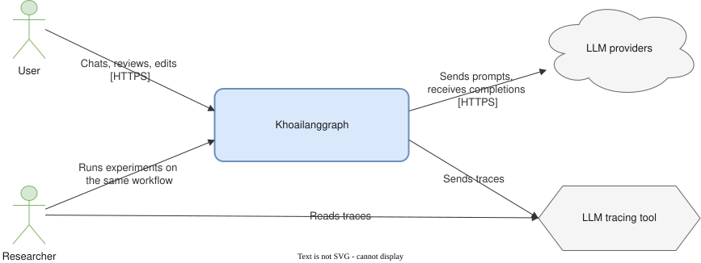
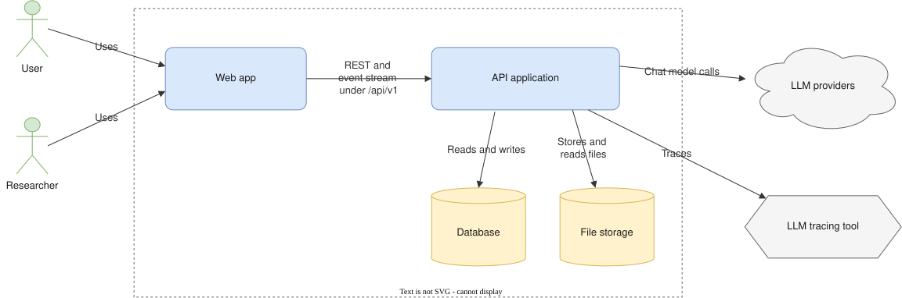
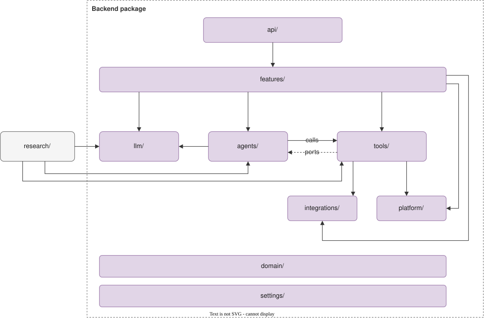
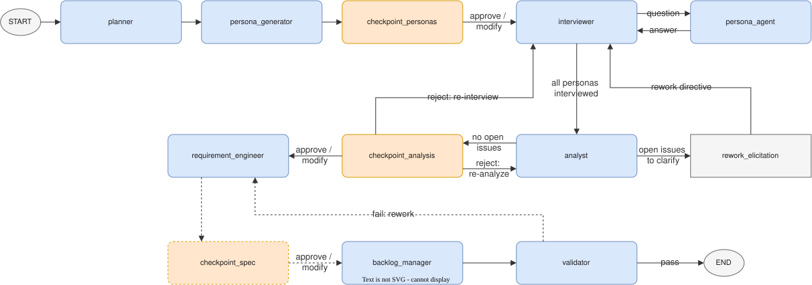
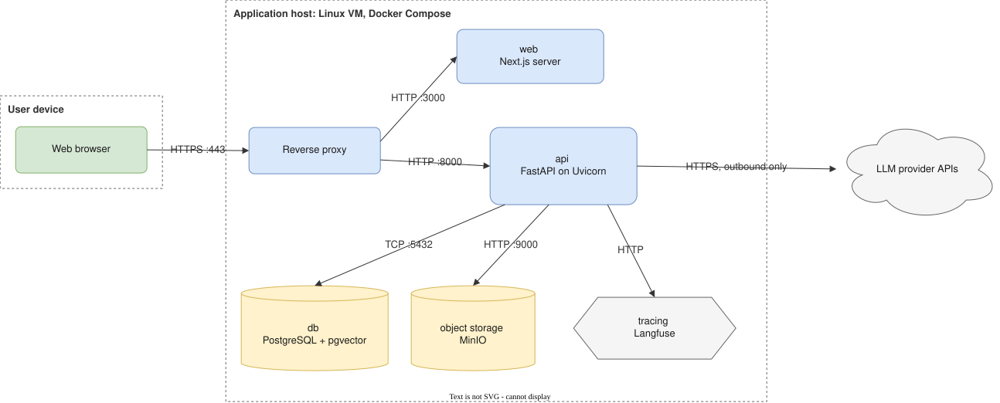
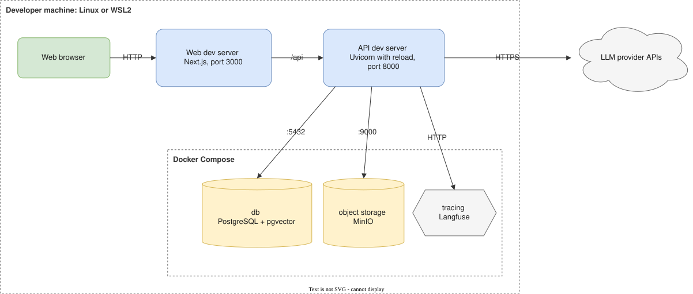

# Architecture

Diagrams of the system, from the outside in, followed by where it runs.

## Contents

- [Architecture](#architecture)
  - [Contents](#contents)
  - [1. Method](#1-method)
    - [Diagram files](#diagram-files)
  - [2. System context](#2-system-context)
  - [3. Building blocks](#3-building-blocks)
  - [4. Backend modules](#4-backend-modules)
  - [5. Agent workflow](#5-agent-workflow)
  - [6. Deployment](#6-deployment)
    - [Production](#production)
    - [Local development](#local-development)
  - [7. Database](#7-database)
    - [Artifact storage](#artifact-storage)
    - [Workflow vocabulary](#workflow-vocabulary)
    - [Relational or graph database](#relational-or-graph-database)
    - [Other choices](#other-choices)
  - [8. Not covered here](#8-not-covered-here)
  - [9. Open points](#9-open-points)
  - [10. Review checklist](#10-review-checklist)

---

## 1. Method

The structure diagrams follow the building block view of arc42 (the C4 model calls the same levels context, container and component), and are tech-neutral: they show what each part does, not what it is built with. Technology appears only in the deployment diagrams. One behavior diagram, two deployment diagrams and one database diagram complete the set. The table maps them to the views of the 4+1 view model.

| Diagram | Level | 4+1 view | Question it answers |
|---|---|---|---|
| [System context](#2-system-context) | Context | Logical | Who uses the system and what does it depend on |
| [Building blocks](#3-building-blocks) | Building blocks, level 1 | Logical | Which separately running parts make up the system |
| [Backend modules](#4-backend-modules) | Building blocks, level 2 | Logical, development | How the backend code is divided and which module may import which |
| [Agent workflow](#5-agent-workflow) | - | Logical (behavior) | Which agents run in which order, and where the user decides |
| [Deployment: production](#production) | Deployment | Physical | Which process runs on which machine and over which protocol they talk |
| [Deployment: local development](#local-development) | Deployment | Physical | The same, on a developer machine |
| [Database](#7-database) | - | Logical (data) | Which tables exist and how they reference each other |

### Diagram files

Every diagram is a `.drawio.svg` file in [`diagrams/`](diagrams/). The file is an SVG image and also holds the editable draw.io model.

| Task | How |
|---|---|
| View | Open the file, or read this page |
| Edit | Open the file in VS Code with the Draw.io Integration extension, or in the draw.io desktop app, then save. The image is updated on save |
| Add a diagram | Create `diagrams/<name>.drawio.svg` and add a section to this page |

## 2. System context

| Element | Type | Role |
|---|---|---|
| User | Person | Describes a product idea, answers review checkpoints, edits and exports the requirements |
| Researcher | Person | Uses the web app like a user to run the workflow and inspect runs, and also runs the same workflow on datasets to measure quality, cost and latency |
| Khoailanggraph | Software system | The multi-agent requirements engineering assistant |
| LLM providers | External system | Chat models reached over HTTPS; a local model server is also possible |
| LLM tracing tool | Supporting system | Stores a trace of every agent step. Self-hosted, operated by the team |

Besides the web app, the researcher runs experiments on datasets through the evaluation harness, which imports the agent workflow as a library instead of calling the API, see [Backend modules](#4-backend-modules).

## 3. Building blocks

| Building block | Responsibility |
|---|---|
| Web app | Chat, workflow graph, artifact panel, settings. Holds no business logic |
| API application | REST and event stream API; authentication; runs the agent workflow as background tasks; calls the LLM providers |
| Database | Application data, run events, workflow checkpoints, vectors |
| File storage | Exported documents and uploaded files |

Rules visible in the diagram:

- The web app is the only client of the API. It reaches the API under `/api/v1` on the same origin, with an httpOnly session cookie.
- One event stream per run carries tokens, agent steps, artifact changes and review requests to the web app.
- The workflow writes its events to an event log in the database, and the stream endpoint reads the log. The workflow never writes into an HTTP response, so a closed browser does not stop a run and a reconnecting client gets the events it missed.
- The stream to the browser and the call to an LLM provider are separate connections. A provider call lasts for one model response; no provider call is open while a run waits for the user.

## 4. Backend modules

The API application is one deployable unit (a modular monolith). This diagram shows its internal modules and the allowed import directions.

| Module | Responsibility |
|---|---|
| `api/` | Mounts the feature routers under `/api/v1`; shared dependencies; maps domain errors to HTTP responses |
| `features/` | One package per business feature: `auth`, `projects`, `threads`, `runs`, `artifacts`, `model_settings`. Each has a router, schemas, a service, a repository and models |
| `agents/` | The workflow graph: state, nodes, prompts, the interfaces (ports) the graph needs from outside, and the versioned workflow definition (agent roles, stages, checkpoint options, directive kinds, run parameters) |
| `llm/` | The only place that creates chat models. Resolves an agent role to a provider and model, and gives the rest of the code one format for messages, tool calls and token usage whatever the provider |
| `tools/` | Tools that agents can call |
| `integrations/` | Clients for external APIs other than LLM providers |
| `platform/` | Database session, object storage client, background run executor |
| `domain/` | Business rules that need no infrastructure: content schemas of the artifact kinds and item kinds, integrity rules of artifacts, items and trace links, key format, domain errors. Imports no other module |
| `settings/` | Application settings and logging setup. Imported by every module except `domain/` |
| `research/` | Separate package outside the backend: evaluation harness and experiments |

Reading the diagram: a solid arrow means "may import", and the dashed arrow means `tools/` imports only the port interfaces of `agents/`. `domain/` and `settings/` are imported by almost every module, so their arrows are not drawn; the exact rules are in the next list.

Rules visible in the diagram:

- `agents/` imports `llm/`, `tools/`, `domain/` and `settings/` only. It never imports `features/`, `api/` or the database session, so the workflow runs without the API.
- `research/` uses the same `agents/`, `llm/` and `tools/` as the product. No agent code is duplicated.
- `domain/` imports no other module and does no input or output. Its models and rules are plain functions over data, so they are tested without a database, a model or the workflow runtime. The workflow uses its models as the output format of an agent, and the artifact feature uses the same models and rules to validate what is saved, so the two cannot disagree. The schemas are listed in [Content schemas](../schemas/README.md), the rules in [Data shape: integrity rules](../DATA_SHAPE.md#integrity-rules).
- The workflow runtime is part of the application layer, not hidden behind an interface: `agents/` uses it directly for the graph, checkpoints and interrupts. Only the business rules are kept free of it.
- `tools/` imports from `agents/` only the port interfaces. A feature supplies the implementation when a run starts.
- A feature does not import another feature's internals; it calls the other feature's public service. This rule is not drawn.

The import rules are enforced as listed in [Contributing: Python](../../CONTRIBUTING.md#python-backend).

## 5. Agent workflow

One workflow graph covers the whole requirements engineering process: elicitation, analysis, specification, validation.

| Node | Kind | Produces |
|---|---|---|
| `planner` | LLM agent | Elicitation plan |
| `persona_generator` | LLM agent | Personas |
| `checkpoint_personas` | Human review | Decision on the personas |
| `interviewer` | LLM agent | Interview questions |
| `persona_agent` | LLM agent | Interview answers, as one persona |
| `analyst` | LLM agent | Raw requirements, analyzed requirements, latent needs, assumptions, ambiguity issues, conflicts |
| `rework_elicitation` | Control | Rework directive for another interview round |
| `checkpoint_analysis` | Human review | Decision on the analysis |
| `requirement_engineer` | LLM agent | Requirement specification |
| `checkpoint_spec` | Human review | Decision on the specification. The proposed architecture labels this node `checkpoint_analysis` too; it is named separately here |
| `backlog_manager` | LLM agent | Product backlog |
| `validator` | LLM agent | Validation report |

Reading the diagram: blue boxes are LLM agent nodes, orange boxes are human review checkpoints where the run pauses, and the grey square box is a control node. Dashed arrows are assumed and listed in [Open points](#9-open-points); every other node and arrow is taken from the proposed architecture.

Behavior:

- **Interview loop.** `interviewer` and `persona_agent` alternate until the turn limit is reached for the persona, then the next persona is interviewed. When all personas are done, the workflow moves to `analyst`.
- **Automatic rework.** When the analyst's result is not OK, because issues need a stakeholder's answer, `rework_elicitation` writes a directive and the interview continues with the personas it names. When it is OK, the run goes to the analysis checkpoint.
- **Human review.** At a checkpoint the run pauses and waits for the user. At the analysis checkpoint the user accepts, which moves on to the requirement engineer; rejects with re-analyse, which runs the analyst again; or rejects with re-interview, which goes through `rework_elicitation` back to the interview. At the specification checkpoint, OK moves on to the backlog manager and not OK sends the specification back to the requirement engineer.
- **Limits.** The number of personas, turns per persona and rework loops are bounded by the run configuration.

Prompt and cost rules that apply to every LLM agent node:

- Each agent role has a fixed prompt beginning (tool definitions, role instructions) and receives the changing state after it, so that repeated calls of the same role reuse the provider's prompt cache. The rules are in [Data shape: prompt view of an item](../DATA_SHAPE.md#prompt-view-of-an-item).
- A node gets the current artifacts it needs, not the message history of the whole run. The interview is the exception: `interviewer` and `persona_agent` receive the transcript of the persona being interviewed, which only grows at the end.
- Token usage, including tokens read from and written to the prompt cache, is recorded for every step.
- After a failure or a retry request the workflow continues from the saved checkpoint, so the LLM calls of earlier steps are not made again.

The state fields each node reads and writes are listed in [Data shape: what each node reads and writes](../DATA_SHAPE.md#what-each-node-reads-and-writes).

## 6. Deployment

### Production

This diagram shows the baseline the repository is planned around: one Linux host running every service with Docker Compose behind a reverse proxy.

| Node | Responsibility | Technology | Listens on | Persistent data |
|---|---|---|---|---|
| Web browser | Runs the web app; holds the session cookie | - | - | - |
| Reverse proxy | Single public entry: terminates TLS, routes `/` to `web` and `/api` to `api` | Not chosen yet | 443, public | TLS certificates |
| `web` | Serves the pages and static files of the web app | Next.js server | 3000, internal | None |
| `api` | Handles API requests; runs the agent workflow as background runs, in one process | FastAPI on Uvicorn | 8000, internal | None |
| `db` | Stores application data, run events and workflow checkpoints | PostgreSQL with pgvector | 5432, internal | Volume with the database files |
| Object storage | Stores exported and uploaded files | MinIO | 9000, internal | Volume with the stored files |
| Tracing | Stores and shows a trace of every agent step | Langfuse and its own data stores | Internal | Its own volumes |
| LLM provider APIs | Generate model responses | External service | Reached by outbound HTTPS | - |

The ports are the defaults of each product and can change in the Compose file.

Constraints that follow from this layout:

- **Same origin.** The browser reaches the web app and the API through one host name, so the session cookie is sent on every API and event stream request and no cross-origin configuration is needed.
- **One API process.** Runs execute inside the API process. A second API process or a restart loses the runs in progress. Running more than one process requires moving run execution to a queue with separate workers first.
- **Long-lived responses.** The reverse proxy must not buffer or cache the event stream and must allow connections that stay open for minutes. The API sends a heartbeat every 15 seconds so that an idle stream is not closed while a run waits.
- **HTTP/2 to the browser.** Over HTTP/1.1 a browser opens about 6 connections per host, so several tabs with an open event stream block further requests. The reverse proxy serves HTTP/2.
- **Path to separate workers.** When runs must survive a restart or more than one process is needed, run execution moves to a `worker` service fed by a queue, with a publish and subscribe channel for live events. Because events already pass through the event log, the API and the web app do not change.
- **Outbound only.** The host needs outbound HTTPS to the LLM providers. Only port 443 is open to the internet.
- **Secrets.** Provider API keys and the session secret exist only in the environment of the `api` service.

### Local development

| Process | Responsibility | Started with | Notes |
|---|---|---|---|
| Web dev server | Serves the web app and forwards `/api` to the API dev server, which keeps the same-origin rule of production | `pnpm dev` in `frontend/` | Port 3000 |
| API dev server | Same as `api` in production, reloaded on code change | Uvicorn with reload | Port 8000. Not implemented yet |
| Docker Compose services | Database, object storage and tracing, same roles as in production | The Compose file in `infra/` | Not implemented yet |
| LLM provider APIs | Same as in production; a local model server can replace them | - | - |

In mock mode the web app answers API requests from mocked handlers in the browser. Neither the API dev server nor the Compose services are needed, which is the only way to run the web app today.

## 7. Database

The schema is written in DBML in [`database.dbml`](database.dbml). To see the diagram, paste the file content into dbdiagram.io. No migration exists yet.

It is the storage form of [Data shape](../DATA_SHAPE.md): 34 tables in 5 groups.

| Table group | Tables |
|---|---|
| `identity_and_settings` | `users`, `auth_identities`, `sessions`, `user_settings`, `model_settings`, `provider_credentials` |
| `workspace` | `projects`, `project_members`, `project_key_counters`, `source_documents` |
| `conversation_and_execution` | `threads`, `messages`, `message_artifacts`, `message_items`, `runs`, `run_steps`, `run_events`, `interrupts`, `interrupt_artifacts`, `human_decisions`, `human_decision_items`, `directives`, `directive_items` |
| `artifacts_and_trace` | `artifacts`, `artifact_items`, `artifact_revisions`, `item_revisions`, `trace_links` |
| `supporting` | `exports`, `export_artifacts`, `comments`, `activity_events`, `notifications`, `idempotency_keys` |

### Artifact storage

Requirements engineering output has two levels, artifacts and the items inside them, each in its own generic table. The items and their links are a property graph: an item is a node with a kind and properties, a trace link is a typed edge.

| Table | Role | Columns |
|---|---|---|
| `artifacts` | Upper level: a work product | Project, kind, title, summary, version, review status, origin, and `content`, a JSON column with the fields of the artifact kind |
| `artifact_items` | Lower level, and node of the trace graph | Artifact, kind, key, parent item, position, version, review status, origin, and `content`, a JSON column with the fields of the item kind |
| `trace_links` | Edge of the trace graph | Source item, target item, link type, target version, quote |

Options considered for the artifact fields:

| Option | Advantage | Disadvantage | Fits when |
|---|---|---|---|
| Generic tables, fields in a JSON `content` column | A field change is a change of the content schema in code, with no table migration; one table per level for every cross-kind feature; a new kind needs no table | The database does not check field names, types or enum values; filtering and sorting by a content field need a JSON expression and an index on it | Fields change often, as they do while prompts and agents are tuned |
| One table per kind with typed columns | The database enforces types and enums; plain queries on any field | Every field change is a migration; 19 tables and about 70 columns to keep in step with the prompts | The fields are stable |
| Generic table plus typed columns for a few fields | Fast filters on the chosen fields | Two places define a field | A content field becomes a frequent filter |

Decision: generic tables, one per level. Trade-off: correctness of content and links is the job of the application, through the checks listed in [Data shape: integrity rules](../DATA_SHAPE.md#integrity-rules). The fields of each kind are still defined up front, as version 1 of the content schema of that kind.

### Workflow vocabulary

Names that belong to one version of the workflow (agent roles, stages, node names, checkpoint options, directive kinds and item roles, artifact kinds, item kinds, link types, export templates) change from one experiment to the next. The question is where the list of allowed values lives.

| Option | Advantage | Disadvantage | Fits when |
|---|---|---|---|
| Database enum types | The database rejects an unknown value | Every new value is a migration; a value cannot be removed while old rows use it; the same list must also be kept in code | The list never changes |
| Lookup tables with foreign keys | The database rejects an unknown value; values are data, not migrations | The list still has to match the graph in code; values per workflow version need a version column on every lookup table | Values are managed by users at run time |
| Text checked against a versioned workflow definition in code | One list, next to the graph that uses it; a new experiment is a new definition version, with no migration; old runs stay readable with the version they ran with | The database does not check the values; the application must check every write | The values change with the code, which is this project |

Decision: text checked against the workflow definition. Every run stores `workflow_name` and `workflow_version`. The tables for human review and directives hold no name of a particular workflow: an interrupt stores the node that paused and the options it offered, a decision stores the key of the chosen option, and a directive stores its kind, its target node and its items with their roles. The checks are listed in [Data shape: integrity rules](../DATA_SHAPE.md#integrity-rules).

### Relational or graph database

The artifact model is a graph, so a graph database is a natural candidate. The decision depends on the rest of the data and on what the agent runtime can store its own state in.

| Requirement | Detail |
|---|---|
| Trace queries | From one item, follow links backward or forward up to about 6 levels; coverage and orphan lists per project |
| Size | Hundreds to a few thousand items per project |
| Other data in the same system | Users, sessions, projects, threads, runs, run events, interrupts: tabular, with transactions that span a run step and the items it wrote |
| Workflow checkpoints | Written by the agent runtime after every step, through a storage package of the runtime |

| Option | Advantage | Disadvantage | Fits when |
|---|---|---|---|
| PostgreSQL only, graph in `artifact_items` and `trace_links` | One database for application data, checkpoints, events and the graph; one transaction covers a step and the items it wrote; the runtime has a maintained PostgreSQL checkpoint package; traversal with a recursive query is enough at this size | Traversal queries are longer to write than in a graph query language; no built-in graph algorithms | The graph is small and traversals are shallow, which is this project |
| PostgreSQL with a graph extension | Graph query language over the same database | One more component to install and keep compatible; fewer hosting options | Traversal queries become many and complex |
| Graph database for artifacts and links, PostgreSQL for the rest | Native traversal, graph algorithms, graph visualisation tools | Two databases to run, back up and keep consistent; no single transaction across a step and its artifacts; checkpoints still need PostgreSQL | Cross-project knowledge graphs or deep traversals over large graphs |
| Graph database only | One database | The proposed architecture lists runtime checkpoint storage for SQLite and PostgreSQL, and long-term stores for PostgreSQL, MongoDB and Redis among others; none is a graph database. Checkpoint storage would have to be written and maintained by the team | Not recommended |

Decision: PostgreSQL only. The node and edge tables keep the model a graph, so moving them to a graph database later is a data copy, not a redesign: each row of `artifact_items` becomes a node, each row of `trace_links` an edge.

The agent runtime and a graph database are unrelated despite the name: the runtime's graph is the workflow of nodes and edges it executes, not a data store. A graph database can still be reached from inside a node as an ordinary tool or client.

### Other choices

- **Artifacts belong to a project.** `artifacts.project_id` is the scope, and `(project_id, key)` is unique on `artifact_items`. A thread does not own artifacts.
- **Keys come from a counter table.** `project_key_counters` holds the last number used per project and prefix, so a number is never reused.
- **Two levels, two tables.** An artifact (persona catalog, requirements analysis, requirement specification, product backlog, interview transcript, validation report, elicitation plan) is a row of `artifacts`. Each entry inside it is a row of `artifact_items` that points at the artifact through `artifact_id`. Items nest through `parent_item_id`, so sections can contain sections and items, ordered by `position` among siblings; the subtree of an item is read with a recursive query. Items are not copied into the artifact's `content`, and ordering needs no JSON expression. A revision of an artifact stores the versions of its items, which gives the state of the whole artifact at any earlier point.
- **Only items are traced.** Trace links connect items, so the graph has one node table. An artifact is reached from an item through `artifact_id`.
- **Lists of references from execution records are join tables**: to artifacts (`interrupt_artifacts`, `message_artifacts`, `export_artifacts`) and to items (`human_decision_items`, `message_items`, `directive_items`). A join table that holds items of different roles says so in a `role` column instead of one table per role.
- **Not in the schema:** the workflow checkpoint tables, which the agent runtime creates and owns, keyed by `threads.id`; the model catalog, which is server configuration; `item_counts`, which is derived.

## 8. Not covered here

| Topic | Where |
|---|---|
| Entities, fields and traceability | [Data shape](../DATA_SHAPE.md) |
| Exact content schema of each artifact kind and item kind | [Content schemas](../schemas/README.md) |
| Endpoints, event stream format, request flows | [API design](../API.md) |
| Run lifecycle, event types, resume and retry | [Planning: Agent run lifecycle](../PLANNING.md#6-agent-run-lifecycle) |
| Model and provider selection | [README: Model Configuration](../../README.md#model-configuration) |
| Reasons for each technology choice | [Planning: Key decisions](../PLANNING.md#3-key-decisions--rationale-to-become-adrs) |
| Sequence diagrams of a run (process view) | Not written yet |

## 9. Open points

1. **Name of the specification checkpoint.** The proposed architecture shows a checkpoint after the requirement engineer, with OK and not OK branches, but labels it `checkpoint_analysis`, the same as the analysis checkpoint. A graph cannot have two nodes with one name, so it is drawn as `checkpoint_spec`.
2. **What follows the validator.** The proposed architecture stops after the validator. Both edges drawn from it are assumed: pass ends the run, and fail sends the specification back to the requirement engineer. The alternative for fail is to route by the category of the issue: to the interview, the analysis, the specification or the backlog.
3. **`rework_elicitation` as an LLM node or plain code.** It is drawn as a control node. If it calls a model, it needs an agent role and a model setting.
4. **Rejecting personas.** The diagram has no edge from `checkpoint_personas` back to `persona_generator`. Modify is the only way to change personas.
5. **Production hosting.** A single host is assumed. A managed database or managed object storage changes the deployment diagram but not the building blocks diagram.
6. **Tracing tool.** Langfuse is drawn. If LangSmith is chosen, the tracing node moves outside the host as an external service.
7. **Interviewing personas in parallel.** The workflow interviews one persona at a time. Parallel interviews shorten a run, but calls that start at the same moment cannot reuse each other's prompt cache; one call must finish its first response before the others start.
8. **Long waits at a checkpoint.** A provider's prompt cache expires after minutes of no use (up to one hour with a longer setting that costs more to write). A run resumed after a longer wait pays the full input price once. Whether to request the longer setting for the step before a checkpoint is not decided.
9. **After re-analyse.** On the slide for the analysis checkpoint, the analyst reached by reject + re-analyse also has an arrow toward an interviewer node. It is not drawn, because the other slides send the analyst only to `rework_elicitation` or to the analysis checkpoint.

## 10. Review checklist

- [ ] Every building block in section 3 appears as a node in both deployment diagrams
- [ ] Every arrow between backend modules matches the import rules enforced by the linter
- [ ] Every node of the workflow has an agent role or is marked as control or human review
- [ ] Every dashed element has an entry in the open points
- [ ] No diagram label contains a requirement id or a document path
