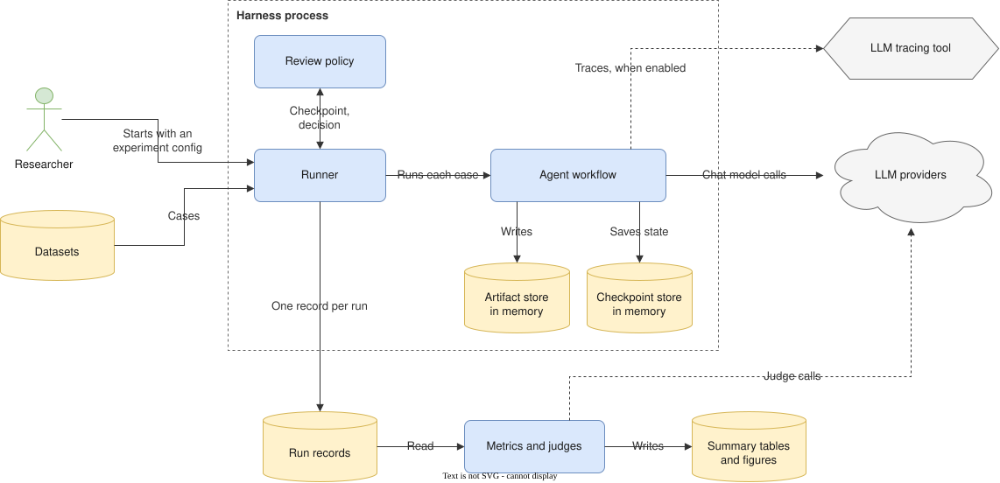

# Experiments

How the research track runs the agent workflow on a dataset to measure quality, cost and latency: what runs, what it reads, how the review checkpoints are answered without a person, what it records, and how the results are computed. Nothing described here is implemented yet.

The research method (research questions, dataset splits, baselines, repeated runs, statistics) is in [Planning: research methodology](../PLANNING.md#7-research-methodology), and the experiment workflow (issue, branch, folder, pull request) in [Contributing: research contributions](../../CONTRIBUTING.md#research-contributions). The run, step and usage fields reused here are defined in [Data shape](../DATA_SHAPE.md).

## Contents

- [Experiments](#experiments)
  - [Contents](#contents)
  - [1. Two ways a researcher runs the workflow](#1-two-ways-a-researcher-runs-the-workflow)
  - [2. What runs](#2-what-runs)
  - [3. Inputs](#3-inputs)
    - [Dataset](#dataset)
    - [Experiment config](#experiment-config)
  - [4. Answering review checkpoints](#4-answering-review-checkpoints)
  - [5. Running an experiment](#5-running-an-experiment)
  - [6. Results](#6-results)
    - [Run records](#run-records)
    - [Metrics](#metrics)
  - [7. Resource use](#7-resource-use)
  - [8. Viewing results in the web app](#8-viewing-results-in-the-web-app)
  - [9. Files](#9-files)
  - [10. Open points](#10-open-points)
  - [11. Review checklist](#11-review-checklist)

---

## 1. Two ways a researcher runs the workflow

| Way | Used for | What must run |
|---|---|---|
| Web app | Trying the workflow on a few product ideas by hand; inspecting the graph, the artifacts and the trace links; answering checkpoints; demos; a user study | Web app, API application and database; object storage only for exports |
| Evaluation harness | Running the workflow on every case of a dataset, several times per configuration, and computing the metrics | One harness process; no web app, API application or database |

Experiments use the harness. The web app is not needed while an experiment runs, and the results are read from files afterwards, see [section 8](#8-viewing-results-in-the-web-app).

## 2. What runs



| Part | Responsibility |
|---|---|
| Runner | Reads the experiment config and the dataset, runs the workflow once per variant, case and repeat, passes each checkpoint to the review policy, and writes one record per run |
| Review policy | Answers the checkpoints at which the workflow pauses, see [section 4](#4-answering-review-checkpoints) |
| Agent workflow | The same graph, nodes, prompts and model layer as the product, imported from the backend package |
| Artifact store in memory | Implements the artifact port of `agents/ports.py`: saves artifacts, items and trace links, applies the integrity rules of `domain/`, and keeps every version, since the workflow state references versions |
| Checkpoint store in memory | Holds the workflow state after each step while a run is open, so that a run can pause at a checkpoint and continue |
| Run records | One record per run, with its steps, usage, review answers and a file of its artifacts, see [section 6](#6-results) |
| Metrics and judges | A separate step after the runs: reads the run records, computes the metrics, calls the judge model for the metrics that need one, and writes the summary |
| LLM providers | The same providers as the product. The `llm_reviewer` policy also calls them; that edge is not drawn |
| LLM tracing tool | Optional, see [section 7](#7-resource-use) |

What the harness replaces, compared with a run started from the web app:

| In the product | In the harness | Reason |
|---|---|---|
| A chat message starts a run, executed as a background task of the API process | The runner calls the compiled graph directly | No API process |
| Checkpoints saved in the database | Checkpoint store in memory | A run lives only as long as the harness process |
| The artifact feature saves to the database | Artifact store in memory, written to a file when the run ends | No database. The same rules of `domain/` keep the output as valid as in the product |
| The user answers a checkpoint | Review policy | No person in the loop |
| Steps and events written to the run event log | Steps written into the run record | No stream to follow |
| Model per role from the user settings, the project and the run | Model per role from the experiment config, passed with each run | One config states every model of an experiment |

Rules:

- The harness imports only `agents/`, `llm/`, `tools/`, `domain/` and `settings/`, as the [dependency rules](../../CONTRIBUTING.md#python-backend) state. A workflow change made for an experiment goes into `agents/` as a new workflow definition version; agent code is never copied into `research/`.
- The code that turns the output of the workflow runtime into steps and usage lives in `agents/`, so that the run executor of the product and the harness record steps the same way.
- The harness creates no run in the database, as [Runtime: what a run is](runtime.md#1-what-a-run-is) states.

## 3. Inputs

### Dataset

One JSON Lines file per dataset split and version, under `research/datasets/`, with one case per line. The dev split is used to adjust prompts and agents; the test split is frozen and used only for reported numbers.

| Field | Type | Notes |
|---|---|---|
| `id` | string | Unique in the dataset |
| `idea` | string | The first message of the thread: the product idea the workflow starts from |
| `reference` | object? | What the quality metrics compare with, for example the requirements a domain expert wrote for the idea. Its fields depend on the metrics |
| `decisions` | ScriptedDecision[] | Answers for the `scripted` review policy; empty for the other policies |

`ScriptedDecision` is `{ node: string, visit: int, option: string?, feedback: string?, answers: map<string, Answer> }`, with `Answer` as in the [data shape](../DATA_SHAPE.md#humandecision-mvp); a question without an answer takes its default. `visit` counts the times the run reaches that checkpoint node, from 1.

One case, spread over several lines here:

```json
{
  "id": "mentoring-01",
  "idea": "I want to build an online platform for university students to find mentors.",
  "reference": {
    "requirements": ["Students search mentors by field of study", "Mentors set the hours they are available"]
  },
  "decisions": [
    {
      "node": "checkpoint_analysis",
      "visit": 1,
      "option": "reject_reinterview",
      "feedback": "Ask the admin persona how mentors are verified.",
      "answers": {}
    }
  ]
}
```

### Experiment config

`config.yaml` in the experiment folder, validated by a Pydantic model when the harness starts. `run_config` has the shape of RunConfig in the data shape, so an experiment sets exactly what a user can set for a run, and `variants` lists the configurations the experiment compares.

```yaml
dataset: research/datasets/product-ideas/v1/dev.jsonl
cases: null                     # every case of the dataset
workflow_version: 1
repeats: 3
concurrency: 2
max_total_cost_usd: 20
review_policy: scripted         # default | scripted | llm_reviewer
reviewer: null                  # model and rubric, for llm_reviewer only
run_config:                     # shape of RunConfig, without review_checkpoints
  models:
    planner: anthropic:claude-sonnet-5
    interviewer: anthropic:claude-sonnet-5
    analyst: anthropic:claude-sonnet-5
  output_language: en
  max_steps: 80
  max_cost_usd: 1.5
  parameters: { target_personas_num: 3, max_personas: 3, max_turns: 6, max_iterations: 2 }
variants:                       # one per configuration compared
  baseline: {}
  cheap_interviewer:
    run_config: { models: { interviewer: openai:gpt-4.1-mini } }
    # prompt_versions: { analyst: 2 } would select another prompt file for a role
metrics: [requirement_recall, cost_usd, duration_ms, failure_rate]
judge:
  model: openai:gpt-4.1
```

| Field | Notes |
|---|---|
| `dataset` | Path of the dataset file; the dataset version is part of the path |
| `cases` | Ids of the cases to run; null runs every case |
| `workflow_version` | Workflow definition version. The harness refuses to start when the backend code does not provide it |
| `repeats` | Runs per variant and case. At least 3 for reported numbers, as the research methodology requires |
| `concurrency` | Runs open at the same time |
| `max_total_cost_usd` | Cost limit of the experiment, workflow, reviewer and judge together. When it is reached, no further run starts |
| `review_policy` | How checkpoints are answered, see [section 4](#4-answering-review-checkpoints) |
| `reviewer` | Model and rubric of the `llm_reviewer` policy; null for the other policies |
| `run_config` | The run configuration shared by every variant. A role without a model uses the server default; the run record stores the model resolved for every role |
| `variants` | The configurations compared, by name. Each has `run_config`, its changes to the shared run configuration, and `prompt_versions`, the prompt version of each role where it differs from the workflow definition, see [Prompts: versions](prompts.md#8-versions). The baseline is listed explicitly, with no changes |
| `metrics` | Names of the metrics the metrics step computes |
| `judge` | Model of the judge; null when no metric needs one |

## 4. Answering review checkpoints

In workflow definition version 1 the workflow pauses for a person only at its three checkpoints. Everything else runs without a person: the persona agent answers the interviewer in place of each stakeholder.

| Policy | Behavior | Fits when |
|---|---|---|
| `default` | `review_checkpoints` of the run is empty, so every checkpoint continues with its default option and default answers without pausing, and the run records them as the decision | Baselines and most experiments: no extra cost, and every run takes the same path through the checkpoints |
| `scripted` | Every checkpoint pauses. The answer is the decision of the case for that node and visit; a visit with no decision, and a question with no answer, take the defaults | Experiments on rework loops; the answers are the same in every repeat |
| `llm_reviewer` | Every checkpoint pauses. A model reads the prompt, the options and the artifacts under review, applies the rubric, and returns an option, feedback and an answer to every question, checked against the options and the questions | Research questions about the effect of review feedback. Adds cost, and its answers vary between repeats |

Rules:

- `review_policy` sets `review_checkpoints`: `default` leaves it empty, and the other policies list every checkpoint of the definition version. `run_config` in the experiment config therefore has no `review_checkpoints`.
- An answer has the fields of the resume body of the API (`option`, `feedback`, `answers`, `modified_items`), and the runner passes it to the workflow as the resume value, so the workflow handles it as it handles a person's answer. `modified_items` is always empty: no policy edits items in version 1.
- Every answer is recorded in the run record with its node and visit.
- The cost of the reviewer model and of the judge is recorded apart from the cost of the workflow, so the cost of the system is not overstated.
- The reviewer model is pinned to a dated version and comes from a different model family than the agents, as for the judge in the research methodology.
- The harness sends no message during a run, see [Open points](#10-open-points).

## 5. Running an experiment

```text
just eval research/experiments/2026-10-20-cheap-interviewer/config.yaml
```

The runner, as a sketch; the names of backend modules and classes are not fixed yet:

```python
async def run_experiment(config_path: Path) -> None:
    cfg = ExperimentConfig.from_yaml(config_path)
    checkpoints = InMemorySaver()
    graph = build_graph(cfg.workflow_version).compile(checkpointer=checkpoints)
    records = RunRecords(cfg.folder / "results" / "runs.jsonl")
    jobs = [
        (variant, case, repeat)
        for variant in cfg.variants
        for case in load_cases(cfg.dataset, cfg.cases)
        for repeat in range(cfg.repeats)
        if not records.has(variant.name, case.id, repeat)  # skip runs recorded before a stop
    ]
    limit = asyncio.Semaphore(cfg.concurrency)

    async def one(variant: Variant, case: Case, repeat: int) -> None:
        async with limit:
            if records.total_cost_usd() >= cfg.max_total_cost_usd:
                return
            records.append(await run_case(graph, checkpoints, cfg, variant, case, repeat))

    await asyncio.gather(*(one(*job) for job in jobs))


async def run_case(graph, checkpoints, cfg, variant, case, repeat) -> RunRecord:
    store = InMemoryArtifactStore()  # the artifact port, checked by the rules of domain/
    recorder = StepRecorder()  # steps and usage, from agents/
    policy = make_policy(cfg, case)
    thread_id = f"{variant.name}-{case.id}-r{repeat}"
    config = {
        "configurable": {
            "thread_id": thread_id,
            "run_config": variant.run_config,
            "models": variant.run_config.models,
            "prompt_versions": variant.prompt_versions,
            "artifact_store": store,
        },
        "callbacks": [recorder],
    }
    try:
        await graph.ainvoke({"initial_intent": case.idea}, config)
        while (snapshot := await graph.aget_state(config)).interrupts:
            answer = await policy.answer(snapshot.interrupts[0].value)
            await graph.ainvoke(Command(resume=answer), config)
        status, error = "succeeded", None
    except WorkflowError as exc:
        status, error = "failed", exc.run_error()
    finally:
        await checkpoints.adelete_thread(thread_id)  # frees the state of the finished run
    return RunRecord.build(variant, case, repeat, status, error, recorder, policy, store)
```

Rules:

- **One record per finished run, written at once.** A record is appended to `runs.jsonl` as soon as its run ends. Starting the same config again skips every variant, case and repeat already recorded, so a stopped experiment continues where it stopped. A run that was open when the harness stopped has no record and runs again.
- **A failed run is a result.** It is recorded with its error code, and the experiment continues. The codes are those of [Runtime: failures](runtime.md#failures) that apply without the API process: `provider_error`, `step_limit_exceeded`, `cost_limit_exceeded` and `timeout`. The failure rate is a reliability metric.
- **Cost limits.** `max_cost_usd` in the run configuration ends a run, and `max_total_cost_usd` stops starting runs.
- **Estimate first.** `just eval <config> --limit 1` runs one case once for each variant and prints its cost and duration, to estimate the cost of the full experiment before starting it.
- **Check without cost.** `--fake-models` runs the harness with the fake chat models of the unit tests, to check the config, the policy and the records without calling a provider.
- **No response cache for measured runs.** A cache of model responses makes repeated runs identical and their standard deviation zero. The harness refuses to start with the cache on and `repeats` above 1.

## 6. Results

```text
research/experiments/2026-10-20-cheap-interviewer/
├── config.yaml
├── README.md                     hypothesis, setup, results, conclusion
└── results/
    ├── runs.jsonl                one record per run
    ├── artifacts/                one file per run: <variant>-<case>-r<repeat>.json
    └── summary.csv               written by the metrics step
```

Small files are committed; larger ones are tracked with DVC, as the research rules of the contributing guide state.

### Run records

| Field | Notes |
|---|---|
| `variant`, `case_id`, `repeat` | Which run this is |
| `status` | `succeeded` or `failed` |
| `error` | RunError of the data shape; null when the run succeeded |
| `workflow_name`, `workflow_version` | The definition the run used |
| `run_config` | The run configuration with the variant applied, and the model resolved for every role |
| `prompt_versions` | The prompt version used by every role |
| `iteration_count` | Number of rework loops |
| `usage` | Usage of the workflow, summed over the steps. The reviewer is not included |
| `steps` | The fields of RunStep in the data shape, without the database ids; items are named by their keys, in `subject_item_key` and `produced` |
| `review` | One entry per answered checkpoint: `node`, `visit`, `option`, `feedback`, `answers`, `defaults_taken` (true when the defaults were taken because no answer was given), and the `usage` of the reviewer model, null unless the policy is `llm_reviewer` |
| `artifacts_file` | Path of the file with the artifacts, items and trace links of the run, in the shape of the API bodies, each artifact with its items in outline order |
| `dataset` | Path of the dataset file, which includes its version |
| `git_sha`, `git_dirty` | The commit the harness ran from, and whether the working tree had uncommitted changes |
| `trace_id` | Id in the tracing tool; null when tracing is off |
| `started_at`, `finished_at` | |

A record of the `scripted` experiment, spread over several lines and with the steps shortened to one:

```json
{
  "variant": "cheap_interviewer",
  "case_id": "mentoring-01",
  "repeat": 0,
  "status": "succeeded",
  "error": null,
  "workflow_name": "requirements_engineering",
  "workflow_version": 1,
  "run_config": {
    "models": { "planner": "anthropic:claude-sonnet-5", "interviewer": "openai:gpt-4.1-mini", "analyst": "anthropic:claude-sonnet-5" },
    "review_checkpoints": ["checkpoint_personas", "checkpoint_analysis", "checkpoint_spec"],
    "output_language": "en",
    "max_steps": 80,
    "max_cost_usd": 1.5,
    "parameters": { "target_personas_num": 3, "max_personas": 3, "max_turns": 6, "max_iterations": 2 }
  },
  "prompt_versions": {
    "planner": 1, "persona_generator": 1, "interviewer": 1, "persona_agent": 1, "analyst": 1,
    "requirement_engineer": 1, "backlog_manager": 1, "validator": 1, "intent_router": 1
  },
  "iteration_count": 1,
  "usage": { "input_tokens": 61200, "output_tokens": 14100, "cache_read_tokens": 40100, "cache_write_tokens": 7300, "cost_usd": 0.51, "duration_ms": 268000 },
  "steps": [
    {
      "sequence": 1, "node": "planner", "agent_role": "planner", "stage": "planning", "status": "succeeded",
      "iteration": 0, "subject_item_key": null, "model_id": "anthropic:claude-sonnet-5", "llm_calls": 1,
      "usage": { "input_tokens": 1820, "output_tokens": 640, "cache_read_tokens": 0, "cache_write_tokens": 0, "cost_usd": 0.015, "duration_ms": 9400 },
      "produced": [], "error": null
    }
  ],
  "review": [
    { "node": "checkpoint_personas", "visit": 1, "option": "approve", "feedback": null, "answers": {}, "defaults_taken": true, "usage": null },
    { "node": "checkpoint_analysis", "visit": 1, "option": "reject_reinterview", "feedback": "Ask the admin persona how mentors are verified.", "answers": {}, "defaults_taken": false, "usage": null },
    { "node": "checkpoint_analysis", "visit": 2, "option": "accept", "feedback": null, "answers": {}, "defaults_taken": true, "usage": null },
    { "node": "checkpoint_spec", "visit": 1, "option": "ok", "feedback": null, "answers": {}, "defaults_taken": true, "usage": null }
  ],
  "artifacts_file": "artifacts/cheap_interviewer-mentoring-01-r0.json",
  "dataset": "research/datasets/product-ideas/v1/dev.jsonl",
  "git_sha": "e4ea477",
  "git_dirty": false,
  "trace_id": null,
  "started_at": "2026-10-20T09:00:02Z",
  "finished_at": "2026-10-20T09:04:30Z"
}
```

### Metrics

The metrics step reads `runs.jsonl` and the artifact files, and writes `summary.csv` with one row per variant and metric: mean, standard deviation and number of runs. It runs after the last run, and can be run again alone with `just eval-metrics <experiment folder>`, so a metric or a judge rubric can change without running the workflow again. The tables and figures of the paper are generated from `summary.csv`.

| Family | Computed from |
|---|---|
| Quality | The artifact files compared with `reference` of the case, or scored by the judge with a rubric. The quality metrics depend on the research questions, which are not fixed yet |
| Cost | `usage` of the record for the system, and of each step for the cost per agent role |
| Latency | `duration_ms` of the record and of each step |
| Reliability | `status` and `error` of the records, the number of steps, and `iteration_count` |

## 7. Resource use

| Part | Memory | Notes |
|---|---|---|
| Harness process | The state of the open runs only; the models run at the providers | Not measured yet |
| Open runs | Each holds its state and its checkpoints until its record is written | Provider rate limits and cost set the useful `concurrency` before memory does; 1 or 2 fits a development machine |
| Web app | Not needed during an experiment. When used afterwards, the development server uses about 300 MB idle and 700 MB after compiling a page, as measured in the web app guide | Running `pnpm build` once and then `pnpm start` keeps the compiler out of memory; not measured yet |
| LLM tracing tool | Self-hosted, it runs several services of its own | Off by default on a development machine. When traces are needed, the hosted service of the same tool is the lighter choice, if the dataset may leave the machine |
| Local model server | Holds the model weights in memory | Not suitable for a low-memory machine; use the provider APIs |

## 8. Viewing results in the web app

The run records and artifact files are complete without the web app. Viewing a run with the graph and the artifact panel of the web app needs its data in the database.

| Option | Advantage | Disadvantage |
|---|---|---|
| Files only | Lightest; does not depend on the database schema | Results are read with notebooks and scripts, not with the graph and the artifact panel |
| The harness writes to the database through the services of the product | A run appears in the web app like any other | The database runs during the whole experiment; `research/` depends on the database schema and on `features/`, which the dependency rules forbid |
| The harness calls the API | Measures the full path of the product, including the run executor and the event log | The API application and the database run during the experiment; the harness handles authentication and the event stream; slower |
| Files, plus a command that imports chosen runs into a project | The web app runs only when someone looks at a few runs | One more command to write and to keep in step with the database schema |

Decision: files only now. The import command is added when the team needs to show experiment runs in the web app; the artifact files already use the shape of the API bodies, so it can read them directly.

## 9. Files

Proposed layout of the code, following the research folder of the repository structure:

```text
research/
├── datasets/
│   └── product-ideas/v1/          dev.jsonl, test.jsonl, README.md (source and license)
├── experiments/<YYYY-MM-DD>-<slug>/
├── evals/
│   ├── metrics/                   one module per metric
│   └── judges/                    judge prompts and rubrics
└── src/khoailanggraph_research/
    ├── config.py                  ExperimentConfig and Variant
    ├── runner.py                  run_experiment, run_case
    ├── policies.py                default, scripted and llm_reviewer
    ├── artifact_store.py          the artifact port, in memory
    └── records.py                 RunRecord; reading and writing runs.jsonl
```

## 10. Open points

1. **Messages during a run.** The harness sends no message while a run works, so the intent router is never used. An experiment on incremental intent needs scripted messages in the case, each with the node after which it is sent.
2. **Edits at checkpoints.** No policy edits items before answering. A reviewer that edits needs `modified_items` and the item update rules of the artifact store.
3. **State after a run.** The checkpoint store in memory drops the state when the record is written. A store in a local file keeps it for inspecting a run step by step, at the cost of disk space.
4. **Step recording.** Section 2 assumes that the code turning the runtime output into steps lives in `agents/`. Its exact module depends on how the run executor of the product is built.
5. **Quality metrics and references.** They depend on the research questions, which are not fixed.

## 11. Review checklist

- [ ] An experiment runs with no web app, API application or database running
- [ ] Every run record names the workflow version, the model of every role, the dataset version and the git commit
- [ ] The cost of the reviewer and the judge is recorded apart from the cost of the workflow
- [ ] Starting a stopped experiment again does not repeat a recorded run
- [ ] Repeated runs are never served from the response cache
- [ ] No agent code is copied into `research/`
