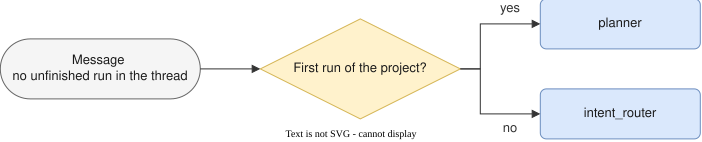
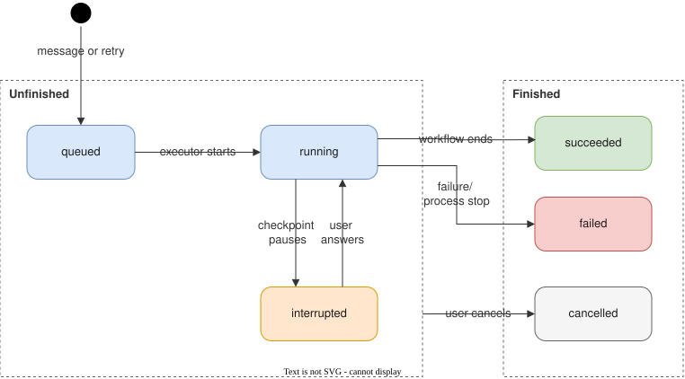
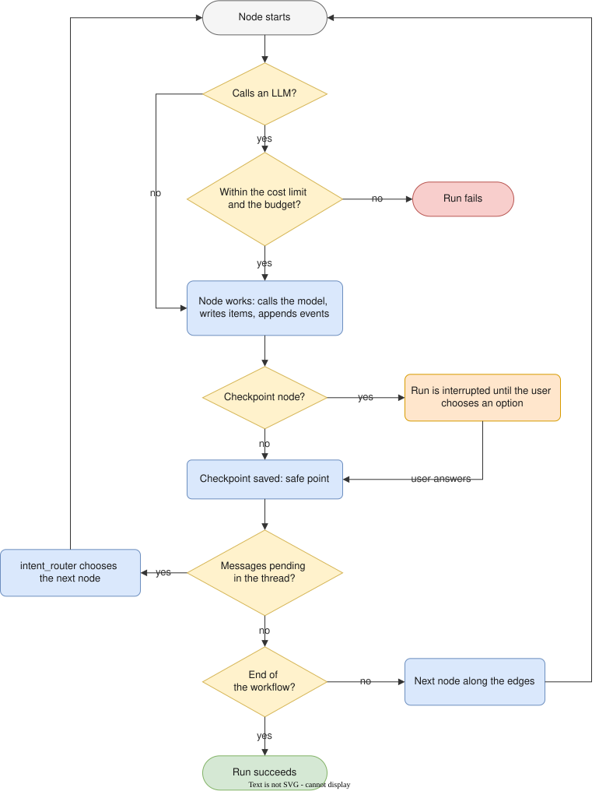
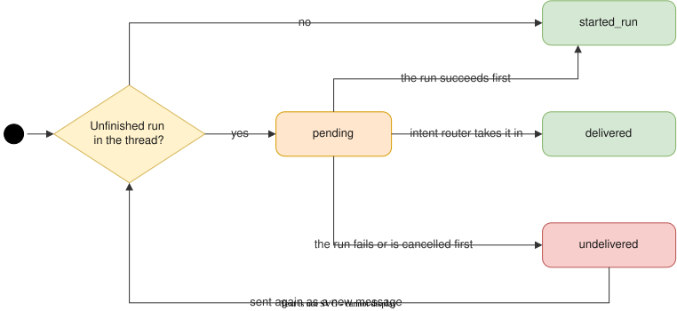
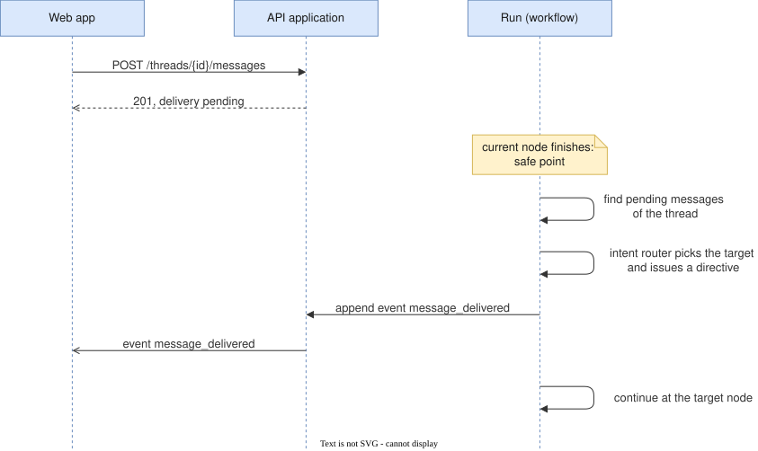
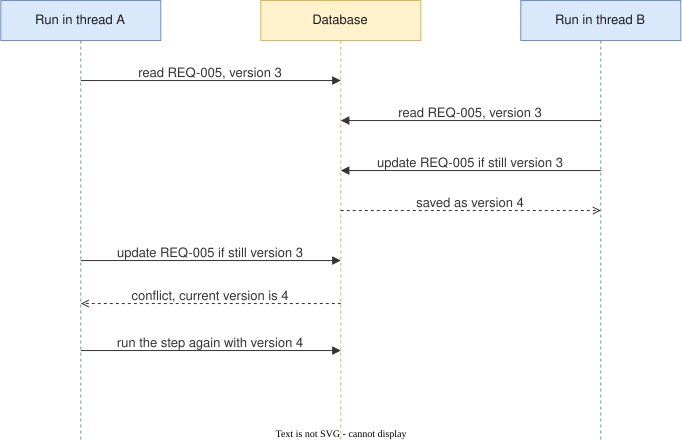
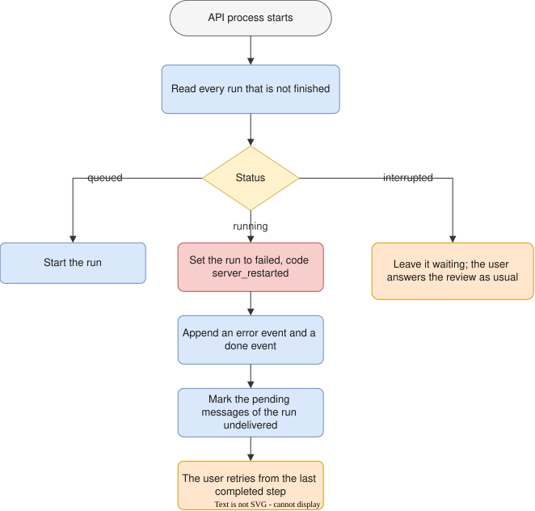

# Runtime

How a run behaves while it executes: how it starts, which statuses it passes through, what happens inside it, what happens to messages the user sends meanwhile, and what happens when something fails or the process stops.

The entities named here (Run, RunStep, Interrupt, HumanDecision, Directive, Message) and their fields are defined in [Data shape](../DATA_SHAPE.md). The endpoints, request bodies and events are defined in [API design](../API.md).

## Contents

- [Runtime](#runtime)
  - [Contents](#contents)
  - [1. What a run is](#1-what-a-run-is)
  - [2. Starting a run](#2-starting-a-run)
  - [3. Lifecycle](#3-lifecycle)
  - [4. Inside a run](#4-inside-a-run)
  - [5. Messages during a run](#5-messages-during-a-run)
  - [6. Runs at the same time](#6-runs-at-the-same-time)
  - [7. Failures, cancellation and restarts](#7-failures-cancellation-and-restarts)
    - [Failures](#failures)
    - [Cancellation](#cancellation)
    - [Retry](#retry)
    - [When the API process stops or restarts](#when-the-api-process-stops-or-restarts)
  - [8. Open points](#8-open-points)
  - [9. Review checklist](#9-review-checklist)

---

## 1. What a run is

A run is one execution of the agent workflow in a thread, from the moment it is created until it finishes.

- **A run is a stored resource with a status,** not an HTTP request. Closing the browser does not stop it.
- **One run can span several executions of the workflow runtime.** When a checkpoint pauses the workflow, the runtime's execution ends; when the user answers, the runtime continues on the same thread. Both belong to the same run.
- **A retry is a new run.** Running again from an earlier step creates a run that points at the original one through `retry_of_run_id`.
- **The evaluation harness does not create runs.** It calls the workflow as a library, without the API.

## 2. Starting a run

Work starts from the chat box. Creating a thread does not start anything; the first message does.

| Request | Effect |
|---|---|
| `POST /projects/{project_id}/threads` | Creates an empty thread |
| `POST /threads/{thread_id}/messages`, no unfinished run in the thread | Stores the message and starts a run with it as input |
| `POST /threads/{thread_id}/messages`, a run is unfinished | Stores the message; the run takes it in, see [section 5](#5-messages-during-a-run) |
| `POST /runs/{run_id}/retry` | Starts a new run from a step of a finished run |

The request and the response of the first message are shown in [API design: threads and messages](../API.md#threads-and-messages). The response comes back at once with the run in status `queued`; the run executes in the background, and the web app follows it through the event stream of the run.

Where a run begins in the workflow:

The message of the first run is the initial intent of the project. Every later run begins at the intent router, which decides which node should handle the message, see [section 5](#5-messages-during-a-run).

## 3. Lifecycle

A run is unfinished while it is `queued`, `running` or `interrupted`, and finished once it is `succeeded`, `failed` or `cancelled`. A thread has at most one unfinished run.

The failures that end a run as `failed` are listed in [section 7](#7-failures-cancellation-and-restarts). An `interrupted` run waits for the user with no time limit. A finished run never changes status again.

## 4. Inside a run

What happens around every node of a run:

- **Steps.** Nodes execute one after another. Each execution of a node is a run step, with the model it used, its tokens and its cost.
- **Events.** Every step appends events to the event log of the run: node start and end, generated text, tool calls, artifact changes, interrupts, delivered messages, errors, and the end. The event stream sends them to every open page, and a page that reconnects gets what it missed.
- **Artifacts.** Steps create and change items; every change adds a version.
- **Human review.** A checkpoint node creates an interrupt with its options. The run stays `interrupted` until the user chooses an option, and continues along the edge of that option.
- **Rework.** A node, or the user's choice at a checkpoint, issues a directive that sends the workflow back to an earlier node. Each such loop increases the iteration count.
- **Safe points.** After every node, once its checkpoint is saved, the workflow checks the thread for pending messages, see [section 5](#5-messages-during-a-run).
- **Limits.** Before every LLM call the backend checks the cost limit of the run and the monthly budget of the user. The number of steps, the number of rework loops, and the time a node or a tool may take are bounded as well.

## 5. Messages during a run

The chat box stays open while a run works, so the user can send a message before the previous one is fully handled, the same way one keeps typing to an assistant that is still answering. The workflow handles such a message, an incremental intent, with the intent router: a node that decides which part of the workflow the message belongs to.

What happens to a message sent while a run is unfinished:

1. The message is stored with delivery status `pending`. It is never rejected because the thread has an unfinished run.
2. At the next safe point, the workflow finds the pending messages of its thread, and the next node becomes the intent router instead of the node that would have come next.
3. The intent router reads the pending messages, the current artifacts and the position of the run, and chooses a target: the node that should handle the change, from the targets the workflow definition allows. In version 1 these are the planner, the interviewer, the analyst, the requirement engineer and the backlog manager. When a message needs no change of course, for example a remark, the target is the node that would have come next.
4. The router issues a directive of kind `intent`, with the target node, the intent restated as an instruction, and the items it concerns. The messages become `delivered`, and the event stream sends `message_delivered`.
5. The run continues at the target node, which reads the directive as it reads a rework directive. The nodes after the target run again, as in a rework round, so artifacts produced before the message are brought up to date as well.

Delivery status of a user message:

- A run that is `interrupted` takes no message until the user answers the review; the message is routed at the safe point right after the checkpoint.
- Messages left pending by a run that succeeded start the next run together, in the order they were sent, and that run begins at the intent router.

Bounds:

- Every jump the router makes counts as a rework loop, so it is bounded by the maximum number of loops of the run.
- The router never targets the persona agent; to ask a persona again, it targets the interviewer.
- Routing costs one LLM call per safe point that finds pending messages; messages that arrive together are routed together.

## 6. Runs at the same time

- **One unfinished run per thread**. A message sent meanwhile goes into that run, see [section 5](#5-messages-during-a-run). A retry requested meanwhile answers `409 run_already_active`.
- **Runs of different threads may execute at the same time,** also in the same project. Because artifacts belong to the project, two such runs may change the same item.
- **Conflicting item updates.** Every item update by a step checks the version the step read, the same way an edit by the user does. When another run changed the item in between, the step runs again with the current items, up to two more times; after that the run fails with error code `item_conflict`.
- **Visibility.** The web app shows on a thread when another thread of the same project has an unfinished run.

## 7. Failures, cancellation and restarts

### Failures

A run becomes `failed` when one of these happens. The error code is stored on the run and sent in the `error` event.

| Error code | Cause |
|---|---|
| `provider_error` | The LLM provider failed, after the retries and the fallback models of the role |
| `step_limit_exceeded` | The run reached its maximum number of steps |
| `cost_limit_exceeded` | The next LLM call would exceed the cost limit of the run |
| `budget_exceeded` | The next LLM call would exceed the monthly budget of the user |
| `timeout` | A node or a tool took longer than its time limit |
| `item_conflict` | Item updates kept conflicting with another run, see [section 6](#6-runs-at-the-same-time) |
| `server_restarted` | The API process stopped while the run was in a step, see below |

The rework loop limit does not fail a run: when it is reached, the workflow stops looping and continues forward with the current artifacts.

### Cancellation

The user cancels with `POST /runs/{run_id}/cancel`. The open call to the LLM provider is closed, the run becomes `cancelled`, and the event stream sends `done`. Items already written stay; tokens already generated are paid.

### Retry

`POST /runs/{run_id}/retry` with a step starts a new run from the workflow checkpoint saved before that step. The steps before it are not run again, so their LLM calls are not paid twice. The state saved after each step can be read with `GET /runs/{run_id}/steps/{step_id}/state`, which helps choose the step to retry from.

### When the API process stops or restarts

Runs execute as tasks inside the API process, see [the deployment constraints](README.md#production). A stop, a crash or a deploy ends the tasks of the runs in progress. Everything already stored remains: the run rows, the event log, the items already written, the pending messages, and the workflow checkpoint saved after every completed step.

What the API does when it starts again:

For a run that was `running`, the step in progress is lost, including the cost of its partial LLM call; completed steps are not run, or paid, again on retry. Nothing is lost for a run that was `queued` or `interrupted`.

A planned deploy first stops starting new runs and waits, up to a configured time limit, for the steps in progress to finish; only steps still running after the limit are lost as above. The event stream of an open page drops with the process, and the browser reconnects by itself and replays what it missed from the event log.

The backend does not resume a `running` run by itself after a restart. The step in progress may already have written items, and running it again would write them twice. Automatic resume becomes possible once every step writes its items in a way that can be repeated safely (keyed by run and step), which is also what moving runs to separate workers requires.

## 8. Open points

1. **Targets of the intent router.** The five targets listed in [section 5](#5-messages-during-a-run) are assumed here.
2. **A chat message that answers the pending review.** While a run is `interrupted`, the user may type an answer to the review in the chat box instead of choosing an option. This design keeps such a message pending until the review is answered; reading it as the answer would need the router to run before the checkpoint continues.
3. **Retries after an item conflict.** Two more attempts is an assumption.
4. **Reaching the rework loop limit.** This design continues forward with the current artifacts. The alternative is to fail the run, which stops the user from getting any specification at all.

## 9. Review checklist

- [ ] Every status transition has a trigger
- [ ] Every request that acts on a run has a defined result in every status
- [ ] A message is never lost silently: it starts a run, is delivered, or is shown as undelivered
- [ ] After a restart every run ends up in a defined status
- [ ] Every error code has a cause
